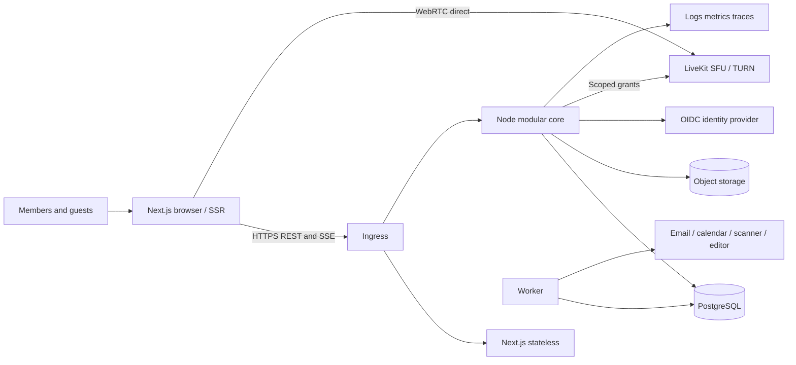
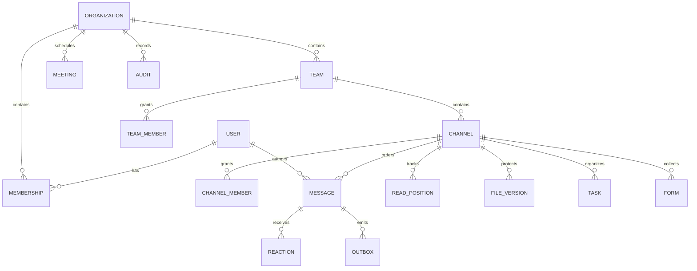
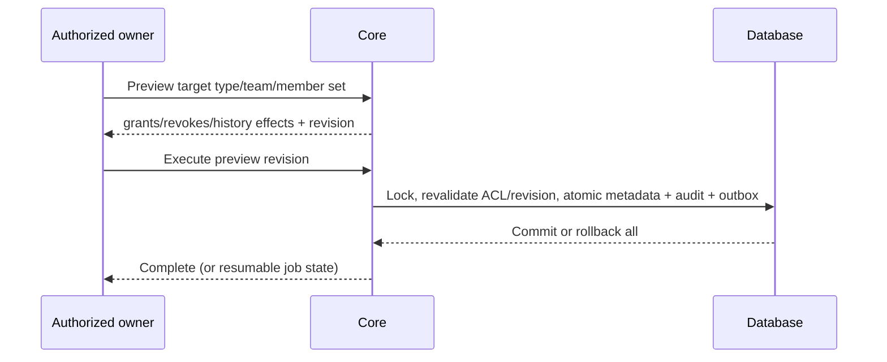

# Collaboration platform architecture — ADR baseline 2026-10-12

Status: design approved for first implementation increment by the execution rules in the specification. This is not release verification. Primary register: `requirements.json`; generated human matrix: `TRACEABILITY.md`. All 146 primary requirements are required: the two integration requirements have mandatory providers even though marketplaces are optional. GIFs/stickers, general whiteboards/polls, broader tasks, directory sync, advanced discovery and marketplace remain optional subfeatures, not removed primary IDs.

## Discovery and constraints

Repository is a Next.js 16.4.0 / React 19.3.0 App Router starter, TypeScript strict. Unrelated `.idea` files are preserved. Node 24.19.0, Java 21, Go and Python are installed. Docker engine 29.4 is reachable with sandbox escalation. No external deployment target or provider configuration has been supplied. Local Docker staging incurs no new cloud resources. Sites hosting was assessed but its Worker/Vinext runtime is not chosen because the specification requires Next.js and persistent backend connections.

Read installed Next guides for installation, layouts, server/client components, route handlers, caching, and deployment. Keep existing framework pins and lockfile. Official compatibility: [Next 16](https://nextjs.org/docs/app/guides/upgrading/version-16) requires Node >=20.9; [Node release policy](https://github.com/nodejs/Release) identifies 24 as LTS; [PostgreSQL support](https://www.postgresql.org/support/versioning/) uses five-year major support. Registry versions selected at implementation are pinned, including transitive lockfile. Local build/test evidence, rather than version numbers alone, establishes compatibility. Security audit remains required before release.

## ADR-001: modular TypeScript core

| Service / context | Runtime and data ownership | Alternatives evaluated | Reason / interface / scaling / extraction trigger |
|---|---|---|---|
| Object storage | SeaweedFS4.48 (vendor Go infrastructure), owns its internal object metadata/bytes only | Managed S3 awaits authorized target; custom storage rejected | S3 protocol with AWS JS SDK3.1150.0; persistent single-node local volume, no core-table writes; extract to managed/replicated deployment for production durability/capacity |
| Web | Next.js/React/TS, owns no authoritative records | Other frontend excluded | SSR shell, client workspace/media; direct same-origin `/v1` via ingress, no business rules in Next. Stateless replicas |
| Core | Node 24/TypeScript/Fastify; identity/membership, collaboration, messages, calendar/work/governance schemas in PostgreSQL 17 | Spring Boot/Java 21: excellent complex transactions, more JVM/tooling overhead for first increment. Go: efficient concurrency, higher cost for rich domain validation. Python: no ecosystem advantage for this transactional core | One deployment, strict validation, SQL transactions and shared contracts; REST v1 + SSE. Scale stateless API; extract real-time only on measured connection or GC pressure |
| Durable worker | Same Node codebase, outbox/jobs tables owned by core | Dedicated queue initially unnecessary | PostgreSQL leases/SKIP LOCKED, bounded retries and DLQ. Independent process when processing load requires it; no other service writes core tables |
| Media | Mature LiveKit SFU (Go upstream), external provider boundary; owns transient media rooms | Custom Go media server rejected; managed provider possible | Browser connects directly using short-lived server-authorized room grants; TURN/SFU scale independently. No media through Next/API |
| Documents | Provider-owned collaborative document engine (Collabora/OnlyOffice candidate) | Node/Yjs when restricted native text documents suffice | Provider session/version contract; no direct core-table writes. Provider selection/live verification unresolved |
| Processing | Initially provider adapters + Node workers; Python only when extraction/transcription libraries justify a separate worker | Java/Go possible but no current library advantage | Signed object references/events; worker reports results via API, not cross-service SQL |
| Telephony | SIP/PSTN provider integration boundary | Browser-only simulation rejected | Requires real trunk/numbers/billing/region and live calls. No approved chargeable resources |

No redundant Redis, Kafka or search cluster initially. PostgreSQL full-text search with authoritative ACL joins; dedicated search only after measured need. S3-compatible object storage for binary files/recordings; database owns ACL and metadata. Ephemeral presence expires; durable replay uses outbox. Development infrastructure can use filesystem/object adapters but must never claim production object durability from them.

## Context/container/deployment



Local staging: loopback ports web 3100/API 4100/Postgres 55432. Compose dedicated project/network/volumes, never touch other projects. Deployment target: TLS ingress + web/core/worker containers, managed replicated PostgreSQL, encrypted object storage, separately routable UDP/TCP media. At least two API instances and synchronous replica needed before durability/availability sign-off. No production deployment until all required gates, target authorization, TLS and secrets are available.

## Roles and permission matrix

Identity is global; organization membership is independent and active/revoked. Tenant roles: owner/admin/member/guest. Team membership determines standard channel access. Private/shared channels use explicit channel members. Same-tenant shared channels initially; external tenant membership requires explicit guest representation and policy, never trusting a foreign tenant claim. Direct/group conversations use explicit participants. Removing membership removes current history access; already downloaded plaintext is unrecoverable.

| Action | Owner/admin | Team owner | Member | Guest |
|---|---|---|---|---|
| Tenant settings/roles/audit/export | Yes scoped tenant | No | No | No |
| Team lifecycle/member administration | Yes | Own team | Create/join public/leave subject to last owner | Invite-only |
| Read standard channel | Must be team member | Own team | Team member | Team member |
| Read private/shared channel | Explicit member required; admin has no implicit content access | Explicit member | Explicit member | Explicit member + policy |
| Change channel type/team | Tenant admin + channel access | Own team + channel access | No | No |
| Message/file/task/forms | Authorized resource member | Same | Same | Same except policy-limited file mutation |
| Edit/delete message | Own; moderator delete policy | Moderator in scope | Own | Own |
| Meeting control | Organizer/assigned role, not tenant admin by default | Same | Assigned role | Assigned role |

Every request/subscription/send rechecks membership in the authoritative database. Resource IDs never confer access. Unknown/denied resources yield indistinguishable 404. Tenant queries use membership-derived scope and parameterized SQL. Cross-table composite FKs prevent cross-tenant attachments/threads. Mutation authorization and writes share resource locks to avoid revocation races. Account closure revokes sessions. No shared tenant-sensitive Next cache; all private responses `no-store`.

## Entities and boundaries



Conversations and channels may share a stream record but retain distinct kind/membership semantics. IDs UUID, sequence allocated under stream lock, UTC timestamps and IANA timezone on meetings. Tenant/resource ACL is the common authority for search/files/work. SQL migrations are ordered, checksum-recorded and transactional. Expand/contract, never destructive downgrade in routine rollback.

## API and event drafts

REST `/v1`: `/session`, `/organizations`, `/organizations/:id/bootstrap`, `/teams`, `/channels`, `/channels/:id/messages?before=seq&limit=50`, `/channels/:id/read`, `/channels/:id/events?after=cursor`, `/search`, `/files`, `/tasks`, `/forms`, `/meetings`, `/policies`, `/audit`, `/exports`, `/migrations/preview` and `/migrations/:id`. Schemas validate IDs/enums/body bounds; conflicts 409; unauthenticated 401; inaccessible 404; rate 429; provider unconfigured 503 with actionable code. Error envelope `{error, correlationId}`. Session cookie HttpOnly/SameSite; Origin validation on mutations; OIDC authorization-code/PKCE and issuer/audience/nonce validation. Development identity is explicitly gated and prohibited in production.

Writes with retriable effects carry stable UUID `clientId`/idempotency key. Uniqueness scope `(stream, actor, clientId)` and payload conflict detection. Accepted means committed on primary, sent means client observed durable acceptance, delivered means recipient acknowledged, read means explicit monotonic read cursor. Do not conflate SSE send with delivered. Read receipts honor preferences, target initial capacity 32 members, eventual receipt events.

Outbox envelope: `{id, version:1, tenantId, resourceId, type, occurredAt, payload}`. Keep payload minimal (invalidations rather than plaintext), authorized hydration required. Ordering is per conversation; global event sequence is cursor only, commit inversion must not lose events (serialize relevant writes or replay overlap/dedup). At-least-once, not exactly-once. SSE reconnect cursor/bounded replay with reset snapshot, heartbeat and queue caps. Slow sockets disconnect before unbounded buffering. Outbox and write in one transaction; consumers idempotent via unique delivery key. Retry capped at 8, exponential jitter, timeout, terminal DLQ, operator replay with audit.

```mermaid
sequenceDiagram
 participant A as Sender
 participant C as Core
 participant D as PostgreSQL
 participant B as Recipient
 A->>C: POST message with stable clientId
 C->>D: BEGIN; lock stream; verify current ACL
 C->>D: insert message + outbox + audit; COMMIT
 C-->>A: persisted id/sequence
 B->>C: authorized SSE cursor
 C->>D: recheck ACL and replay committed outbox
 C-->>B: invalidation/cursor
 B->>C: GET history; POST read position
```

## Migration safety (GAP-01–03)

Same-tenant only. Preview snapshots source/target membership and ACL revision, listing gained/lost historical access including guests. Require confirmation of the preview revision. Execution locks stream and relevant team membership, validates revision, prepares job/audit. For current relational metadata transaction atomically changes team/type/membership and increments ACL revision; stable IDs preserve references. Large external ACL propagation uses deny-until-reconciled fence, resumable states prepared/fenced/reconciling/complete/failed. Files/download authorization always checks database, preventing a stale public object link. Search joins current ACL. Subscriptions recheck on delivery and heartbeat; notifications recheck at send. Failed jobs remain fenced and operator-recoverable. No public-to-private intermediate release.



## Encryption and browser feasibility

[LiveKit E2EE](https://docs.livekit.io/transport/encryption/) provides SDK encryption but key distribution remains the application's responsibility. Never generate endpoint-only keys on the server. For durable text/file E2EE evaluate maintained MLS implementation or Matrix Olm/Megolm SDK against device verification/recovery/browser compatibility before enabling. This is an explicit later-increment security blocker, not permission to implement ad-hoc crypto. No encrypted label until protocol and independent review/tests are complete. Default server-processable mode visibly identified.

| Capability | Server-processable | Endpoint-only encrypted |
|---|---|---|
| Text/search/email | Server authorized indexing/digest | Ciphertext server; local search only; content-free digest |
| File scanning/preview | Quarantine until scan, isolated preview | Cannot server scan; endpoint warning and local preview; no false clean badge |
| Coauthoring | Provider authorized processing | Requires compatible encrypted editor; otherwise unavailable |
| Media | SFU transport encryption; optional consented processing | Verified endpoint key epochs, fail closed if unsupported |
| Recording/transcription/coach | Consented provider processing | Explicit recording endpoint handles plaintext locally, encrypts output, shares keys only to authorized devices |
| Retention/discovery | Server deletion/hold/export | Ciphertext retention/hold only; no plaintext discovery promise |

Device identity verified out-of-band/SAS; membership changes rotate epochs; new member history policy explicit; removed devices cannot get new keys. Recovery via user-held recovery secret or verified device, never server plaintext escrow under provider-blind mode. Lost recovery means lost content. Key/metadata exposure: backend knows members/times/sizes/routing, not content. Downloaded keys/plaintext cannot be revoked. Malicious client delivery/XSS remains a threat requiring CSP/dependency controls and review.

| Browser feature | Chrome / Edge | Firefox | Safari | Validation |
|---|---|---|---|---|
| Core UI/SSE/multiple windows | Supported candidate | Candidate | Candidate | Current + previous stable, actual versions recorded later |
| Camera/mic/share | getUserMedia/getDisplayMedia detection | Same | Shares/device differences detected | HTTPS, user gesture, denial handling |
| E2EE | SDK/encoded-transform runtime check | Runtime check | Runtime check | Fail closed; no blanket support claim |
| Gallery | target 16 tiles | target 9 | target 9 | Measure CPU/frame drops; reduce subscriptions |
| Effects / spatial/music/AGC | Constraint/worklet/canvas capability checks | Same | Same | Low-power disable and accessible alternative |
| OS remote control | Not provided by browser | Not provided | Not provided | WEB-06 app-level control explicitly labeled; full desktop requires scope decision |
| Coach / avatars | Opt-in local processing + text equivalent | Same | Same | No recording without consent; limitations visible |

E2EE and advanced browser APIs are not verified by architecture. Need real devices and independent participants. WEB-18 needs provider account/trunk/phone numbers and billing authorization, regions and consent determined by deployment owner. PSTN cannot be silently treated as endpoint-encrypted browser participant.

## Workload, budgets and SLOs

Sign-off target: 10000 registered/2000 concurrent connections, 100 messages/s, 1M messages, 100 concurrent meetings x 50 participants, 500 attendee moderated event, 32-person receipt group. These are targets, not demonstrated capacity. Lab baseline: report host CPU/RAM/browser versions, data set, process replicas, warm/cold, 50ms RTT/10Mbps plus 3Mbps lossy profile. Web LCP 2.5s/INP 200ms/CLS .1 p75. API p95 read 300ms/write 500ms, delivery 1s, search 2s. Idle <100MB JS heap and <20KB/min background traffic target; chat <200MB and <10% single CPU, meeting <1GB and <70% CPU on reference 4-core laptop; battery measured 30min differential. No field metric claims from lab.

Core 99.95% monthly; media 99.9%; external provider latency/availability measured separately. Primary commit is local durability initially, not region-safe. Production synchronous standby must preserve acknowledged writes for single-node failure; regional recovery RPO<=5min via WAL backups, RTO<=60min. Region loss may lose acknowledged data within that RPO; this is explicitly distinct from normal durable ack.

## Threats and operational design

Threats: IDOR and confused tenant, stale socket/notification ACL, XSS/key theft, CSRF, malicious upload, replay/idempotency collisions, migration ACL races, provider compromise, abuse/backpressure, audit tampering, cross-tenant caches. Mitigations: parameterized SQL/current ACL in every path, immutable IDs/FKs, origin checks/HttpOnly cookies, text rendering/no raw HTML, quarantine and size bounds, no public object ACL, commit outbox, redacted logs and least-privilege deployment credentials. Independent penetration/security review remains open.

Use request IDs, release version, structured redacted logs, latency/status metrics and trace IDs without message bodies/cookies. Alert on 5xx burn rate, queue age/DLQ, disk/WAL, backup age, scan backlog, media joins; dashboards with no content. Server error telemetry must scrub URLs/identifiers. CI type/lint/domain/integration/browser/axe/build/audit; nightly load/failure/restore. Release image digest + manifest, health/readiness, SIGTERM drain then bounded shutdown. Secrets injected, never committed. Development seed refused in production. Backups encrypted with separate key/access, daily full plus continuous WAL, retention 30d subject to holds; restore monthly into isolated environment and verify checksums/ACL. Rollback app only with compatible schema; otherwise forward-fix or restore and reconcile outbox. Costs reported by active user/GB/meeting-minute; provider calls off without configured budget.

## Increments / risks / gate

1. Phase 2: schema, real identity boundary/development login, tenant ACL, server/client contract, CI, shell.
2. Phase 3a: durable streams/messages/reactions/threads/read/reconnect/drafts/search.
3. Phase 3b: files/quarantine/editor, private tasks/forms, scheduling/notifications/providers/settings.
4. Phase 4: atomic channel migration; separately gated E2EE protocol/device lifecycle.
5. Phase 5: real media first, then role/lobby/breakouts/artifacts; advanced browser features individually tested; telephony separately gated.
6. Phase 6: governance/lifecycle/export/closure/reporting.
7. Phases 7–9: hardening/staging/production/handover. Every requirement has its own criteria/evidence; partial subfeatures never qualify whole entry as Verified.

Blockers: B-TARGET external staging/production domain/credentials absent; B-SSO enterprise issuer/client/MFA test accounts; B-CALENDAR consent/account; B-EMAIL delivery domain/SMTP; B-EDITOR selected/licensed provider; B-TRANSCRIPTION language/provider or approved local model; B-PSTN trunk/numbers/region/billing; B-E2EE maintained protocol selection and security validation; B-DEVICES real browser/device matrix and independent audio endpoints; B-OBSERVATION monthly SLO/battery/user study evidence. Local database/core/chat are independent. Future-provider blockers do not affect the first coding increment. Architecture gate: validated 146 IDs, mapped owners/phases/workflows/dependencies/criteria, bounded local deployment and security modes; first increment has no unresolved feasibility blocker.

## ADR-009 — Durable OIDC transactions and local provider verification (0.1.1)

Keep identity protocol handling in the modular core using pinned openid-client 6.8.8. Replace process-local pending PKCE state with short-lived PostgreSQL transactions; atomic delete-returning provides single-consumer callback handling across replicas. Bind state to the initiating browser and issuer/client/callback/assurance policy; never infer membership from email. Keep the verifier and nonce server-side. Purge expired rows on login and every minute; a stopped service may retain expired rows until restart, but never accepts them. Outstanding flows are globally capped at 1,000 and authentication routes use a per-instance/IP 60/minute limit. DB at-rest protection remains an environment prerequisite.

Local feasibility provider: Keycloak 26.7.3, pinned image digest, separate owned H2 development volume, loopback port5180, 1 CPU/768MiB. It owns identity credentials, not application memberships. This is a provider deployment, not a new custom Java business service. Production requires a supported managed or HA IdP with TLS, verified MFA/recovery policy, session revocation integration and independently managed storage. Local public credentials and HTTP routing are forbidden in production.

Require the configured ACR claim on the validated ID token, regardless of browser authorization hints. The ACR string has no universal meaning: the deployment owner must map it to a verified provider MFA policy. Production boot validates explicit storage, origins, client settings, HTTPS and assurance configuration before migrations. Config changes can invalidate in-flight logins; prompt a fresh sign-in rather than accepting a weaker flow.

Official references checked for this increment: [Keycloak containers](https://www.keycloak.org/server/containers), [realm import](https://www.keycloak.org/server/importExport), [Keycloak ACR/step-up administration](https://www.keycloak.org/docs/26.7.0/server_admin/index.html), [openid-client discovery](https://github.com/panva/openid-client/blob/main/docs/functions/discovery.md). Installed 6.8.8 declaration signatures were used for discovery/custom fetch; insecure transport is explicitly local-only. Unknown provider subjects are denied, even when email matches an existing organization domain.

## ADR-010 — Recoverable browser send operations

Before transmitting a message, save its immutable client ID, exact body/thread reference and user/workspace/channel scope in bounded tab-scoped sessionStorage. This survives reload and conversation navigation within a tab; it is not an offline application shell or a guarantee across browser closure/storage deletion. Retain at most32 pending conversations, one operation per conversation. Fail before network transmission when storage cannot be written. Never automatically replace an ambiguous operation with a new identifier. Explicit retry reuses the same immutable payload; authoritative server ACL and idempotency rules still apply.

Keep this server-processable plaintext only for unresolved sends. Remove it on acknowledgment, explicit discard, logout/broadcast logout, access revocation or sign-in as another identity. Discard only removes the local retry record; an already accepted server message cannot be unsent this way. Storage is not an authorization boundary; validate its shape and resource scope, and rely on backend permissions on every retry. Users can continue editing a separate draft while an operation is unresolved, but must resolve/discard it before sending another message in that conversation. Acknowledgment and subsequent draft/history refresh are separate outcomes: failure to refresh must not relabel an accepted operation as unaccepted.

## ADR-011 — Signed provider logout and session revocation

Implement OpenID Connect Back-Channel Logout using maintained JOSE verification and the configured issuer's discovered JWKS. Accept only signed RS256 logout tokens for the configured issuer/client, with fresh issued-at time and mandatory expiry, unique event ID, explicit logout event, no nonce, and a subject or session identifier. The endpoint accepts a bounded form POST and uses token authentication instead of browser cookies/Origin. All other mutation Origin checks remain intact.

Own provider/session bindings, replay receipts and revocation tombstones in PostgreSQL. Delete matching application sessions atomically with an audit record; repeated signed events return success without repeating effects. Serialize identity issuance/revocation for each issuer/client to prevent an in-flight callback recreating a revoked provider session. Retain replay receipts/tombstones24h, longer than the5-minute login window; subject revocation uses an issued-at cutoff so a later authentication can sign in. Scope revocation to issuer, client and sid (and sub if present), or to subject when sid is absent. Existing development sessions have no provider binding and are unaffected.

Active SSE connections revalidate the application session every second and close after revocation; the UI must clear local state on session termination. ADR014 supersedes the original missed-event limitation: access now requires a provider check no older than60seconds, within an8-hour absolute application session. No claim that disabling an IdP user always emits logout, or that provider logout and application-local logout are equivalent. Production requires HTTPS reachability from the IdP and provider-specific delivery/retry verification.

Protocol reference: [OpenID Back-Channel Logout1.0](https://openid.net/specs/openid-connect-backchannel-1_0.html). Library: [panva/jose](https://github.com/panva/jose), registry-pinned6.2.12, Node24 runtime. Local provider administration follows [Keycloak temporary admin recovery](https://www.keycloak.org/server/bootstrap-admin-recovery); no public development administrator is permitted in production.

ADR011 implementation note: migration005 invalidates pre-binding legacy sessions once without deleting user content. Provider logout has a separate600/minute per-instance/IP budget. Local live Keycloak delivery and independent-user isolation are verified; a temporary configuration administrator was removed afterward.

## ADR012 — Provider-managed OTP and meaningful assurance

Accepted for the local identity increment. Keycloak26.7.3 owns OTP secrets, enrollment and verification; the application continues to receive only signed OIDC claims and stores provider/session bindings. The browser flow orders LoA1 (required password) before LoA2 (required OTP), using the maintained built-in level condition. Both levels have max-age0 for explicit reauthentication. The application client has minimum/default ACR `urn:concord:mfa`, mapped to LoA2; the API independently requires this exact signed ACR. No constant claim mapper is used. First login without an OTP requires provider enrollment. Existing lower-assurance application sessions must be invalidated on deployment.

A separate loopback-only confidential test client has minimum LoA1 and no application deployment bound to it. It exists solely to verify that signed password-only tokens cannot satisfy a stronger API policy even when browser hints are removed. Test OTP generation uses pinned OTPAuth9.5.2, a development dependency; only synthetic accounts are automated. Enrollment secrets are stored in ignored local test state with mode0600, never in source, release evidence, frontend bundles or production. Identity browser traces/screenshots are disabled because enrollment screens expose secrets. Losing test state requires explicit local provider credential reset, never automatic weakening of the flow. Human users use their own authenticator.

Account recovery, recovery-code enrollment and enterprise lifecycle checks remain separate unfinished work. Enforcing MFA here does not establish enterprise readiness. Development shortcut login remains explicitly development-only and is forbidden in production.

Sources checked against pinned provider code: [Keycloak step-up flow](https://github.com/keycloak/keycloak/blob/26.7.3/docs/documentation/server_admin/topics/authentication/flows.adoc), [LoA condition](https://github.com/keycloak/keycloak/blob/26.7.3/services/src/main/java/org/keycloak/authentication/authenticators/conditional/ConditionalLoaAuthenticator.java), [OTPAuth](https://github.com/hectorm/otpauth).

## ADR013 — Provider-managed second-factor recovery

Accepted for the next local increment. Keycloak26.7.3's supported recovery-code authenticator owns generation, storage, consumption and regeneration. Password remains LoA1. LoA2 allows either configured OTP or a configured recovery code. A separate conditional fallback requires OTP enrollment if neither credential is configured; never grant LoA2 by skipping an empty alternatives flow. Build a new versioned flow, validate its structure, then switch the realm binding; retain the previous flow for diagnosis. Existing application ACR policy stays unchanged.

Settings can launch Keycloak's allowlisted recovery-code required action through the existing PKCE login path only when the deployment explicitly declares `OIDC_PROVIDER=keycloak`. Provider-managed reauthentication precedes code display. The application never receives codes and never treats a browser-returned action-status parameter as proof of completed enrollment. Cancelling can return to a normal authenticated application session but cannot be reported as enrollment success. Tests use synthetic credentials, no traces/screenshots or source-controlled recovery secrets.

Verify enrollment, second-factor recovery, invalid/reused-code rejection, regeneration invalidating the previous set, unchanged signed assurance, and no-factor enrollment. This is recovery from loss of an authenticator with a retained password and pre-enrolled recovery codes. Forgotten-password/email recovery, loss of all factors, enterprise helpdesk verification remain separate incomplete scope. Provider-disable reconciliation is locally verified under ADR014. Recovery codes are bearer secrets and cannot recover an account after all factors/codes are lost.

Source: [Keycloak26.7 recovery-code administration](https://www.keycloak.org/docs/26.7.0/server_admin/index.html), [pinned flow condition](https://github.com/keycloak/keycloak/blob/26.7.3/services/src/main/java/org/keycloak/authentication/authenticators/conditional/ConditionalSubFlowExecutedAuthenticatorFactory.java).

## ADR014 — Bounded provider-session reconciliation

Accepted for the local revocation increment. Keep signed back-channel logout as the fast path. Retain only a refresh token, encrypted using maintained JOSE compact JWE (`dir`/`A256GCM`) with a versioned256-bit keyring injected through a server-only file. Bind each encrypted payload to its application-session hash, issuer, client and subject. Do not persist plaintext access/ID/refresh tokens, use offline scopes, or grant the application provider-admin roles. This is server-side secret encryption, not E2EE; a compromised running API can use its credentials.

On authenticated requests and SSE checks, reuse a successful provider check for at most60seconds. After that, introspect the refresh token through the confidential client's RFC7662 endpoint, verify subject/client, then refresh it and encrypt the successor. Refreshing only when the application is accessed preserves provider expiry for inactive applications. A connected SSE session counts as activity. Application sessions retain their8-hour absolute expiry. Provider inactive responses or terminal invalid_grant remove the local session and audit a bounded reason. Provider timeouts/outages or invalid metadata fail closed with503 once freshness expires; never mint a fresh local lease on failure. Existing dev shortcut sessions are independent and remain forbidden in production.

Use short durable per-session leases (no database connection held across provider HTTP), process-local request coalescing and bounded concurrency. Updates must be conditional on the lease and existing session so a late refresh response cannot recreate logged-out access. Re-read session authorization after checking. Server time defines60-second freshness, provider calls have5-second timeouts, retry leases have bounded jitter. A busy peer check returns retryable503 after expiry rather than exhausting SQL connections. Legacy bindings without an encrypted token must sign in again when enforcement is enabled. Require explicit enforcement/key-file configuration in production.

Local development can create a mode0600 random keyring in its existing private API data volume, only with explicit development authentication and non-production mode. Production never auto-generates keys. Rotate by distributing a ring containing old+new keys with a new active ID, recreate instances, allow successful checks to rewrap credentials, then remove old keys only after all old bindings expire or are rewrapped. Losing keys forces reauthentication; keep key backup/recovery separate from SQL backups and test target secret-manager integration before production.

Live acceptance must cover disabled users (without assuming logout delivery), deliberately missed logout callbacks, active SSE revocation, independent identities, provider outage/recovery and persisted encrypted credentials across API restart. Laboratory tests additionally cover tampering/binding/key rotation, concurrent checks, stale leases, late responses after logout and terminal/transient failures. This closes a local session gap, not enterprise directory synchronization, full audit compliance or an operational revocation SLA.

References: [pinned Keycloak refresh introspection](https://github.com/keycloak/keycloak/blob/26.7.3/services/src/main/java/org/keycloak/protocol/oidc/RefreshTokenIntrospectionProvider.java), [openid-client introspection](https://github.com/panva/openid-client/blob/main/docs/functions/tokenIntrospection.md), [JOSE](https://github.com/panva/jose).

## ADR015 — Identity audit scope and failure privacy

Authentication is global; membership determines which organization administrators may observe a verified identity's session lifecycle. Within the same SQL transaction as successful sign-in/local logout/reconciliation, append the existing global event and one organization event per currently active membership. For signed provider logout, retain the global provider receipt and add one scoped event per distinct affected user, without exposing other users or aggregate session counts to tenant administrators. No client-provided organization or role determines event scope. Inactive/former memberships receive no new events; historical events remain scoped to their original organization.

Record rejected local sign-in, OIDC initiation/callback and back-channel submissions globally, with no actor attribution from unverified input. Metadata is restricted to a fixed route category, HTTP outcome and generated UUID request correlation ID (not the process-local default counter); target is a fixed authentication label. Never retain entered email/password, IP, query string, cookies, state/code, JWTs, provider descriptions or raw errors. Errors from provider screens that never reach this API remain provider-owned evidence; this is not comprehensive IdP event ingestion. Do not duplicate every expired-session poll. Requests rejected by the existing rate limiter (429) are excluded to avoid audit amplification; rate-limit telemetry/aggregation remains future work.

Audit persistence is awaited. Session mutations and success records commit atomically; a failed failure-audit write returns generic503 and emits only a bounded operational log. The existing tenant admin audit endpoint exposes only tenant rows and continues denying ordinary members/foreign tenants. No public/global authentication audit endpoint is introduced. Database-superuser tamper resistance, external immutable audit sinks, retention/holds, full audit filtering/export and tenant lifecycle policy remain unimplemented; this increment does not complete BE-FR-32 or BE-NFR-19.

## ADR016 — Versioned formatted message bodies

Add `messages.format` constrained to `plain` or `markdown-v1`, defaulting to plain for existing rows and older API clients. Persist the source string (10,000-character bound) with the format; never store generated HTML. POST idempotency compares format as well as body/thread. PATCH preserves format when omitted; explicit changes are validated. Committed message events retain existing ordering and resource authorization. Search/activity previews continue showing source text in this increment.

Use pinned react-markdown10.1.0 (official React>=18 peer compatibility verified) for CommonMark formatting. No raw-HTML plugin, MDX, executable content, image fetching or syntax plugins. Raw HTML is displayed as text; only absolute HTTP(S) links without credentials become anchors, with noreferrer/noopener and a new tab. Image syntax becomes an explicit text placeholder; no external request occurs. Headings are reduced to emphasized paragraphs to preserve application heading structure. The exact renderer is shared by preview/history/edit. Plain messages remain literal, including Markdown-looking characters.

Composer offers keyboard-accessible formatting controls and optional preview; drafts retain Markdown source through existing persistence. New pending operations carry the format; older browser records without it replay as plain. Never relabel an already persisted/retried operation using current composer state. Existing ownership checks, thread behavior and tenant isolation apply unchanged. Legacy clients may display formatted source literally; no silent body migration. This completes only the formatted-text/link portion of FE-FR-10, not structured mentions or attachment references. Review raw-HTML/URL/image restrictions if plugins are ever introduced.

Reference: https://github.com/remarkjs/react-markdown (official README security, components and URL-transform guidance; checked2026-10-12). No cryptographic or provider dependency is added.

## ADR017 — Structured channel-authorized mentions

Use explicit Markdown links `[@Display name](concord-mention:USER_UUID)` as portable source, preserving drafts and existing retry payloads. Parse with the maintained CommonMark AST (remark-parse11/unified11, already pinned transitively); promote these to direct dependencies. Only inline link nodes with the reserved scheme count; text, code, images, raw HTML and reference-style links do not notify. Plain-format messages never create mentions. Maximum20 distinct recipients; malformed reserved links are rejected. Display labels do not establish identity: history uses authoritative directory names for validated mention rows.

Migration009 creates normalized message_mentions with message/user foreign keys and unique(message,user). In the existing channel-locked message transaction, validate every recipient against current active membership/channel access and non-disabled identity, then insert references before the durable outbox event. Edits atomically replace references; deletion clears them. Retry checks precede new validation so a prior accepted operation remains deduplicated after recipient revocation. No extra copies of message plaintext are created.

Reuse the authorized channel-members endpoint for the picker; exclude disabled accounts. Activity filter `mentions` selects references for the requesting identity, including already-read messages, while enforcing current org/channel ACL and deleted state. Default unread activity is preserved and labels mentions. The Activity screen polls every5seconds while open with stale-response guards and clears data on failures. No email/browser push is claimed; no unknown tenant or user identifiers in events. Existing channel locks serialize with membership/conversion mutations; read-time ACL checks remain authoritative after revocation. Private channels and same-tenant shared channels use the same access predicate. No cross-tenant channel migration or @everyone fanout.

History displays validated mentions as non-navigating highlighted spans with server-resolved names; preview shows the typed label as untrusted text until accepted. A user must remove a now-ineligible mention before editing that source. Existing source text may retain a previously known display label after revocation; neither downloaded history nor knowledge can be retroactively revoked. Names/UUIDs already present in authorized history are metadata, not access grants. Keep richer delivery preferences, quiet hours, email digests and full notification lifecycle open.

## ADR018 — Durable quarantine scanning increment

Keep existing private-volume storage for this increment; S3/object storage, resumable uploads, file versions/previews/coauthoring and message attachments remain open scope. Integrate official ClamAV1.5.4 over its documented INSTREAM protocol. The official image lacks an ARM64 manifest; use its pinned AMD64 digest under local Docker emulation, with4GiB limit and persistent signature data. No scanner port is publicly exposed. TCP ClamD is unauthenticated/unencrypted, so only the isolated local container network is supported here; production needs a private authenticated transport boundary and approved deployment configuration.

Use a core-owned PostgreSQL file_scan_jobs table. Upload metadata and one scan job commit together, after immutable private bytes are written. Workers claim one eligible job with SKIP LOCKED, a random lease and60-second expiry; no SQL connection is held during filesystem or scanner I/O. Each scanner command has a20-second deadline (up to40seconds for capability/freshness and content checks) and bounded reply size; loaded signature date must be no older than7days and version must report INSTREAM support. Retry transient failures with exponential backoff/jitter (five attempts), then retain a dead job with generic reason and quarantined bytes. Authorized uploader requeue resets the bounded attempt budget; no fake clean result if the provider is absent. Crashed jobs become claimable after lease expiry; late results cannot replace a newer lease or resurrect deleted files.

Scan immutable bytes whose size/SHA256 match authoritative metadata. A clean verdict marks ready; detections mark rejected; errors stay quarantined. Commit file state, job completion, audit and outbox atomically under the channel lock (same ordering as delete/membership/migration). A dedicated worker uses the same modular-core image/schema owner and a read-only file mount, allowing separate scaling without another service writing owned tables. Deleted files cancel jobs. Existing quarantined files are enqueued by additive migration.

Downloads require current channel access, ready state and a second size/hash validation. Serve attachment-only application/octet-stream, nosniff, no-store and a safely encoded filename. Never serve quarantined/rejected/missing/tampered bytes. Check authorization again after reading bytes; revocation cannot recall already downloaded content. Only UTF-8 plain-text .txt/.md/.csv and signature-checked PDF/PNG/JPEG uploads are accepted in this increment; declared MIME must match, but this is not comprehensive content disarm/reconstruction or a malware guarantee. No encrypted-file scanning claim. Existing unsupported files stay quarantined on worker validation failure. Keep the existing1MiB upload/100MiB local tenant bounds; these are not enterprise capacity targets.

References checked2026-10-12: official https://docs.clamav.net/manual/Usage/ClamdProtocol.html (INSTREAM framing and TCP trust boundary), https://docs.clamav.net/manual/Installing/Docker.html (image/signature persistence and memory), https://www.clamav.net/downloads (1.5.4).

The pinned scanner configuration alerts on encrypted archives/documents and exceeded scan limits, with bounded archive recursion/file counts. Such heuristic detections are rejected, not treated as clean. This is server-processable scanning, not E2EE.

## ADR019 — Scanned message attachments

Implement channel-local attachment references before object storage: the existing scanner and private byte repository are sufficient for an integrated authorized sharing increment. This ordering does not defer mandatory object storage, upload idempotency or reconciliation; those remain next independent work. No new runtime/provider/library is required.

POST message accepts up to10 distinct UUID attachmentIds, canonicalized and persisted as an immutable retry snapshot on messages. Normalized message_attachments links enforce file/message foreign keys. Under the existing channel lock, every new reference must point to a ready file in that same channel and organization. A current member may share another member's already-visible ready file; never copy/move bytes or widen access. Check prior clientId and full payload equality before reevaluating file state, so a lost-response retry still acknowledges an accepted operation after file deletion. Attachment sets cannot be altered by text edit in this increment.

History projects authoritative current file metadata only for ready same-channel references; deleted/unavailable files render a generic unavailable entry without the former filename. Deleted messages expose no attachments. Download always uses the existing current-ACL/ready/integrity endpoint. File deletion events already cause history refresh; no signed permanent links or authority from client names. Retained UUID references record accepted operation identity, not permission to retrieve content. Member revocation and channel conversions retain existing authoritative access checks. No cross-channel forwarding or encrypted attachments are claimed.

The composer paperclip opens an accessible picker of current conversation files, with loading/error/empty/retry states and unavailable scan states. Choosing Send file sends that file with the current draft, or a simple fallback body, immediately; this explicit action avoids introducing an unsaved attachment-selection draft. Existing session-scoped pending recovery stores attachment UUIDs alongside the exact text/clientId and preserves them through reload/retry. Legacy pending records mean zero attachments. History renders attachment download links separately from formatted user text. Text-only edit preserves attachments; deleting a message hides its links without deleting shared files. Tests cover ready/quarantine/rejection, same-channel and tenant boundaries, forged/stale references, concurrency/idempotency, deletion, independent-user browser download and lost-response recovery. File storage/provider work remains explicitly incomplete.

## ADR020 — Upload retry identity and local orphan reconciliation

Before adding an object-store provider, close the existing local upload ambiguity: a committed upload whose response is lost must not create duplicate file/job/audit rows on retry, and a failed SQL commit must not trigger deletion of possibly committed bytes. This increment keeps local private storage explicitly; S3/object storage remains mandatory open work, not a completed provider integration.

Add nullable client_id to files with a unique(channel_id,created_by,client_id) constraint. Legacy callers may omit it and retain non-idempotent semantics; the new UI always sends a UUID. Normalize UUIDs and compare filename, canonical MIME, decoded size and SHA256 under the channel lock before quota/write. Return existing id/current state for identical retries (including deleted state); reject changed payload409. Revalidate channel authorization for every retry. Server-generated storage keys remain immutable. Hold the existing tenant quota lock and a shared global storage advisory transaction lock across the bounded <=1MiB local write and metadata/job/outbox commit. This limited local I/O-in-transaction choice is not a pattern for remote object-store operations.

Write bytes with exclusive create, fsync file, then fsync directory before committing metadata. Never unlink on an ambiguous transaction failure; cleanup owns orphan removal. The maintenance process scans only the application file root, in bounded batches under the exclusive counterpart of the storage lock. Remove only UUID-named regular files older than one hour with no files.storage_key row at all. Preserve young bytes, symlinks, directories, unknown names, and every referenced file including soft-deleted/rejected/quarantined records. Skip a batch when uploads hold the lock and retry on a later pass. Stream directory enumeration to bound memory. A SQL outage or inability to acquire/check authoritative state must not delete files. Separate worker uses the same owning core image, writable bytes and database, not scanner credentials. Counts-only logs; no filenames/content. This is crash-orphan cleanup, not retention, legal hold or user-content purge.

Frontend recovery keeps only scoped pending metadata (identity/channel, random operation ID and SHA256 fingerprint) in session storage, never file contents. Reselecting the same bytes/name/type after reload reuses the ID; a confirmed response removes the pending record. Invalid/unavailable storage fails before sending. Bound to32 pending entries; sign-out/session-clear removes metadata. Reselect is explicit because browsers cannot restore a chosen local file after reload. New upload attempts with different bytes obtain different IDs; already-confirmed uploads intentionally selected again are new operations. Automated tests cover real SQL concurrency, payload conflicts, lost response/reload/reselection, revoked access, deletion retries, orphan grace/protected files/symlinks and cleanup lock exclusion. Object storage, upload progress, physical retention quotas and production durability remain open.

## ADR021 — S3 promotion with a local quarantine spool

Choose SeaweedFS4.48 for the local S3-compatible provider, using its official pinned image, persistent volume and signed requests; AWS SDK JavaScript v3 client-s3 3.1150.0 (Node>=20, compatible with Node24). Alternatives: managed S3 is preferred for a separately authorized production target but absent here; no cloud resources will be created. Avoid adding another custom storage runtime. SeaweedFS owns object bytes internally and never writes core tables. Core owns file identity, ACL, scan state and the authoritative storage-location pointer. Single-node local SeaweedFS is not HA, encrypted-storage or production durability evidence.

Retain <=1MiB uploads in the existing durable local quarantine spool and queue. The scan worker reads verified local bytes, scans them, then for a clean verdict PUTs to a tenant/file/hash-derived S3 key and GETs/checks exact length/SHA256. Provider I/O occurs outside SQL transactions. Only after successful verification does the same lease-guarded transaction publish ready + storage_backend=s3. Failed/ambiguous PUTs remain quarantined and retry the deterministic key; repeated bytes are identical. No lease winner means no publication. Increase scan lease to120seconds to cover bounded40second scan plus two15second S3 requests, and allow120second shutdown grace. Existing local-only operation remains possible without the optional overlay; once a row says s3, missing configuration/outage fails closed without silent local fallback.

The existing download API retains current ACL, ready-state and checksum enforcement. For this1MiB increment it reads the authoritative object directly and returns attachment bytes; Next introduces no extra proxy. Direct provider-signed downloads are deferred because the current resource revocation boundary would otherwise become a bearer-URL expiry window. Upload staging remains local; this increment does not claim fully independent stateless API scaling or direct object uploads.

Migration013 defaults existing rows to local. An explicit resumable command promotes existing ready/local files: verify local bytes, PUT/GET outside transaction, lock channel, compare current state/location/hash, then switch pointer and audit. Retain local copies for recovery; do not treat their presence as permission to fallback. Pending/rejected/deleted rows retain local location unless already promoted. Migration failures do not switch pointers and reruns skip completed rows. S3 objects created before a failed/revoked publication may remain unreferenced; object-store garbage collection, staged retention and local-spool reclamation require a later intent/reconciliation design and are not silently delegated to provider lifecycle rules.

Local storage network exposes no host ports. Configure separate bucket-scoped read-only API and read/write worker credentials through server-side configuration; provider bootstrap has its own administrative credential. These are synthetic development credentials and invalid for production use. Internal filer/admin interfaces require a trusted isolated runtime and are not a production security boundary. Production requires HTTPS, encrypted managed storage, secret injection/rotation, least-privilege IAM and restore evidence. No custom cryptography or E2EE claim.

Verify live provider round-trip, anonymous denial, read-only writer denial, corruption failure, provider restart persistence, API outage behavior without fallback, clean/EICAR publication semantics, migration repeatability and all existing authorization/retry tests. Source references checked2026-10-13: https://github.com/seaweedfs/seaweedfs/releases/tag/4.48 ; https://github.com/seaweedfs/seaweedfs/wiki/Quick-Start-with-weed-mini ; https://docs.aws.amazon.com/AWSJavaScriptSDK/v3/latest/client/s3/ ; npm registry metadata for client-s3 3.1150.0. Provider release/SDK are pinned; production/provider security claims remain gated on evidence.

## ADR022 — Coordinated encrypted local backup/restore exercise

Use PostgreSQL REPEATABLE READ READ ONLY plus pg_export_snapshot; pg_dump --snapshot and the authoritative file manifest use the same snapshot. Export each referenced file through the existing storage dispatcher and checksum verifier, including soft-deleted/quarantined records. Current local/S3 keys are immutable and referenced bytes are retained, so concurrent promotion/deletion does not invalidate the snapshot's byte references. This assumption must be revisited before any physical reclamation; future GC must honor backup readers/leases. No service shutdown or live-table restore is necessary.

For the bounded local dataset, bundle the custom-format dump and verified file bytes in a versioned JSON envelope, then use existing maintained jose CompactEncrypt dir/A256GCM (standard authenticated JWE). No custom cryptography. Keep a random32-byte recovery key in a separate mode0600 file under a mode0700 ignored directory; never print it or include it in the artifact. Plaintext dump/content exists only in bounded process memory/child pipes, not a plaintext archive on host disk. Limit export buffers and envelope to64MiB; larger workloads fail explicitly and need a streaming/managed design. This is local recovery evidence, not a scalable production backup system. Same-host key storage is not an offline recovery strategy.

Restore authenticates/decrypts and validates the envelope before creating disposable infrastructure. Reuse recorded immutable image IDs, a unique internal Docker network and fresh named volumes with no published ports. Restore SQL into a fresh PostgreSQL service, rehydrate local spool and S3 objects via checksum-verified PUT/GET, then verify every file and manifest/dump agreement. Exercise real restored API sign-in, resource access and cross-tenant denial. Do not run scan/reconciliation workers that could mutate the restored snapshot during verification. Destroy only the uniquely named exercise containers/volumes/network in finally; never target source containers or source volumes.

This includes core database/messages/memberships/file metadata and authoritative file bytes. Keycloak's separate identity-data volume, provider configuration/secrets (including identity-token keyring), object orphans and nonauthoritative local mirrors are outside the artifact; they require separate coordinated recovery plans. Existing S3 rows are restored both to S3 and optional local recovery copies, without changing authoritative pointers. No production RPO/RTO, region-loss, legal-hold retention or monthly backup schedule claim. Snapshot/dump/file verification must fail closed on missing/corrupt/unavailable bytes. Corrupted JWE must fail before target creation. Record snapshot time, counts, source image identities, artifact digest, measured exercise duration and cleanup evidence without exposing content/secrets.

References: PostgreSQL17 snapshot synchronization and pg_dump --snapshot (https://www.postgresql.org/docs/17/functions-admin.html , https://www.postgresql.org/docs/17/app-pgdump.html); existing pinned jose6.2.12 CompactEncrypt/compactDecrypt implementation. No runtime application/API change is required for this operational increment; retain release0.1.13 images and record backup tooling separately.

## ADR023 — Authorized, bounded source-text previews

Core owns a synchronous preview endpoint alongside downloads. Support UTF-8 TXT/MD/CSV in server-processable mode only. Return JSON containing literal source text, at most32,768 UTF-16 code units without splitting a surrogate pair, with truncation/total-byte metadata. Markdown, HTML, CSV formulas and links are never interpreted. PDF and images explicitly report unsupported preview; downloads remain available after scanning. No new parser/provider/storage derivative is necessary for this increment. Versions, rich previews, coauthoring and E2EE previews remain open.

Use the same authoritative ready-state, current channel ACL and checksum-verified local/S3 reads as downloads, with ACL/state revalidation after provider I/O. Reject quarantined/rejected/deleted/mismatched-channel resources before reading. Responses inherit no-store/nosniff; no public URLs or plaintext caches. Full stored bytes are bounded to1MiB before source truncation. Provider errors fail closed, without fallback. Authorization is evaluated at response time; previously received plaintext cannot be retroactively revoked.

The Files screen opens a named native modal with loading, error/retry, empty and truncated states. Render a single escaped text node in a keyboard-scrollable pre element. Keep text only in mounted component memory. Poll authorization/content every5seconds while visible, bound each browser request to8seconds, clear content on any failed refresh or hidden tab, abort on close/unmount. Resource navigation unmounts the keyed Files panel. This is a best-effort UI withdrawal bound, not revocation of bytes already received or a guarantee for suspended browsers. Every server request enforces current access independently.

Verification: API negative ACL/tenant/channel, scan state, deletion/revocation, corruption and unsupported MIME tests; truncation/Unicode/empty-source tests. Browser test with actual scanner/S3 and independent users verifies literal hostile markup, no embedded elements, retry, keyboard close, bounded preview, and active deletion withdrawal. Existing scanning/download/attachment regressions remain required. No schema/dependency changes, no full FE-FR-15/BE-FR-15 completion claim.

## ADR024 — Fail-closed local release evidence

The interrupted0.1.14 handover exposed a stale release record. Make the local recorder reject stopped/unhealthy services, missing image identities and application/worker/provider image mismatches before overwriting evidence. Derive the application version from package.json, verify loopback API health reports that version and readiness/web respond successfully, with bounded HTTP/Docker commands. Persist JSON through an exclusive temporary file and atomic rename so failed collection does not replace the previous record. Capture base commit and uncommitted source hash as before; this hash is a workspace snapshot, not proof that every hashed test/tool was built into the application image. Do not infer staging/production approval from local health. Unit-test missing/unhealthy/stale-image rejection; run the recorder against the resumed real deployment. No app/schema/image change required.

## ADR025 — Immutable file revisions with explicit history

Add revision_root (nullable self-reference scoped to the same organization/channel) and revision_number to core files. Existing files are version1 roots. Each new revision is an independent immutable file/scan job/object key; no replacement of bytes or attachment IDs. Root listings remain version1 resources, with explicit Versions navigation; history offers each ready version's download. This avoids silently changing content previously shared in messages. Latest accepted revision may be quarantined/rejected; prior ready versions stay accessible.

The root uploader, while currently authorized in the channel, may append a revision via POST files with versionOf=root UUID. Require the root to be ready and retain its filename/MIME. Serialize allocation under the existing channel lock; unique lineage/version index prevents duplicate ordinals. Limit100 accepted versions per lineage for bounded history. Retry identity includes versionOf, checked before root eligibility so lost acceptance followed by deletion still returns the original state without resurrection. All revisions count toward existing logical quota and inherit channel ACL on every request. No owner role supplied by client.

Deleting a root soft-deletes the entire lineage and cancels all scan jobs atomically under the channel lock; deleting a revision withdraws only that revision. Already shared references remain immutable but become unavailable if their specific version is deleted. No physical reclamation, restore-as-current or editor conflict-resolution claim. Backup snapshots already enumerate all file rows and immutable bytes; keep their retention invariant. Additive migration requires a forward-fix/compatible binary after first revision because old root-delete semantics would not cascade.

Files UI adds a named Versions modal with history/state/download, root-owner upload, recovery via reselecting the same file, loading/error/empty states and periodic authorized refresh. Upload fingerprints include the root UUID to isolate pending revision operations. Backend/API/database tests cover concurrent numbering, retry conflict/dedup, owner/tenant/channel boundaries, pending/rejected revisions and deletion/scan races. Real scanner/S3 two-user browser test verifies old/new exact bytes and root deletion withdrawal. No new provider/dependency. FE-FR-16/BE-FR-14 progress only; collaborative editor remains blocked/unimplemented.

## ADR026 — Revision-aware recovery evidence

Export backup envelope version2 with required revision_root/revision_number for every file. Validate lineage shape, same tenant/channel root references, unique ordinals and deleted-root withdrawal before creating restore infrastructure. Continue accepting version1 historical artifacts without inventing revision metadata; these provide no revision-specific verification. SQL dump remains authoritative and contains all revision columns/constraints. Compare version2 manifest fields against restored rows before reading bytes.

Extend the existing isolated verifier to exercise authorized history and exact per-version downloads for ready lineages in the known local test channel, and deny the second tenant's history request. The live fixture creates original and revision through the real scanner/S3, backs up both, deletes the source lineage, and asserts its ID was specifically verified in the restored instance. Keep authenticated encryption, bounded memory, separate key, immutable snapshots and finally cleanup unchanged. No live table restoration, physical deletion, provider secrets or external resource creation. This closes local revision recovery evidence only; production identity/offsite/RPO/RTO remain open. No application image/schema/version change is needed.

## ADR027 — Opt-in browser mention alerts and server quiet hours

Implement durable per-user notification settings independently from profile JSON, with default-off browser alerts, daily quiet interval and authoritative profile timezone. Equal start/end means all-day quiet; overnight intervals and daylight-saving transitions use Intl wall-clock parts. Server claim endpoint checks current organization/channel ACL, unread mention, nondeleted message, unmuted/unhidden conversation and preferences before returning up to10 items. Only messages created after enabling alerts and within24hours qualify; edits to older messages do not create new alerts. Activity/history remain intact during quiet hours.

A unique user/message claim ledger deduplicates tabs/devices under a settings-row transaction lock. Claim is at-most-once allocation, not confirmed OS delivery: lost response or browser failure may lose an alert; activity is the recovery path. Do not claim exactly-once or durable push. No plaintext message body is returned; titles identify the authorized workspace and channel. Current permissions apply on every claim; previously shown metadata cannot be retroactively revoked. No outgoing email/provider messaging is introduced.

The active workspace polls while signed in and browser permission is granted; browser permission is requested only by an explicit Settings click. Notification construction errors show actionable unavailable feedback. Close active notifications on unmount/logout/organization switch and expire them after15seconds. Closed/suspended tabs and unsupported/mobile implementations have no delivery guarantee; mobile push/service worker, email digest, reply/invitation/call alerts and broad notification policy remain open. Source references checked2026-10-14: MDN Notifications API and Notification.requestPermission document secure-context/user-gesture requirements and mobile constructor limitations (https://developer.mozilla.org/en-US/docs/Web/API/Notifications_API , https://developer.mozilla.org/en-US/docs/Web/API/Notification/requestPermission_static).

Tests: timezone/overnight/equal endpoints/DST boundary evaluation; settings validation; enable-time cutoff; concurrent claims and persistent dedup; muted/hidden/read/deleted/revoked/cross-tenant exclusions. Browser workflow verifies preference persistence, quiet suppression, native Notification constructor path after browser permission grant and explicit failure states. Automated native-constructor observation is not proof the operating system displayed a toast. No phase3 completion claim; this is partial FE-FR-18/BE-FR-13/FE-FR-31.

## ADR028 — Private-activity email digests with a local SMTP boundary

Use Nodemailer10.1.0 (Node>=20, Node24 compatible) with its bundled TypeScript definitions; pin lockfile. Verify through official SMTP documentation and registry metadata. Local capture provider Mailpit1.31.5 image digest94f6b70c1436defae6799d9ac7ff0eeff9540465b842026d5cdb018f1c0234ea, native ARM64. Mailpit is SMTP infrastructure, never owner of business tables. Expose only loopback UI8025->host5185, no host SMTP port, no forwarding/relay configuration, internal network, persistent volume. Local adapter permits only .test recipients and rejects production mode. External SMTP credentials/domain/TLS/deliverability remain B-EMAIL; do not send outside local capture.

Core owns opt-in hourly digest settings and PostgreSQL jobs/items. Schedule at most one batch/user/organization/UTC-hour, max100 unread messages, since enablement and within24hours; exclude author, read/deleted, muted/hidden and currently unauthorized standard/private/shared channels. A unique user/message reservation prevents duplication in later batches. Quiet hours defer queued jobs; disabling or losing access cancels/filters them. Reservations for canceled/expired items are not replayed; Activity remains authoritative. Re-enabling starts a fresh cutoff. One organization per email and summary counts only, including authorized private activity; never include message bodies, participant names, private channel names or attachment data. Link requires application authentication/current ACL.

Separate digest-worker process shares core ownership, schedules fairly with a bounded per-user interval and claims jobs using SKIP LOCKED/leases. Recheck preference, quiet time, read state, content and ACL immediately before sending; this authorization point precedes external SMTP I/O. Revocation after that point cannot retract mail already submitted. Do not hold SQL transactions across provider I/O. Persist sending intent before SMTP; expired sending is uncertain and never automatically resent. Definitive pre-connection failures and explicit SMTP4xx rejections retry with backoff/jitter up to5attempts; SMTP5xx is dead; transport ambiguity or crash after intent is uncertain. Stable Message-ID assists investigation but is not a provider dedup guarantee. SMTP acceptance is not mailbox delivery, not exactly-once processing.

API exposes per-user recent job statuses and honest configured/unconfigured provider state. UI extends existing notification settings with digest opt-in, quiet policy and status; no free-form recipient field. Real local test covers private counts without plaintext, recipient boundary, provider outage/recovery, quiet deferral and access withdrawal before send. Unit/integration tests may inject transport outcomes, clearly separate from live SMTP evidence. No email content retained in core jobs, no sensitive transport errors in logs. Digest retention/claim purging, production delivery/bounce handling, offsite email-provider recovery and target capacity remain open.

Official references checked2026-10-14: https://nodemailer.com/smtp ; https://nodemailer.com/message ; https://mailpit.axllent.org/docs/install/docker/ ; https://mailpit.axllent.org/docs/api-v1/ ; https://mailpit.axllent.org/docs/integration/healthcheck/ . The image version command's update check fails intentionally with network disabled; local binary identifies1.31.5.

ADR028 deployment refinement: this runtime does not publish ports for an internal-only network. Mailpit additionally joins the existing default application network so its loopback UI is reachable. SMTP remains unexposed on the host; adapter and receiver both restrict .test recipients, and no relay/forwarding configuration is supplied. Do not describe Mailpit itself as having no network egress; the capture-only delivery boundary is configuration plus recipient restrictions. The internal mail network is retained for the worker/provider path. No additional proxy/runtime/image is introduced.

ADR028 transport refinement: Nodemailer10 ships its own types, so the initially evaluated external types package was removed. Its generic ECONNECTION/CONN may represent a closure after submission, so retry only explicit SMTP4xx, initial EDNS/CONN or ESOCKET with originalCode=ECONNREFUSED and syscall=connect. Treat generic closure and timeouts as uncertain. This is verified against installed provider source and negative transport tests.

## ADR029 — scanner-aware worker readiness (2026-10-14)

The scanning overlay currently declares its worker healthy from a recent heartbeat alone. That heartbeat proves loop activity even when ClamAV is unavailable or its signatures cannot be verified. Preserve independent messaging/API availability, but require the file-worker health check to verify both a finite recent heartbeat and the same VERSIONCOMMANDS/INSTREAM capability and signature freshness policy used before scans. This is dependency readiness, not a completed scan or a guarantee that every queued job will succeed.

Reuse one scanner probe in scan execution and a dedicated Node health entrypoint. Health probes have a three-second socket deadline, a4096-byte response bound and sanitized failure output; Compose allows five seconds. Keep scan execution's existing20-second command deadlines and fail-closed quarantine behavior. Do not restart or mark the core API unavailable because this dependency fails. Docker unhealthy status is observable and blocks release recording; it does not itself restart a running worker. No schema, provider version or signature policy change. The scanner image remains0.1.10-local; application images advance0.1.18-local.

Verify protocol framing, fragmented replies, capability/freshness rejection, connection closure, response bounds and deadlines against controlled TCP test peers (not live malware-detection evidence). Verify the deployed readiness transition by stopping and restarting the actual local scanner, then execute existing real clean/EICAR and worker-restart browser checks. Keep prior full browser evidence for unchanged UI; this increment requires affected scanning regressions. Whole BE-FR-15/BE-NFR-18/23 remain incomplete.

## ADR030 — authorized reply activity (2026-10-14)

Extend the existing core Activity projection with a replies filter and replied boolean. A reply qualifies when its immediate parent is a nondeleted message by the current identity in the same organization/channel. Exclude self-authored and deleted replies and enforce current channel ACL on every query. Parent deletion removes the reply from the dedicated reply feed; it can remain an ordinary unread message. Mentions/replies may overlap without duplicate rows. This is a view over authoritative messages, so no new notification table or backfill is needed. Existing descending date/ID order and50row limit remain; filter includes read replies, matching historical mentions behavior. No participant-wide thread subscription, browser reply opt-in or external delivery is implied. UI adds a named select option and reply badge; selection opens the existing authorized conversation. Preserve existing loading/error/empty states. Verify independent-user discovery, self/tenant/channel denial and deletion withdrawal in core and browser tests. No provider or migration change; release0.1.19-local.

## ADR031 — explicit browser reply alerts (2026-10-14)

Add browser_replies_enabled (defaultfalse) and replies_enabled_at to notification settings. Existing browser_enabled remains mention-only for old clients; omitted reply preference is preserved on updates. False→true resets the reply cutoff independently. Reuse current claim transaction/unique user-message ledger: one eligible message produces at most one claim even if it both mentions and replies. Prefer mention label when both categories qualify. Replies require a live immediate parent by recipient in the same channel/tenant; no thread-participant subscriptions. Apply current ACL, unread, author/deletion, mute/hide,24hour age and quiet-hours checks to both categories. Only messages since the respective opt-in qualify. Claims remain at-most-once allocations, not OS delivery guarantees.

Extend settings with a separately labeled reply checkbox and bridge payload kind. Notification content stays organization/channel metadata only. Older payloads without kind retain mention label. Keep native browser permission behavior/contextual opt-in; no new browser API/provider. Verify independent toggles, cutoff, overlapping categories, concurrent claims, parent deletion and shared suppression rules. Browser test forwards the actual native Notification constructor to observe a real reply invocation across two tabs; OS toast visibility remains unverified. Additive migration017; app0.1.20-local. Rollback to0.1.19 safely stops reply delivery while retaining preference/claim rows; do not replay allocated claims.

## ADR032 — identity-bound invitation inbox (2026-10-14)

Expose GET /v1/invitations for the signed-in identity, matching the trusted stored user email exactly. Return only unexpired, nonrevoked, unaccepted invitations, newest50, with organization name/ID, role and expiry; no token/hash, sender email or unrelated tenant data. This is intentional cross-organization invitation metadata addressed to that identity; it does not grant organization discovery/access. Exclude existing memberships (including inactive ones) from inbox; administrators must resolve membership restoration. Existing identity provisioning remains required; no public account signup/email delivery implied.

Extend existing accept body with a mutually exclusive invitationId alternative to token. Both paths verify identity, expiry/revocation/use under row lock and preserve membership guard/audit. Serialize acceptance per user before locking the invitation to prevent concurrent distinct invitations for the same org causing a uniqueness500. Neither old nor new route silently reactivates membership. Acceptance is explicit, single-use, not automatic on notification/read. Revocation racing acceptance is ordered by invitation row locking; committed membership needs separate revocation afterwards.

Settings gains a polling inbox with loading, empty, error/retry, accepting and success states. Show organization, role and expiry before acceptance, then refresh authorized workspace selection. Preserve manual token entry. GET polling rechecks validity/current identity; failures clear stale invitations. No browser/email invitation delivery or active notification badge in this increment. No migration/provider/dependency change; release0.1.21-local. Verify recipient isolation, expiry/revocation, concurrent acceptance and authenticated two-user browser discovery/acceptance/workspace access.

## ADR033 — invitation discovery and recipient decline (2026-10-14)

Reuse the identity-bound inbox to show a global pending-invitation notice on authenticated screens, labeled across workspaces (not attributed to the selected tenant). Fetch every5seconds with an8second deadline; no local persistence. Clear stale counts on errors and render an honest unavailable status. Show50+ at the existing50item limit rather than claiming an exact total. Key notice state by identity, cancel outstanding fetch on unmount. Review opens a dedicated Invitations view using existing inbox; Settings remains an alternate entry. This is in-app discovery, not browser push/email.

Add authenticated DELETE /v1/invitations/:id for explicit recipient decline. In one transaction, match trusted email, require unexpired/unrevoked/unaccepted state and set revoked=true with invitation.declined audit. Do not create/reactivate/remove membership. Existing invite row serializes decline/accept/revoke races; later use is404. Invitation revocation storage is reused rather than introducing redundant lifecycle columns; audit distinguishes recipient decline from admin revocation. No schema/provider changes. UI disables actions while request pending, names target organization, keeps errors visible and updates inbox; no irreversible content deletion. Tests verify wrong-recipient/expired/used rejection, no membership grant, audit and notice-to-decline/accept browser workflows. Release0.1.22-local; global provider/retention/rate-limit completeness remains open.

ADR033 concurrency refinement: acceptance serializes identity via FOR NO KEY UPDATE, which excludes another acceptance's same lock while allowing audit/membership foreign-key key-share locks. A full FOR UPDATE user lock could deadlock with recipient decline holding the invitation row and writing its actor audit. Added concurrent accept/decline test asserting exactly one success and consistent invitation/membership state. Rebuild final image after this refinement.

## ADR034 — organizer meeting edits and response consistency (2026-10-14)

Add revision integer default1 to meetings. Organizer-only PUT /organizations/:id/meetings/:meeting/details accepts expected revision, title, description, absolute startsAt/endsAt and IANA timezone. Validate interval/timezone; lock authorized noncancelled meeting, reject stale revision409, atomically update/audit and increment revision. Time changes reset nonorganizer responses pending; title/description changes preserve them. Retain attendee roster in this increment. Compare instants numerically, not lexicographic ISO strings; also fix create interval validation accordingly.

Serialize existing RSVP/cancel paths on the same meeting row. Cancel increments revision and audits; RSVP on cancelled meetings is rejected. Reject empty/ambiguous PATCH bodies. No recurrence/calendar-provider/media implication. UI uses a separate accessible edit dialog, browser-local date inputs with explicit timezone labeling, loading/saving/error feedback and actionable stale-edit instructions. Preserve original ISO instant if input untouched. No auto-overwrite on conflict; close/reload calendar before editing latest revision. Successful edit refreshes calendar; no automatic open-dialog field replacement. New migration018, no runtime dependency/provider; release0.1.23-local. Verify organizer/tenant denial, concurrent edits, response resets, cancellation/RSVP guard and two-user browser update visibility.
