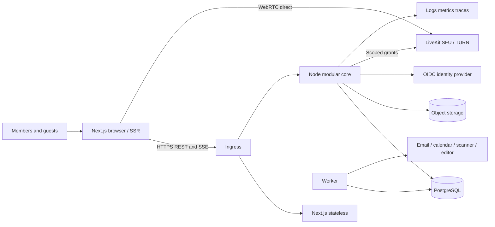
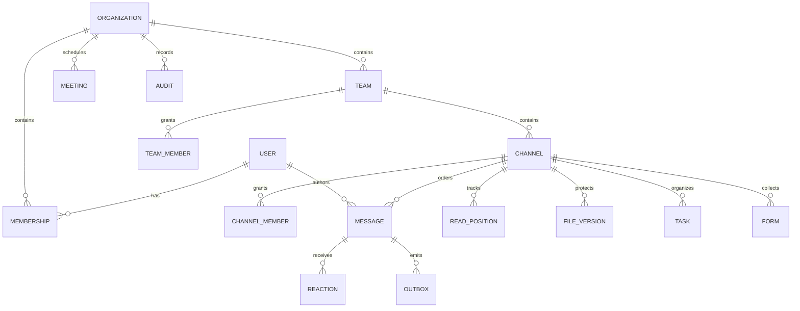
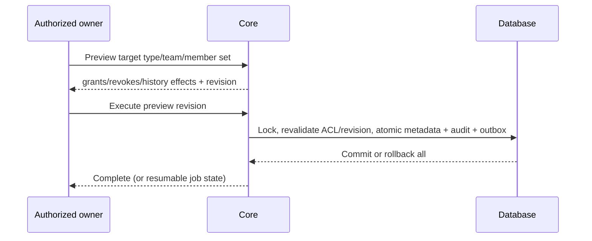

# Collaboration platform architecture — ADR baseline 2026-10-12

Status: design approved for first implementation increment by the execution rules in the specification. This is not release verification. Primary register: `requirements.json`; generated human matrix: `TRACEABILITY.md`. All 146 primary requirements are required: the two integration requirements have mandatory providers even though marketplaces are optional. GIFs/stickers, general whiteboards/polls, broader tasks, directory sync, advanced discovery and marketplace remain optional subfeatures, not removed primary IDs.

## Discovery and constraints

Repository is a Next.js 16.4.0 / React 19.3.0 App Router starter, TypeScript strict. Unrelated `.idea` files are preserved. Node 24.19.0, Java 21, Go and Python are installed. Docker engine 29.4 is reachable with sandbox escalation. No external deployment target or provider configuration has been supplied. Local Docker staging incurs no new cloud resources. Sites hosting was assessed but its Worker/Vinext runtime is not chosen because the specification requires Next.js and persistent backend connections.

Read installed Next guides for installation, layouts, server/client components, route handlers, caching, and deployment. Keep existing framework pins and lockfile. Official compatibility: [Next 16](https://nextjs.org/docs/app/guides/upgrading/version-16) requires Node >=20.9; [Node release policy](https://github.com/nodejs/Release) identifies 24 as LTS; [PostgreSQL support](https://www.postgresql.org/support/versioning/) uses five-year major support. Registry versions selected at implementation are pinned, including transitive lockfile. Local build/test evidence, rather than version numbers alone, establishes compatibility. Security audit remains required before release.

## ADR-001: modular TypeScript core

| Service / context | Runtime and data ownership | Alternatives evaluated | Reason / interface / scaling / extraction trigger |
|---|---|---|---|
| Object storage | SeaweedFS4.48 (vendor Go infrastructure), owns its internal object metadata/bytes only | Managed S3 awaits authorized target; custom storage rejected | S3 protocol with AWS JS SDK3.1150.0; persistent single-node local volume, no core-table writes; extract to managed/replicated deployment for production durability/capacity |
| Web | Next.js/React/TS, owns no authoritative records | Other frontend excluded | SSR shell, client workspace/media; direct same-origin `/v1` via ingress, no business rules in Next. Stateless replicas |
| Core | Node 24/TypeScript/Fastify; identity/membership, collaboration, messages, calendar/work/governance schemas in PostgreSQL 17 | Spring Boot/Java 21: excellent complex transactions, more JVM/tooling overhead for first increment. Go: efficient concurrency, higher cost for rich domain validation. Python: no ecosystem advantage for this transactional core | One deployment, strict validation, SQL transactions and shared contracts; REST v1 + SSE. Scale stateless API; extract real-time only on measured connection or GC pressure |
| Durable worker | Same Node codebase, outbox/jobs tables owned by core | Dedicated queue initially unnecessary | PostgreSQL leases/SKIP LOCKED, bounded retries and DLQ. Independent process when processing load requires it; no other service writes core tables |
| Media | Mature LiveKit SFU (Go upstream), external provider boundary; owns transient media rooms | Custom Go media server rejected; managed provider possible | Browser connects directly using short-lived server-authorized room grants; TURN/SFU scale independently. No media through Next/API |
| Documents | Provider-owned collaborative document engine (Collabora/OnlyOffice candidate) | Node/Yjs when restricted native text documents suffice | Provider session/version contract; no direct core-table writes. Provider selection/live verification unresolved |
| Processing | Initially provider adapters + Node workers; Python only when extraction/transcription libraries justify a separate worker | Java/Go possible but no current library advantage | Signed object references/events; worker reports results via API, not cross-service SQL |
| Telephony | SIP/PSTN provider integration boundary | Browser-only simulation rejected | Requires real trunk/numbers/billing/region and live calls. No approved chargeable resources |

No redundant Redis, Kafka or search cluster initially. PostgreSQL full-text search with authoritative ACL joins; dedicated search only after measured need. S3-compatible object storage for binary files/recordings; database owns ACL and metadata. Ephemeral presence expires; durable replay uses outbox. Development infrastructure can use filesystem/object adapters but must never claim production object durability from them.

## Context/container/deployment



Local staging: loopback ports web 3100/API 4100/Postgres 55432. Compose dedicated project/network/volumes, never touch other projects. Deployment target: TLS ingress + web/core/worker containers, managed replicated PostgreSQL, encrypted object storage, separately routable UDP/TCP media. At least two API instances and synchronous replica needed before durability/availability sign-off. No production deployment until all required gates, target authorization, TLS and secrets are available.

## Roles and permission matrix

Identity is global; organization membership is independent and active/revoked. Tenant roles: owner/admin/member/guest. Team membership determines standard channel access. Private/shared channels use explicit channel members. Same-tenant shared channels initially; external tenant membership requires explicit guest representation and policy, never trusting a foreign tenant claim. Direct/group conversations use explicit participants. Removing membership removes current history access; already downloaded plaintext is unrecoverable.

| Action | Owner/admin | Team owner | Member | Guest |
|---|---|---|---|---|
| Tenant settings/roles/audit/export | Yes scoped tenant | No | No | No |
| Team lifecycle/member administration | Yes | Own team | Create/join public/leave subject to last owner | Invite-only |
| Read standard channel | Must be team member | Own team | Team member | Team member |
| Read private/shared channel | Explicit member required; admin has no implicit content access | Explicit member | Explicit member | Explicit member + policy |
| Change channel type/team | Tenant admin + channel access | Own team + channel access | No | No |
| Message/file/task/forms | Authorized resource member | Same | Same | Same except policy-limited file mutation |
| Edit/delete message | Own; moderator delete policy | Moderator in scope | Own | Own |
| Meeting control | Organizer/assigned role, not tenant admin by default | Same | Assigned role | Assigned role |

Every request/subscription/send rechecks membership in the authoritative database. Resource IDs never confer access. Unknown/denied resources yield indistinguishable 404. Tenant queries use membership-derived scope and parameterized SQL. Cross-table composite FKs prevent cross-tenant attachments/threads. Mutation authorization and writes share resource locks to avoid revocation races. Account closure revokes sessions. No shared tenant-sensitive Next cache; all private responses `no-store`.

## Entities and boundaries



Conversations and channels may share a stream record but retain distinct kind/membership semantics. IDs UUID, sequence allocated under stream lock, UTC timestamps and IANA timezone on meetings. Tenant/resource ACL is the common authority for search/files/work. SQL migrations are ordered, checksum-recorded and transactional. Expand/contract, never destructive downgrade in routine rollback.

## API and event drafts

REST `/v1`: `/session`, `/organizations`, `/organizations/:id/bootstrap`, `/teams`, `/channels`, `/channels/:id/messages?before=seq&limit=50`, `/channels/:id/read`, `/channels/:id/events?after=cursor`, `/search`, `/files`, `/tasks`, `/forms`, `/meetings`, `/policies`, `/audit`, `/exports`, `/migrations/preview` and `/migrations/:id`. Schemas validate IDs/enums/body bounds; conflicts 409; unauthenticated 401; inaccessible 404; rate 429; provider unconfigured 503 with actionable code. Error envelope `{error, correlationId}`. Session cookie HttpOnly/SameSite; Origin validation on mutations; OIDC authorization-code/PKCE and issuer/audience/nonce validation. Development identity is explicitly gated and prohibited in production.

Writes with retriable effects carry stable UUID `clientId`/idempotency key. Uniqueness scope `(stream, actor, clientId)` and payload conflict detection. Accepted means committed on primary, sent means client observed durable acceptance, delivered means recipient acknowledged, read means explicit monotonic read cursor. Do not conflate SSE send with delivered. Read receipts honor preferences, target initial capacity 32 members, eventual receipt events.

Outbox envelope: `{id, version:1, tenantId, resourceId, type, occurredAt, payload}`. Keep payload minimal (invalidations rather than plaintext), authorized hydration required. Ordering is per conversation; global event sequence is cursor only, commit inversion must not lose events (serialize relevant writes or replay overlap/dedup). At-least-once, not exactly-once. SSE reconnect cursor/bounded replay with reset snapshot, heartbeat and queue caps. Slow sockets disconnect before unbounded buffering. Outbox and write in one transaction; consumers idempotent via unique delivery key. Retry capped at 8, exponential jitter, timeout, terminal DLQ, operator replay with audit.

```mermaid
sequenceDiagram
 participant A as Sender
 participant C as Core
 participant D as PostgreSQL
 participant B as Recipient
 A->>C: POST message with stable clientId
 C->>D: BEGIN; lock stream; verify current ACL
 C->>D: insert message + outbox + audit; COMMIT
 C-->>A: persisted id/sequence
 B->>C: authorized SSE cursor
 C->>D: recheck ACL and replay committed outbox
 C-->>B: invalidation/cursor
 B->>C: GET history; POST read position
```

## Migration safety (GAP-01–03)

Same-tenant only. Preview snapshots source/target membership and ACL revision, listing gained/lost historical access including guests. Require confirmation of the preview revision. Execution locks stream and relevant team membership, validates revision, prepares job/audit. For current relational metadata transaction atomically changes team/type/membership and increments ACL revision; stable IDs preserve references. Large external ACL propagation uses deny-until-reconciled fence, resumable states prepared/fenced/reconciling/complete/failed. Files/download authorization always checks database, preventing a stale public object link. Search joins current ACL. Subscriptions recheck on delivery and heartbeat; notifications recheck at send. Failed jobs remain fenced and operator-recoverable. No public-to-private intermediate release.



## Encryption and browser feasibility

[LiveKit E2EE](https://docs.livekit.io/transport/encryption/) provides SDK encryption but key distribution remains the application's responsibility. Never generate endpoint-only keys on the server. For durable text/file E2EE evaluate maintained MLS implementation or Matrix Olm/Megolm SDK against device verification/recovery/browser compatibility before enabling. This is an explicit later-increment security blocker, not permission to implement ad-hoc crypto. No encrypted label until protocol and independent review/tests are complete. Default server-processable mode visibly identified.

| Capability | Server-processable | Endpoint-only encrypted |
|---|---|---|
| Text/search/email | Server authorized indexing/digest | Ciphertext server; local search only; content-free digest |
| File scanning/preview | Quarantine until scan, isolated preview | Cannot server scan; endpoint warning and local preview; no false clean badge |
| Coauthoring | Provider authorized processing | Requires compatible encrypted editor; otherwise unavailable |
| Media | SFU transport encryption; optional consented processing | Verified endpoint key epochs, fail closed if unsupported |
| Recording/transcription/coach | Consented provider processing | Explicit recording endpoint handles plaintext locally, encrypts output, shares keys only to authorized devices |
| Retention/discovery | Server deletion/hold/export | Ciphertext retention/hold only; no plaintext discovery promise |

Device identity verified out-of-band/SAS; membership changes rotate epochs; new member history policy explicit; removed devices cannot get new keys. Recovery via user-held recovery secret or verified device, never server plaintext escrow under provider-blind mode. Lost recovery means lost content. Key/metadata exposure: backend knows members/times/sizes/routing, not content. Downloaded keys/plaintext cannot be revoked. Malicious client delivery/XSS remains a threat requiring CSP/dependency controls and review.

| Browser feature | Chrome / Edge | Firefox | Safari | Validation |
|---|---|---|---|---|
| Core UI/SSE/multiple windows | Supported candidate | Candidate | Candidate | Current + previous stable, actual versions recorded later |
| Camera/mic/share | getUserMedia/getDisplayMedia detection | Same | Shares/device differences detected | HTTPS, user gesture, denial handling |
| E2EE | SDK/encoded-transform runtime check | Runtime check | Runtime check | Fail closed; no blanket support claim |
| Gallery | target 16 tiles | target 9 | target 9 | Measure CPU/frame drops; reduce subscriptions |
| Effects / spatial/music/AGC | Constraint/worklet/canvas capability checks | Same | Same | Low-power disable and accessible alternative |
| OS remote control | Not provided by browser | Not provided | Not provided | WEB-06 app-level control explicitly labeled; full desktop requires scope decision |
| Coach / avatars | Opt-in local processing + text equivalent | Same | Same | No recording without consent; limitations visible |

E2EE and advanced browser APIs are not verified by architecture. Need real devices and independent participants. WEB-18 needs provider account/trunk/phone numbers and billing authorization, regions and consent determined by deployment owner. PSTN cannot be silently treated as endpoint-encrypted browser participant.

## Workload, budgets and SLOs

Sign-off target: 10000 registered/2000 concurrent connections, 100 messages/s, 1M messages, 100 concurrent meetings x 50 participants, 500 attendee moderated event, 32-person receipt group. These are targets, not demonstrated capacity. Lab baseline: report host CPU/RAM/browser versions, data set, process replicas, warm/cold, 50ms RTT/10Mbps plus 3Mbps lossy profile. Web LCP 2.5s/INP 200ms/CLS .1 p75. API p95 read 300ms/write 500ms, delivery 1s, search 2s. Idle <100MB JS heap and <20KB/min background traffic target; chat <200MB and <10% single CPU, meeting <1GB and <70% CPU on reference 4-core laptop; battery measured 30min differential. No field metric claims from lab.

Core 99.95% monthly; media 99.9%; external provider latency/availability measured separately. Primary commit is local durability initially, not region-safe. Production synchronous standby must preserve acknowledged writes for single-node failure; regional recovery RPO<=5min via WAL backups, RTO<=60min. Region loss may lose acknowledged data within that RPO; this is explicitly distinct from normal durable ack.

## Threats and operational design

Threats: IDOR and confused tenant, stale socket/notification ACL, XSS/key theft, CSRF, malicious upload, replay/idempotency collisions, migration ACL races, provider compromise, abuse/backpressure, audit tampering, cross-tenant caches. Mitigations: parameterized SQL/current ACL in every path, immutable IDs/FKs, origin checks/HttpOnly cookies, text rendering/no raw HTML, quarantine and size bounds, no public object ACL, commit outbox, redacted logs and least-privilege deployment credentials. Independent penetration/security review remains open.

Use request IDs, release version, structured redacted logs, latency/status metrics and trace IDs without message bodies/cookies. Alert on 5xx burn rate, queue age/DLQ, disk/WAL, backup age, scan backlog, media joins; dashboards with no content. Server error telemetry must scrub URLs/identifiers. CI type/lint/domain/integration/browser/axe/build/audit; nightly load/failure/restore. Release image digest + manifest, health/readiness, SIGTERM drain then bounded shutdown. Secrets injected, never committed. Development seed refused in production. Backups encrypted with separate key/access, daily full plus continuous WAL, retention 30d subject to holds; restore monthly into isolated environment and verify checksums/ACL. Rollback app only with compatible schema; otherwise forward-fix or restore and reconcile outbox. Costs reported by active user/GB/meeting-minute; provider calls off without configured budget.

## Increments / risks / gate

1. Phase 2: schema, real identity boundary/development login, tenant ACL, server/client contract, CI, shell.
2. Phase 3a: durable streams/messages/reactions/threads/read/reconnect/drafts/search.
3. Phase 3b: files/quarantine/editor, private tasks/forms, scheduling/notifications/providers/settings.
4. Phase 4: atomic channel migration; separately gated E2EE protocol/device lifecycle.
5. Phase 5: real media first, then role/lobby/breakouts/artifacts; advanced browser features individually tested; telephony separately gated.
6. Phase 6: governance/lifecycle/export/closure/reporting.
7. Phases 7–9: hardening/staging/production/handover. Every requirement has its own criteria/evidence; partial subfeatures never qualify whole entry as Verified.

Blockers: B-TARGET external staging/production domain/credentials absent; B-SSO enterprise issuer/client/MFA test accounts; B-CALENDAR consent/account; B-EMAIL delivery domain/SMTP; B-EDITOR selected/licensed provider; B-TRANSCRIPTION language/provider or approved local model; B-PSTN trunk/numbers/region/billing; B-E2EE maintained protocol selection and security validation; B-DEVICES real browser/device matrix and independent audio endpoints; B-OBSERVATION monthly SLO/battery/user study evidence. Local database/core/chat are independent. Future-provider blockers do not affect the first coding increment. Architecture gate: validated 146 IDs, mapped owners/phases/workflows/dependencies/criteria, bounded local deployment and security modes; first increment has no unresolved feasibility blocker.

## ADR-009 — Durable OIDC transactions and local provider verification (0.1.1)

Keep identity protocol handling in the modular core using pinned openid-client 6.8.8. Replace process-local pending PKCE state with short-lived PostgreSQL transactions; atomic delete-returning provides single-consumer callback handling across replicas. Bind state to the initiating browser and issuer/client/callback/assurance policy; never infer membership from email. Keep the verifier and nonce server-side. Purge expired rows on login and every minute; a stopped service may retain expired rows until restart, but never accepts them. Outstanding flows are globally capped at 1,000 and authentication routes use a per-instance/IP 60/minute limit. DB at-rest protection remains an environment prerequisite.

Local feasibility provider: Keycloak 26.7.3, pinned image digest, separate owned H2 development volume, loopback port5180, 1 CPU/768MiB. It owns identity credentials, not application memberships. This is a provider deployment, not a new custom Java business service. Production requires a supported managed or HA IdP with TLS, verified MFA/recovery policy, session revocation integration and independently managed storage. Local public credentials and HTTP routing are forbidden in production.

Require the configured ACR claim on the validated ID token, regardless of browser authorization hints. The ACR string has no universal meaning: the deployment owner must map it to a verified provider MFA policy. Production boot validates explicit storage, origins, client settings, HTTPS and assurance configuration before migrations. Config changes can invalidate in-flight logins; prompt a fresh sign-in rather than accepting a weaker flow.

Official references checked for this increment: [Keycloak containers](https://www.keycloak.org/server/containers), [realm import](https://www.keycloak.org/server/importExport), [Keycloak ACR/step-up administration](https://www.keycloak.org/docs/26.7.0/server_admin/index.html), [openid-client discovery](https://github.com/panva/openid-client/blob/main/docs/functions/discovery.md). Installed 6.8.8 declaration signatures were used for discovery/custom fetch; insecure transport is explicitly local-only. Unknown provider subjects are denied, even when email matches an existing organization domain.

## ADR-010 — Recoverable browser send operations

Before transmitting a message, save its immutable client ID, exact body/thread reference and user/workspace/channel scope in bounded tab-scoped sessionStorage. This survives reload and conversation navigation within a tab; it is not an offline application shell or a guarantee across browser closure/storage deletion. Retain at most32 pending conversations, one operation per conversation. Fail before network transmission when storage cannot be written. Never automatically replace an ambiguous operation with a new identifier. Explicit retry reuses the same immutable payload; authoritative server ACL and idempotency rules still apply.

Keep this server-processable plaintext only for unresolved sends. Remove it on acknowledgment, explicit discard, logout/broadcast logout, access revocation or sign-in as another identity. Discard only removes the local retry record; an already accepted server message cannot be unsent this way. Storage is not an authorization boundary; validate its shape and resource scope, and rely on backend permissions on every retry. Users can continue editing a separate draft while an operation is unresolved, but must resolve/discard it before sending another message in that conversation. Acknowledgment and subsequent draft/history refresh are separate outcomes: failure to refresh must not relabel an accepted operation as unaccepted.

## ADR-011 — Signed provider logout and session revocation

Implement OpenID Connect Back-Channel Logout using maintained JOSE verification and the configured issuer's discovered JWKS. Accept only signed RS256 logout tokens for the configured issuer/client, with fresh issued-at time and mandatory expiry, unique event ID, explicit logout event, no nonce, and a subject or session identifier. The endpoint accepts a bounded form POST and uses token authentication instead of browser cookies/Origin. All other mutation Origin checks remain intact.

Own provider/session bindings, replay receipts and revocation tombstones in PostgreSQL. Delete matching application sessions atomically with an audit record; repeated signed events return success without repeating effects. Serialize identity issuance/revocation for each issuer/client to prevent an in-flight callback recreating a revoked provider session. Retain replay receipts/tombstones24h, longer than the5-minute login window; subject revocation uses an issued-at cutoff so a later authentication can sign in. Scope revocation to issuer, client and sid (and sub if present), or to subject when sid is absent. Existing development sessions have no provider binding and are unaffected.

Active SSE connections revalidate the application session every second and close after revocation; the UI must clear local state on session termination. ADR014 supersedes the original missed-event limitation: access now requires a provider check no older than60seconds, within an8-hour absolute application session. No claim that disabling an IdP user always emits logout, or that provider logout and application-local logout are equivalent. Production requires HTTPS reachability from the IdP and provider-specific delivery/retry verification.

Protocol reference: [OpenID Back-Channel Logout1.0](https://openid.net/specs/openid-connect-backchannel-1_0.html). Library: [panva/jose](https://github.com/panva/jose), registry-pinned6.2.12, Node24 runtime. Local provider administration follows [Keycloak temporary admin recovery](https://www.keycloak.org/server/bootstrap-admin-recovery); no public development administrator is permitted in production.

ADR011 implementation note: migration005 invalidates pre-binding legacy sessions once without deleting user content. Provider logout has a separate600/minute per-instance/IP budget. Local live Keycloak delivery and independent-user isolation are verified; a temporary configuration administrator was removed afterward.

## ADR012 — Provider-managed OTP and meaningful assurance

Accepted for the local identity increment. Keycloak26.7.3 owns OTP secrets, enrollment and verification; the application continues to receive only signed OIDC claims and stores provider/session bindings. The browser flow orders LoA1 (required password) before LoA2 (required OTP), using the maintained built-in level condition. Both levels have max-age0 for explicit reauthentication. The application client has minimum/default ACR `urn:concord:mfa`, mapped to LoA2; the API independently requires this exact signed ACR. No constant claim mapper is used. First login without an OTP requires provider enrollment. Existing lower-assurance application sessions must be invalidated on deployment.

A separate loopback-only confidential test client has minimum LoA1 and no application deployment bound to it. It exists solely to verify that signed password-only tokens cannot satisfy a stronger API policy even when browser hints are removed. Test OTP generation uses pinned OTPAuth9.5.2, a development dependency; only synthetic accounts are automated. Enrollment secrets are stored in ignored local test state with mode0600, never in source, release evidence, frontend bundles or production. Identity browser traces/screenshots are disabled because enrollment screens expose secrets. Losing test state requires explicit local provider credential reset, never automatic weakening of the flow. Human users use their own authenticator.

Account recovery, recovery-code enrollment and enterprise lifecycle checks remain separate unfinished work. Enforcing MFA here does not establish enterprise readiness. Development shortcut login remains explicitly development-only and is forbidden in production.

Sources checked against pinned provider code: [Keycloak step-up flow](https://github.com/keycloak/keycloak/blob/26.7.3/docs/documentation/server_admin/topics/authentication/flows.adoc), [LoA condition](https://github.com/keycloak/keycloak/blob/26.7.3/services/src/main/java/org/keycloak/authentication/authenticators/conditional/ConditionalLoaAuthenticator.java), [OTPAuth](https://github.com/hectorm/otpauth).

## ADR013 — Provider-managed second-factor recovery

Accepted for the next local increment. Keycloak26.7.3's supported recovery-code authenticator owns generation, storage, consumption and regeneration. Password remains LoA1. LoA2 allows either configured OTP or a configured recovery code. A separate conditional fallback requires OTP enrollment if neither credential is configured; never grant LoA2 by skipping an empty alternatives flow. Build a new versioned flow, validate its structure, then switch the realm binding; retain the previous flow for diagnosis. Existing application ACR policy stays unchanged.

Settings can launch Keycloak's allowlisted recovery-code required action through the existing PKCE login path only when the deployment explicitly declares `OIDC_PROVIDER=keycloak`. Provider-managed reauthentication precedes code display. The application never receives codes and never treats a browser-returned action-status parameter as proof of completed enrollment. Cancelling can return to a normal authenticated application session but cannot be reported as enrollment success. Tests use synthetic credentials, no traces/screenshots or source-controlled recovery secrets.

Verify enrollment, second-factor recovery, invalid/reused-code rejection, regeneration invalidating the previous set, unchanged signed assurance, and no-factor enrollment. This is recovery from loss of an authenticator with a retained password and pre-enrolled recovery codes. Forgotten-password/email recovery, loss of all factors, enterprise helpdesk verification remain separate incomplete scope. Provider-disable reconciliation is locally verified under ADR014. Recovery codes are bearer secrets and cannot recover an account after all factors/codes are lost.

Source: [Keycloak26.7 recovery-code administration](https://www.keycloak.org/docs/26.7.0/server_admin/index.html), [pinned flow condition](https://github.com/keycloak/keycloak/blob/26.7.3/services/src/main/java/org/keycloak/authentication/authenticators/conditional/ConditionalSubFlowExecutedAuthenticatorFactory.java).

## ADR014 — Bounded provider-session reconciliation

Accepted for the local revocation increment. Keep signed back-channel logout as the fast path. Retain only a refresh token, encrypted using maintained JOSE compact JWE (`dir`/`A256GCM`) with a versioned256-bit keyring injected through a server-only file. Bind each encrypted payload to its application-session hash, issuer, client and subject. Do not persist plaintext access/ID/refresh tokens, use offline scopes, or grant the application provider-admin roles. This is server-side secret encryption, not E2EE; a compromised running API can use its credentials.

On authenticated requests and SSE checks, reuse a successful provider check for at most60seconds. After that, introspect the refresh token through the confidential client's RFC7662 endpoint, verify subject/client, then refresh it and encrypt the successor. Refreshing only when the application is accessed preserves provider expiry for inactive applications. A connected SSE session counts as activity. Application sessions retain their8-hour absolute expiry. Provider inactive responses or terminal invalid_grant remove the local session and audit a bounded reason. Provider timeouts/outages or invalid metadata fail closed with503 once freshness expires; never mint a fresh local lease on failure. Existing dev shortcut sessions are independent and remain forbidden in production.

Use short durable per-session leases (no database connection held across provider HTTP), process-local request coalescing and bounded concurrency. Updates must be conditional on the lease and existing session so a late refresh response cannot recreate logged-out access. Re-read session authorization after checking. Server time defines60-second freshness, provider calls have5-second timeouts, retry leases have bounded jitter. A busy peer check returns retryable503 after expiry rather than exhausting SQL connections. Legacy bindings without an encrypted token must sign in again when enforcement is enabled. Require explicit enforcement/key-file configuration in production.

Local development can create a mode0600 random keyring in its existing private API data volume, only with explicit development authentication and non-production mode. Production never auto-generates keys. Rotate by distributing a ring containing old+new keys with a new active ID, recreate instances, allow successful checks to rewrap credentials, then remove old keys only after all old bindings expire or are rewrapped. Losing keys forces reauthentication; keep key backup/recovery separate from SQL backups and test target secret-manager integration before production.

Live acceptance must cover disabled users (without assuming logout delivery), deliberately missed logout callbacks, active SSE revocation, independent identities, provider outage/recovery and persisted encrypted credentials across API restart. Laboratory tests additionally cover tampering/binding/key rotation, concurrent checks, stale leases, late responses after logout and terminal/transient failures. This closes a local session gap, not enterprise directory synchronization, full audit compliance or an operational revocation SLA.

References: [pinned Keycloak refresh introspection](https://github.com/keycloak/keycloak/blob/26.7.3/services/src/main/java/org/keycloak/protocol/oidc/RefreshTokenIntrospectionProvider.java), [openid-client introspection](https://github.com/panva/openid-client/blob/main/docs/functions/tokenIntrospection.md), [JOSE](https://github.com/panva/jose).

## ADR015 — Identity audit scope and failure privacy

Authentication is global; membership determines which organization administrators may observe a verified identity's session lifecycle. Within the same SQL transaction as successful sign-in/local logout/reconciliation, append the existing global event and one organization event per currently active membership. For signed provider logout, retain the global provider receipt and add one scoped event per distinct affected user, without exposing other users or aggregate session counts to tenant administrators. No client-provided organization or role determines event scope. Inactive/former memberships receive no new events; historical events remain scoped to their original organization.

Record rejected local sign-in, OIDC initiation/callback and back-channel submissions globally, with no actor attribution from unverified input. Metadata is restricted to a fixed route category, HTTP outcome and generated UUID request correlation ID (not the process-local default counter); target is a fixed authentication label. Never retain entered email/password, IP, query string, cookies, state/code, JWTs, provider descriptions or raw errors. Errors from provider screens that never reach this API remain provider-owned evidence; this is not comprehensive IdP event ingestion. Do not duplicate every expired-session poll. Requests rejected by the existing rate limiter (429) are excluded to avoid audit amplification; rate-limit telemetry/aggregation remains future work.

Audit persistence is awaited. Session mutations and success records commit atomically; a failed failure-audit write returns generic503 and emits only a bounded operational log. The existing tenant admin audit endpoint exposes only tenant rows and continues denying ordinary members/foreign tenants. No public/global authentication audit endpoint is introduced. Database-superuser tamper resistance, external immutable audit sinks, retention/holds, full audit filtering/export and tenant lifecycle policy remain unimplemented; this increment does not complete BE-FR-32 or BE-NFR-19.

## ADR016 — Versioned formatted message bodies

Add `messages.format` constrained to `plain` or `markdown-v1`, defaulting to plain for existing rows and older API clients. Persist the source string (10,000-character bound) with the format; never store generated HTML. POST idempotency compares format as well as body/thread. PATCH preserves format when omitted; explicit changes are validated. Committed message events retain existing ordering and resource authorization. Search/activity previews continue showing source text in this increment.

Use pinned react-markdown10.1.0 (official React>=18 peer compatibility verified) for CommonMark formatting. No raw-HTML plugin, MDX, executable content, image fetching or syntax plugins. Raw HTML is displayed as text; only absolute HTTP(S) links without credentials become anchors, with noreferrer/noopener and a new tab. Image syntax becomes an explicit text placeholder; no external request occurs. Headings are reduced to emphasized paragraphs to preserve application heading structure. The exact renderer is shared by preview/history/edit. Plain messages remain literal, including Markdown-looking characters.

Composer offers keyboard-accessible formatting controls and optional preview; drafts retain Markdown source through existing persistence. New pending operations carry the format; older browser records without it replay as plain. Never relabel an already persisted/retried operation using current composer state. Existing ownership checks, thread behavior and tenant isolation apply unchanged. Legacy clients may display formatted source literally; no silent body migration. This completes only the formatted-text/link portion of FE-FR-10, not structured mentions or attachment references. Review raw-HTML/URL/image restrictions if plugins are ever introduced.

Reference: https://github.com/remarkjs/react-markdown (official README security, components and URL-transform guidance; checked2026-10-12). No cryptographic or provider dependency is added.

## ADR017 — Structured channel-authorized mentions

Use explicit Markdown links `[@Display name](concord-mention:USER_UUID)` as portable source, preserving drafts and existing retry payloads. Parse with the maintained CommonMark AST (remark-parse11/unified11, already pinned transitively); promote these to direct dependencies. Only inline link nodes with the reserved scheme count; text, code, images, raw HTML and reference-style links do not notify. Plain-format messages never create mentions. Maximum20 distinct recipients; malformed reserved links are rejected. Display labels do not establish identity: history uses authoritative directory names for validated mention rows.

Migration009 creates normalized message_mentions with message/user foreign keys and unique(message,user). In the existing channel-locked message transaction, validate every recipient against current active membership/channel access and non-disabled identity, then insert references before the durable outbox event. Edits atomically replace references; deletion clears them. Retry checks precede new validation so a prior accepted operation remains deduplicated after recipient revocation. No extra copies of message plaintext are created.

Reuse the authorized channel-members endpoint for the picker; exclude disabled accounts. Activity filter `mentions` selects references for the requesting identity, including already-read messages, while enforcing current org/channel ACL and deleted state. Default unread activity is preserved and labels mentions. The Activity screen polls every5seconds while open with stale-response guards and clears data on failures. No email/browser push is claimed; no unknown tenant or user identifiers in events. Existing channel locks serialize with membership/conversion mutations; read-time ACL checks remain authoritative after revocation. Private channels and same-tenant shared channels use the same access predicate. No cross-tenant channel migration or @everyone fanout.

History displays validated mentions as non-navigating highlighted spans with server-resolved names; preview shows the typed label as untrusted text until accepted. A user must remove a now-ineligible mention before editing that source. Existing source text may retain a previously known display label after revocation; neither downloaded history nor knowledge can be retroactively revoked. Names/UUIDs already present in authorized history are metadata, not access grants. Keep richer delivery preferences, quiet hours, email digests and full notification lifecycle open.

## ADR018 — Durable quarantine scanning increment

Keep existing private-volume storage for this increment; S3/object storage, resumable uploads, file versions/previews/coauthoring and message attachments remain open scope. Integrate official ClamAV1.5.4 over its documented INSTREAM protocol. The official image lacks an ARM64 manifest; use its pinned AMD64 digest under local Docker emulation, with4GiB limit and persistent signature data. No scanner port is publicly exposed. TCP ClamD is unauthenticated/unencrypted, so only the isolated local container network is supported here; production needs a private authenticated transport boundary and approved deployment configuration.

Use a core-owned PostgreSQL file_scan_jobs table. Upload metadata and one scan job commit together, after immutable private bytes are written. Workers claim one eligible job with SKIP LOCKED, a random lease and60-second expiry; no SQL connection is held during filesystem or scanner I/O. Each scanner command has a20-second deadline (up to40seconds for capability/freshness and content checks) and bounded reply size; loaded signature date must be no older than7days and version must report INSTREAM support. Retry transient failures with exponential backoff/jitter (five attempts), then retain a dead job with generic reason and quarantined bytes. Authorized uploader requeue resets the bounded attempt budget; no fake clean result if the provider is absent. Crashed jobs become claimable after lease expiry; late results cannot replace a newer lease or resurrect deleted files.

Scan immutable bytes whose size/SHA256 match authoritative metadata. A clean verdict marks ready; detections mark rejected; errors stay quarantined. Commit file state, job completion, audit and outbox atomically under the channel lock (same ordering as delete/membership/migration). A dedicated worker uses the same modular-core image/schema owner and a read-only file mount, allowing separate scaling without another service writing owned tables. Deleted files cancel jobs. Existing quarantined files are enqueued by additive migration.

Downloads require current channel access, ready state and a second size/hash validation. Serve attachment-only application/octet-stream, nosniff, no-store and a safely encoded filename. Never serve quarantined/rejected/missing/tampered bytes. Check authorization again after reading bytes; revocation cannot recall already downloaded content. Only UTF-8 plain-text .txt/.md/.csv and signature-checked PDF/PNG/JPEG uploads are accepted in this increment; declared MIME must match, but this is not comprehensive content disarm/reconstruction or a malware guarantee. No encrypted-file scanning claim. Existing unsupported files stay quarantined on worker validation failure. Keep the existing1MiB upload/100MiB local tenant bounds; these are not enterprise capacity targets.

References checked2026-10-12: official https://docs.clamav.net/manual/Usage/ClamdProtocol.html (INSTREAM framing and TCP trust boundary), https://docs.clamav.net/manual/Installing/Docker.html (image/signature persistence and memory), https://www.clamav.net/downloads (1.5.4).

The pinned scanner configuration alerts on encrypted archives/documents and exceeded scan limits, with bounded archive recursion/file counts. Such heuristic detections are rejected, not treated as clean. This is server-processable scanning, not E2EE.

## ADR019 — Scanned message attachments

Implement channel-local attachment references before object storage: the existing scanner and private byte repository are sufficient for an integrated authorized sharing increment. This ordering does not defer mandatory object storage, upload idempotency or reconciliation; those remain next independent work. No new runtime/provider/library is required.

POST message accepts up to10 distinct UUID attachmentIds, canonicalized and persisted as an immutable retry snapshot on messages. Normalized message_attachments links enforce file/message foreign keys. Under the existing channel lock, every new reference must point to a ready file in that same channel and organization. A current member may share another member's already-visible ready file; never copy/move bytes or widen access. Check prior clientId and full payload equality before reevaluating file state, so a lost-response retry still acknowledges an accepted operation after file deletion. Attachment sets cannot be altered by text edit in this increment.

History projects authoritative current file metadata only for ready same-channel references; deleted/unavailable files render a generic unavailable entry without the former filename. Deleted messages expose no attachments. Download always uses the existing current-ACL/ready/integrity endpoint. File deletion events already cause history refresh; no signed permanent links or authority from client names. Retained UUID references record accepted operation identity, not permission to retrieve content. Member revocation and channel conversions retain existing authoritative access checks. No cross-channel forwarding or encrypted attachments are claimed.

The composer paperclip opens an accessible picker of current conversation files, with loading/error/empty/retry states and unavailable scan states. Choosing Send file sends that file with the current draft, or a simple fallback body, immediately; this explicit action avoids introducing an unsaved attachment-selection draft. Existing session-scoped pending recovery stores attachment UUIDs alongside the exact text/clientId and preserves them through reload/retry. Legacy pending records mean zero attachments. History renders attachment download links separately from formatted user text. Text-only edit preserves attachments; deleting a message hides its links without deleting shared files. Tests cover ready/quarantine/rejection, same-channel and tenant boundaries, forged/stale references, concurrency/idempotency, deletion, independent-user browser download and lost-response recovery. File storage/provider work remains explicitly incomplete.

## ADR020 — Upload retry identity and local orphan reconciliation

Before adding an object-store provider, close the existing local upload ambiguity: a committed upload whose response is lost must not create duplicate file/job/audit rows on retry, and a failed SQL commit must not trigger deletion of possibly committed bytes. This increment keeps local private storage explicitly; S3/object storage remains mandatory open work, not a completed provider integration.

Add nullable client_id to files with a unique(channel_id,created_by,client_id) constraint. Legacy callers may omit it and retain non-idempotent semantics; the new UI always sends a UUID. Normalize UUIDs and compare filename, canonical MIME, decoded size and SHA256 under the channel lock before quota/write. Return existing id/current state for identical retries (including deleted state); reject changed payload409. Revalidate channel authorization for every retry. Server-generated storage keys remain immutable. Hold the existing tenant quota lock and a shared global storage advisory transaction lock across the bounded <=1MiB local write and metadata/job/outbox commit. This limited local I/O-in-transaction choice is not a pattern for remote object-store operations.

Write bytes with exclusive create, fsync file, then fsync directory before committing metadata. Never unlink on an ambiguous transaction failure; cleanup owns orphan removal. The maintenance process scans only the application file root, in bounded batches under the exclusive counterpart of the storage lock. Remove only UUID-named regular files older than one hour with no files.storage_key row at all. Preserve young bytes, symlinks, directories, unknown names, and every referenced file including soft-deleted/rejected/quarantined records. Skip a batch when uploads hold the lock and retry on a later pass. Stream directory enumeration to bound memory. A SQL outage or inability to acquire/check authoritative state must not delete files. Separate worker uses the same owning core image, writable bytes and database, not scanner credentials. Counts-only logs; no filenames/content. This is crash-orphan cleanup, not retention, legal hold or user-content purge.

Frontend recovery keeps only scoped pending metadata (identity/channel, random operation ID and SHA256 fingerprint) in session storage, never file contents. Reselecting the same bytes/name/type after reload reuses the ID; a confirmed response removes the pending record. Invalid/unavailable storage fails before sending. Bound to32 pending entries; sign-out/session-clear removes metadata. Reselect is explicit because browsers cannot restore a chosen local file after reload. New upload attempts with different bytes obtain different IDs; already-confirmed uploads intentionally selected again are new operations. Automated tests cover real SQL concurrency, payload conflicts, lost response/reload/reselection, revoked access, deletion retries, orphan grace/protected files/symlinks and cleanup lock exclusion. Object storage, upload progress, physical retention quotas and production durability remain open.

## ADR021 — S3 promotion with a local quarantine spool

Choose SeaweedFS4.48 for the local S3-compatible provider, using its official pinned image, persistent volume and signed requests; AWS SDK JavaScript v3 client-s3 3.1150.0 (Node>=20, compatible with Node24). Alternatives: managed S3 is preferred for a separately authorized production target but absent here; no cloud resources will be created. Avoid adding another custom storage runtime. SeaweedFS owns object bytes internally and never writes core tables. Core owns file identity, ACL, scan state and the authoritative storage-location pointer. Single-node local SeaweedFS is not HA, encrypted-storage or production durability evidence.

Retain <=1MiB uploads in the existing durable local quarantine spool and queue. The scan worker reads verified local bytes, scans them, then for a clean verdict PUTs to a tenant/file/hash-derived S3 key and GETs/checks exact length/SHA256. Provider I/O occurs outside SQL transactions. Only after successful verification does the same lease-guarded transaction publish ready + storage_backend=s3. Failed/ambiguous PUTs remain quarantined and retry the deterministic key; repeated bytes are identical. No lease winner means no publication. Increase scan lease to120seconds to cover bounded40second scan plus two15second S3 requests, and allow120second shutdown grace. Existing local-only operation remains possible without the optional overlay; once a row says s3, missing configuration/outage fails closed without silent local fallback.

The existing download API retains current ACL, ready-state and checksum enforcement. For this1MiB increment it reads the authoritative object directly and returns attachment bytes; Next introduces no extra proxy. Direct provider-signed downloads are deferred because the current resource revocation boundary would otherwise become a bearer-URL expiry window. Upload staging remains local; this increment does not claim fully independent stateless API scaling or direct object uploads.

Migration013 defaults existing rows to local. An explicit resumable command promotes existing ready/local files: verify local bytes, PUT/GET outside transaction, lock channel, compare current state/location/hash, then switch pointer and audit. Retain local copies for recovery; do not treat their presence as permission to fallback. Pending/rejected/deleted rows retain local location unless already promoted. Migration failures do not switch pointers and reruns skip completed rows. S3 objects created before a failed/revoked publication may remain unreferenced; object-store garbage collection, staged retention and local-spool reclamation require a later intent/reconciliation design and are not silently delegated to provider lifecycle rules.

Local storage network exposes no host ports. Configure separate bucket-scoped read-only API and read/write worker credentials through server-side configuration; provider bootstrap has its own administrative credential. These are synthetic development credentials and invalid for production use. Internal filer/admin interfaces require a trusted isolated runtime and are not a production security boundary. Production requires HTTPS, encrypted managed storage, secret injection/rotation, least-privilege IAM and restore evidence. No custom cryptography or E2EE claim.

Verify live provider round-trip, anonymous denial, read-only writer denial, corruption failure, provider restart persistence, API outage behavior without fallback, clean/EICAR publication semantics, migration repeatability and all existing authorization/retry tests. Source references checked2026-10-13: https://github.com/seaweedfs/seaweedfs/releases/tag/4.48 ; https://github.com/seaweedfs/seaweedfs/wiki/Quick-Start-with-weed-mini ; https://docs.aws.amazon.com/AWSJavaScriptSDK/v3/latest/client/s3/ ; npm registry metadata for client-s3 3.1150.0. Provider release/SDK are pinned; production/provider security claims remain gated on evidence.

## ADR022 — Coordinated encrypted local backup/restore exercise

Use PostgreSQL REPEATABLE READ READ ONLY plus pg_export_snapshot; pg_dump --snapshot and the authoritative file manifest use the same snapshot. Export each referenced file through the existing storage dispatcher and checksum verifier, including soft-deleted/quarantined records. Current local/S3 keys are immutable and referenced bytes are retained, so concurrent promotion/deletion does not invalidate the snapshot's byte references. This assumption must be revisited before any physical reclamation; future GC must honor backup readers/leases. No service shutdown or live-table restore is necessary.

For the bounded local dataset, bundle the custom-format dump and verified file bytes in a versioned JSON envelope, then use existing maintained jose CompactEncrypt dir/A256GCM (standard authenticated JWE). No custom cryptography. Keep a random32-byte recovery key in a separate mode0600 file under a mode0700 ignored directory; never print it or include it in the artifact. Plaintext dump/content exists only in bounded process memory/child pipes, not a plaintext archive on host disk. Limit export buffers and envelope to64MiB; larger workloads fail explicitly and need a streaming/managed design. This is local recovery evidence, not a scalable production backup system. Same-host key storage is not an offline recovery strategy.

Restore authenticates/decrypts and validates the envelope before creating disposable infrastructure. Reuse recorded immutable image IDs, a unique internal Docker network and fresh named volumes with no published ports. Restore SQL into a fresh PostgreSQL service, rehydrate local spool and S3 objects via checksum-verified PUT/GET, then verify every file and manifest/dump agreement. Exercise real restored API sign-in, resource access and cross-tenant denial. Do not run scan/reconciliation workers that could mutate the restored snapshot during verification. Destroy only the uniquely named exercise containers/volumes/network in finally; never target source containers or source volumes.

This includes core database/messages/memberships/file metadata and authoritative file bytes. Keycloak's separate identity-data volume, provider configuration/secrets (including identity-token keyring), object orphans and nonauthoritative local mirrors are outside the artifact; they require separate coordinated recovery plans. Existing S3 rows are restored both to S3 and optional local recovery copies, without changing authoritative pointers. No production RPO/RTO, region-loss, legal-hold retention or monthly backup schedule claim. Snapshot/dump/file verification must fail closed on missing/corrupt/unavailable bytes. Corrupted JWE must fail before target creation. Record snapshot time, counts, source image identities, artifact digest, measured exercise duration and cleanup evidence without exposing content/secrets.

References: PostgreSQL17 snapshot synchronization and pg_dump --snapshot (https://www.postgresql.org/docs/17/functions-admin.html , https://www.postgresql.org/docs/17/app-pgdump.html); existing pinned jose6.2.12 CompactEncrypt/compactDecrypt implementation. No runtime application/API change is required for this operational increment; retain release0.1.13 images and record backup tooling separately.

## ADR023 — Authorized, bounded source-text previews

Core owns a synchronous preview endpoint alongside downloads. Support UTF-8 TXT/MD/CSV in server-processable mode only. Return JSON containing literal source text, at most32,768 UTF-16 code units without splitting a surrogate pair, with truncation/total-byte metadata. Markdown, HTML, CSV formulas and links are never interpreted. PDF and images explicitly report unsupported preview; downloads remain available after scanning. No new parser/provider/storage derivative is necessary for this increment. Versions, rich previews, coauthoring and E2EE previews remain open.

Use the same authoritative ready-state, current channel ACL and checksum-verified local/S3 reads as downloads, with ACL/state revalidation after provider I/O. Reject quarantined/rejected/deleted/mismatched-channel resources before reading. Responses inherit no-store/nosniff; no public URLs or plaintext caches. Full stored bytes are bounded to1MiB before source truncation. Provider errors fail closed, without fallback. Authorization is evaluated at response time; previously received plaintext cannot be retroactively revoked.

The Files screen opens a named native modal with loading, error/retry, empty and truncated states. Render a single escaped text node in a keyboard-scrollable pre element. Keep text only in mounted component memory. Poll authorization/content every5seconds while visible, bound each browser request to8seconds, clear content on any failed refresh or hidden tab, abort on close/unmount. Resource navigation unmounts the keyed Files panel. This is a best-effort UI withdrawal bound, not revocation of bytes already received or a guarantee for suspended browsers. Every server request enforces current access independently.

Verification: API negative ACL/tenant/channel, scan state, deletion/revocation, corruption and unsupported MIME tests; truncation/Unicode/empty-source tests. Browser test with actual scanner/S3 and independent users verifies literal hostile markup, no embedded elements, retry, keyboard close, bounded preview, and active deletion withdrawal. Existing scanning/download/attachment regressions remain required. No schema/dependency changes, no full FE-FR-15/BE-FR-15 completion claim.

## ADR024 — Fail-closed local release evidence

The interrupted0.1.14 handover exposed a stale release record. Make the local recorder reject stopped/unhealthy services, missing image identities and application/worker/provider image mismatches before overwriting evidence. Derive the application version from package.json, verify loopback API health reports that version and readiness/web respond successfully, with bounded HTTP/Docker commands. Persist JSON through an exclusive temporary file and atomic rename so failed collection does not replace the previous record. Capture base commit and uncommitted source hash as before; this hash is a workspace snapshot, not proof that every hashed test/tool was built into the application image. Do not infer staging/production approval from local health. Unit-test missing/unhealthy/stale-image rejection; run the recorder against the resumed real deployment. No app/schema/image change required.

## ADR025 — Immutable file revisions with explicit history

Add revision_root (nullable self-reference scoped to the same organization/channel) and revision_number to core files. Existing files are version1 roots. Each new revision is an independent immutable file/scan job/object key; no replacement of bytes or attachment IDs. Root listings remain version1 resources, with explicit Versions navigation; history offers each ready version's download. This avoids silently changing content previously shared in messages. Latest accepted revision may be quarantined/rejected; prior ready versions stay accessible.

The root uploader, while currently authorized in the channel, may append a revision via POST files with versionOf=root UUID. Require the root to be ready and retain its filename/MIME. Serialize allocation under the existing channel lock; unique lineage/version index prevents duplicate ordinals. Limit100 accepted versions per lineage for bounded history. Retry identity includes versionOf, checked before root eligibility so lost acceptance followed by deletion still returns the original state without resurrection. All revisions count toward existing logical quota and inherit channel ACL on every request. No owner role supplied by client.

Deleting a root soft-deletes the entire lineage and cancels all scan jobs atomically under the channel lock; deleting a revision withdraws only that revision. Already shared references remain immutable but become unavailable if their specific version is deleted. No physical reclamation, restore-as-current or editor conflict-resolution claim. Backup snapshots already enumerate all file rows and immutable bytes; keep their retention invariant. Additive migration requires a forward-fix/compatible binary after first revision because old root-delete semantics would not cascade.

Files UI adds a named Versions modal with history/state/download, root-owner upload, recovery via reselecting the same file, loading/error/empty states and periodic authorized refresh. Upload fingerprints include the root UUID to isolate pending revision operations. Backend/API/database tests cover concurrent numbering, retry conflict/dedup, owner/tenant/channel boundaries, pending/rejected revisions and deletion/scan races. Real scanner/S3 two-user browser test verifies old/new exact bytes and root deletion withdrawal. No new provider/dependency. FE-FR-16/BE-FR-14 progress only; collaborative editor remains blocked/unimplemented.

## ADR026 — Revision-aware recovery evidence

Export backup envelope version2 with required revision_root/revision_number for every file. Validate lineage shape, same tenant/channel root references, unique ordinals and deleted-root withdrawal before creating restore infrastructure. Continue accepting version1 historical artifacts without inventing revision metadata; these provide no revision-specific verification. SQL dump remains authoritative and contains all revision columns/constraints. Compare version2 manifest fields against restored rows before reading bytes.

Extend the existing isolated verifier to exercise authorized history and exact per-version downloads for ready lineages in the known local test channel, and deny the second tenant's history request. The live fixture creates original and revision through the real scanner/S3, backs up both, deletes the source lineage, and asserts its ID was specifically verified in the restored instance. Keep authenticated encryption, bounded memory, separate key, immutable snapshots and finally cleanup unchanged. No live table restoration, physical deletion, provider secrets or external resource creation. This closes local revision recovery evidence only; production identity/offsite/RPO/RTO remain open. No application image/schema/version change is needed.

## ADR027 — Opt-in browser mention alerts and server quiet hours

Implement durable per-user notification settings independently from profile JSON, with default-off browser alerts, daily quiet interval and authoritative profile timezone. Equal start/end means all-day quiet; overnight intervals and daylight-saving transitions use Intl wall-clock parts. Server claim endpoint checks current organization/channel ACL, unread mention, nondeleted message, unmuted/unhidden conversation and preferences before returning up to10 items. Only messages created after enabling alerts and within24hours qualify; edits to older messages do not create new alerts. Activity/history remain intact during quiet hours.

A unique user/message claim ledger deduplicates tabs/devices under a settings-row transaction lock. Claim is at-most-once allocation, not confirmed OS delivery: lost response or browser failure may lose an alert; activity is the recovery path. Do not claim exactly-once or durable push. No plaintext message body is returned; titles identify the authorized workspace and channel. Current permissions apply on every claim; previously shown metadata cannot be retroactively revoked. No outgoing email/provider messaging is introduced.

The active workspace polls while signed in and browser permission is granted; browser permission is requested only by an explicit Settings click. Notification construction errors show actionable unavailable feedback. Close active notifications on unmount/logout/organization switch and expire them after15seconds. Closed/suspended tabs and unsupported/mobile implementations have no delivery guarantee; mobile push/service worker, email digest, reply/invitation/call alerts and broad notification policy remain open. Source references checked2026-10-14: MDN Notifications API and Notification.requestPermission document secure-context/user-gesture requirements and mobile constructor limitations (https://developer.mozilla.org/en-US/docs/Web/API/Notifications_API , https://developer.mozilla.org/en-US/docs/Web/API/Notification/requestPermission_static).

Tests: timezone/overnight/equal endpoints/DST boundary evaluation; settings validation; enable-time cutoff; concurrent claims and persistent dedup; muted/hidden/read/deleted/revoked/cross-tenant exclusions. Browser workflow verifies preference persistence, quiet suppression, native Notification constructor path after browser permission grant and explicit failure states. Automated native-constructor observation is not proof the operating system displayed a toast. No phase3 completion claim; this is partial FE-FR-18/BE-FR-13/FE-FR-31.

## ADR028 — Private-activity email digests with a local SMTP boundary

Use Nodemailer10.1.0 (Node>=20, Node24 compatible) with its bundled TypeScript definitions; pin lockfile. Verify through official SMTP documentation and registry metadata. Local capture provider Mailpit1.31.5 image digest94f6b70c1436defae6799d9ac7ff0eeff9540465b842026d5cdb018f1c0234ea, native ARM64. Mailpit is SMTP infrastructure, never owner of business tables. Expose only loopback UI8025->host5185, no host SMTP port, no forwarding/relay configuration, internal network, persistent volume. Local adapter permits only .test recipients and rejects production mode. External SMTP credentials/domain/TLS/deliverability remain B-EMAIL; do not send outside local capture.

Core owns opt-in hourly digest settings and PostgreSQL jobs/items. Schedule at most one batch/user/organization/UTC-hour, max100 unread messages, since enablement and within24hours; exclude author, read/deleted, muted/hidden and currently unauthorized standard/private/shared channels. A unique user/message reservation prevents duplication in later batches. Quiet hours defer queued jobs; disabling or losing access cancels/filters them. Reservations for canceled/expired items are not replayed; Activity remains authoritative. Re-enabling starts a fresh cutoff. One organization per email and summary counts only, including authorized private activity; never include message bodies, participant names, private channel names or attachment data. Link requires application authentication/current ACL.

Separate digest-worker process shares core ownership, schedules fairly with a bounded per-user interval and claims jobs using SKIP LOCKED/leases. Recheck preference, quiet time, read state, content and ACL immediately before sending; this authorization point precedes external SMTP I/O. Revocation after that point cannot retract mail already submitted. Do not hold SQL transactions across provider I/O. Persist sending intent before SMTP; expired sending is uncertain and never automatically resent. Definitive pre-connection failures and explicit SMTP4xx rejections retry with backoff/jitter up to5attempts; SMTP5xx is dead; transport ambiguity or crash after intent is uncertain. Stable Message-ID assists investigation but is not a provider dedup guarantee. SMTP acceptance is not mailbox delivery, not exactly-once processing.

API exposes per-user recent job statuses and honest configured/unconfigured provider state. UI extends existing notification settings with digest opt-in, quiet policy and status; no free-form recipient field. Real local test covers private counts without plaintext, recipient boundary, provider outage/recovery, quiet deferral and access withdrawal before send. Unit/integration tests may inject transport outcomes, clearly separate from live SMTP evidence. No email content retained in core jobs, no sensitive transport errors in logs. Digest retention/claim purging, production delivery/bounce handling, offsite email-provider recovery and target capacity remain open.

Official references checked2026-10-14: https://nodemailer.com/smtp ; https://nodemailer.com/message ; https://mailpit.axllent.org/docs/install/docker/ ; https://mailpit.axllent.org/docs/api-v1/ ; https://mailpit.axllent.org/docs/integration/healthcheck/ . The image version command's update check fails intentionally with network disabled; local binary identifies1.31.5.

ADR028 deployment refinement: this runtime does not publish ports for an internal-only network. Mailpit additionally joins the existing default application network so its loopback UI is reachable. SMTP remains unexposed on the host; adapter and receiver both restrict .test recipients, and no relay/forwarding configuration is supplied. Do not describe Mailpit itself as having no network egress; the capture-only delivery boundary is configuration plus recipient restrictions. The internal mail network is retained for the worker/provider path. No additional proxy/runtime/image is introduced.

ADR028 transport refinement: Nodemailer10 ships its own types, so the initially evaluated external types package was removed. Its generic ECONNECTION/CONN may represent a closure after submission, so retry only explicit SMTP4xx, initial EDNS/CONN or ESOCKET with originalCode=ECONNREFUSED and syscall=connect. Treat generic closure and timeouts as uncertain. This is verified against installed provider source and negative transport tests.

## ADR029 — scanner-aware worker readiness (2026-10-14)

The scanning overlay currently declares its worker healthy from a recent heartbeat alone. That heartbeat proves loop activity even when ClamAV is unavailable or its signatures cannot be verified. Preserve independent messaging/API availability, but require the file-worker health check to verify both a finite recent heartbeat and the same VERSIONCOMMANDS/INSTREAM capability and signature freshness policy used before scans. This is dependency readiness, not a completed scan or a guarantee that every queued job will succeed.

Reuse one scanner probe in scan execution and a dedicated Node health entrypoint. Health probes have a three-second socket deadline, a4096-byte response bound and sanitized failure output; Compose allows five seconds. Keep scan execution's existing20-second command deadlines and fail-closed quarantine behavior. Do not restart or mark the core API unavailable because this dependency fails. Docker unhealthy status is observable and blocks release recording; it does not itself restart a running worker. No schema, provider version or signature policy change. The scanner image remains0.1.10-local; application images advance0.1.18-local.

Verify protocol framing, fragmented replies, capability/freshness rejection, connection closure, response bounds and deadlines against controlled TCP test peers (not live malware-detection evidence). Verify the deployed readiness transition by stopping and restarting the actual local scanner, then execute existing real clean/EICAR and worker-restart browser checks. Keep prior full browser evidence for unchanged UI; this increment requires affected scanning regressions. Whole BE-FR-15/BE-NFR-18/23 remain incomplete.

## ADR030 — authorized reply activity (2026-10-14)

Extend the existing core Activity projection with a replies filter and replied boolean. A reply qualifies when its immediate parent is a nondeleted message by the current identity in the same organization/channel. Exclude self-authored and deleted replies and enforce current channel ACL on every query. Parent deletion removes the reply from the dedicated reply feed; it can remain an ordinary unread message. Mentions/replies may overlap without duplicate rows. This is a view over authoritative messages, so no new notification table or backfill is needed. Existing descending date/ID order and50row limit remain; filter includes read replies, matching historical mentions behavior. No participant-wide thread subscription, browser reply opt-in or external delivery is implied. UI adds a named select option and reply badge; selection opens the existing authorized conversation. Preserve existing loading/error/empty states. Verify independent-user discovery, self/tenant/channel denial and deletion withdrawal in core and browser tests. No provider or migration change; release0.1.19-local.

## ADR031 — explicit browser reply alerts (2026-10-14)

Add browser_replies_enabled (defaultfalse) and replies_enabled_at to notification settings. Existing browser_enabled remains mention-only for old clients; omitted reply preference is preserved on updates. False→true resets the reply cutoff independently. Reuse current claim transaction/unique user-message ledger: one eligible message produces at most one claim even if it both mentions and replies. Prefer mention label when both categories qualify. Replies require a live immediate parent by recipient in the same channel/tenant; no thread-participant subscriptions. Apply current ACL, unread, author/deletion, mute/hide,24hour age and quiet-hours checks to both categories. Only messages since the respective opt-in qualify. Claims remain at-most-once allocations, not OS delivery guarantees.

Extend settings with a separately labeled reply checkbox and bridge payload kind. Notification content stays organization/channel metadata only. Older payloads without kind retain mention label. Keep native browser permission behavior/contextual opt-in; no new browser API/provider. Verify independent toggles, cutoff, overlapping categories, concurrent claims, parent deletion and shared suppression rules. Browser test forwards the actual native Notification constructor to observe a real reply invocation across two tabs; OS toast visibility remains unverified. Additive migration017; app0.1.20-local. Rollback to0.1.19 safely stops reply delivery while retaining preference/claim rows; do not replay allocated claims.

## ADR032 — identity-bound invitation inbox (2026-10-14)

Expose GET /v1/invitations for the signed-in identity, matching the trusted stored user email exactly. Return only unexpired, nonrevoked, unaccepted invitations, newest50, with organization name/ID, role and expiry; no token/hash, sender email or unrelated tenant data. This is intentional cross-organization invitation metadata addressed to that identity; it does not grant organization discovery/access. Exclude existing memberships (including inactive ones) from inbox; administrators must resolve membership restoration. Existing identity provisioning remains required; no public account signup/email delivery implied.

Extend existing accept body with a mutually exclusive invitationId alternative to token. Both paths verify identity, expiry/revocation/use under row lock and preserve membership guard/audit. Serialize acceptance per user before locking the invitation to prevent concurrent distinct invitations for the same org causing a uniqueness500. Neither old nor new route silently reactivates membership. Acceptance is explicit, single-use, not automatic on notification/read. Revocation racing acceptance is ordered by invitation row locking; committed membership needs separate revocation afterwards.

Settings gains a polling inbox with loading, empty, error/retry, accepting and success states. Show organization, role and expiry before acceptance, then refresh authorized workspace selection. Preserve manual token entry. GET polling rechecks validity/current identity; failures clear stale invitations. No browser/email invitation delivery or active notification badge in this increment. No migration/provider/dependency change; release0.1.21-local. Verify recipient isolation, expiry/revocation, concurrent acceptance and authenticated two-user browser discovery/acceptance/workspace access.

## ADR033 — invitation discovery and recipient decline (2026-10-14)

Reuse the identity-bound inbox to show a global pending-invitation notice on authenticated screens, labeled across workspaces (not attributed to the selected tenant). Fetch every5seconds with an8second deadline; no local persistence. Clear stale counts on errors and render an honest unavailable status. Show50+ at the existing50item limit rather than claiming an exact total. Key notice state by identity, cancel outstanding fetch on unmount. Review opens a dedicated Invitations view using existing inbox; Settings remains an alternate entry. This is in-app discovery, not browser push/email.

Add authenticated DELETE /v1/invitations/:id for explicit recipient decline. In one transaction, match trusted email, require unexpired/unrevoked/unaccepted state and set revoked=true with invitation.declined audit. Do not create/reactivate/remove membership. Existing invite row serializes decline/accept/revoke races; later use is404. Invitation revocation storage is reused rather than introducing redundant lifecycle columns; audit distinguishes recipient decline from admin revocation. No schema/provider changes. UI disables actions while request pending, names target organization, keeps errors visible and updates inbox; no irreversible content deletion. Tests verify wrong-recipient/expired/used rejection, no membership grant, audit and notice-to-decline/accept browser workflows. Release0.1.22-local; global provider/retention/rate-limit completeness remains open.

ADR033 concurrency refinement: acceptance serializes identity via FOR NO KEY UPDATE, which excludes another acceptance's same lock while allowing audit/membership foreign-key key-share locks. A full FOR UPDATE user lock could deadlock with recipient decline holding the invitation row and writing its actor audit. Added concurrent accept/decline test asserting exactly one success and consistent invitation/membership state. Rebuild final image after this refinement.

## ADR034 — organizer meeting edits and response consistency (2026-10-14)

Add revision integer default1 to meetings. Organizer-only PUT /organizations/:id/meetings/:meeting/details accepts expected revision, title, description, absolute startsAt/endsAt and IANA timezone. Validate interval/timezone; lock authorized noncancelled meeting, reject stale revision409, atomically update/audit and increment revision. Time changes reset nonorganizer responses pending; title/description changes preserve them. Retain attendee roster in this increment. Compare instants numerically, not lexicographic ISO strings; also fix create interval validation accordingly.

Serialize existing RSVP/cancel paths on the same meeting row. Cancel increments revision and audits; RSVP on cancelled meetings is rejected. Reject empty/ambiguous PATCH bodies. No recurrence/calendar-provider/media implication. UI uses a separate accessible edit dialog, browser-local date inputs with explicit timezone labeling, loading/saving/error feedback and actionable stale-edit instructions. Preserve original ISO instant if input untouched. No auto-overwrite on conflict; close/reload calendar before editing latest revision. Successful edit refreshes calendar; no automatic open-dialog field replacement. New migration018, no runtime dependency/provider; release0.1.23-local. Verify organizer/tenant denial, concurrent edits, response resets, cancellation/RSVP guard and two-user browser update visibility.

## ADR035 — revision-protected meeting attendee changes (2026-10-14)

Extend details PUT with optional attendees array (max100 input IDs). Omission preserves roster for older clients. Normalize duplicates, always retain organizer; validate selected recipients against active organization memberships and enabled identities, also applying this eligibility check to meeting creation. Under existing meeting lock/revision transaction, remove deselected attendees, insert new attendees pending, preserve retained responses unless rescheduled, and audit added/removed counts. Removed users lose list/RSVP access immediately on subsequent requests; prior downloaded data cannot be recalled. Same row lock serializes roster changes with RSVP/cancel. No external calendar/email/media revocation claim.

Meeting list adds attendee_ids only for organizer, null for others; no new roster disclosure to ordinary attendees. Editor receives authorized directory people and organizer roster, displays labeled checkboxes, keeps organizer outside removable list. Missing/inactive directory entries already in roster appear as removable unavailable IDs; server rejects submitted unavailable recipients until removed. Revision conflicts require close/refresh/reopen as before. No schema/provider/dependency change; app0.1.24-local. Test roster preservation, new pending/removed denial, tenant/disabled recipients, duplicate normalization, legacy omission and concurrent revisions; browser verifies attendee removal and re-addition through actual organizer UI.

## ADR036 — bounded calendar range and keyset pagination (2026-10-14)

Meetings GET defaults50/max100 rows and returns nextCursor {startsAt,id} or null using starts_at/id ordering, limit+1 and exact PostgreSQL microsecond cursor timestamps. Optional from/to UTC bounds must be paired, positive and <=366days; include meetings overlapping [from,to), not only starts inside. afterStart/afterId must be paired. Current tenant/member/organizer/attendee checks run on every page; cursors confer no access. Existing clients still receive meetings but must follow cursor beyond first page. Add tenant/start/id index. No snapshot isolation across pages: concurrent edits can move entries; client deduplicates IDs and Refresh restarts browsing. Do not claim stable snapshot/export/capacity.

Calendar optionally accepts paired browser-local start/end dates, end date inclusive by next-local-midnight conversion (DST-aware Date arithmetic); constrain span server-side. Empty pair browses all history via bounded pages. Separate draft date fields from applied range. Replace/append loading, visible errors and Retry; abort superseded/unmounted fetches, prevent double load-more, preserve existing rows on append errors but clear stale rows on refresh/range errors. Keep exact cursor from server. Existing edit/create refresh first page of applied range. No silent range expansion after creation. Test >100 same-start meetings without gaps, exact microseconds, overlap endpoints, invalid inputs, tenant/removal checks per page and browser date filtering/load-more. Migration019 and release0.1.25-local, no provider/dependency changes.

## ADR037 — durable recipient-scoped calendar change detection (2026-10-14)

Core owns calendar_versions(org_id,user_id,revision) with membership FK. Increment recipient counters transactionally alongside meeting create/edit/cancel/RSVP; edits notify union of old/new roster plus organizer so removed attendees learn to refresh. No meeting details are exposed by counters. Authenticated GET organization/calendar-version returns only caller's counter after current membership check. Existing meetings need no backfill: counter0 is a valid initial watermark. Concurrent changes use atomic UPSERT increment; rollback produces no false committed increment.

Calendar polls this endpoint every5seconds with8second deadline, one outstanding poll, abort on unmount and identity/organization-scoped mount. Record observed counter before triggering page1 load so a change during fetch is detected next poll. Initial observation also refreshes to avoid bootstrap race. On change clear old cards/cursors and reload first page; announce automatic refresh and page reset. Preserve open editor input; old revision still rejects conflicting saves. Do not rebuild an unbounded set of already-loaded pages. On counter failure clear stale calendar rows, abort any page request and show retrying status; recovery forces refresh even if counter unchanged. Visibility resumption polls immediately; do not claim hidden-tab timing guarantees or media push.

This is durable invalidation plus polling, not SSE delivery or a snapshot guarantee. Current permission checks remain in list/counter/RSVP. Member revocation returns denied and withdraws local rows at next successful poll/failure observation; already copied information cannot be recalled. No new infrastructure/provider/dependency. Migration020, release0.1.26-local. Test affected/unrelated recipients, removed users, rollback/cross-tenant denial and automated two-browser edit/removal/cancel without manual refresh. Existing paging tests must remain stable without false change signals.

## ADR038 — explicit scheduling timezone and DST choices (2026-10-14)

Choose @js-temporal/polyfill0.5.1, pinned with lockfile, for wall-time→instant resolution instead of hand-written timezone offset arithmetic or Date's silent DST normalization. npm metadata reports Node>=12; official README supports Node14+ and ES2020, compatible with local Node24/Next build. Official references checked: https://github.com/js-temporal/temporal-polyfill and https://tc39.es/proposal-temporal/docs/zoneddatetime.html . Existing Intl runtime supplies timezone data; different OS/browser tzdata versions remain an operational compatibility limitation. No claim of full Temporal standard/browser support; import maintained polyfill explicitly.

Creation and editing expose IANA timezone and repeated-time choice reject(default)/earlier/later. Resolve each entered wall datetime through Temporal; round-trip mismatch rejects nonexistent spring-forward times even if an earlier/later choice is selected. Ambiguous fall-back times require explicit choice. Invalid zone/date yields actionable inline error, never silent normalization. Shared local formatter initializes editor in meeting's saved zone; changing zone intentionally reinterprets entered wall times. Untouched editor fields preserve original instant (including an already selected fold); changing timezone or disambiguation resolves anew. Server continues to accept unambiguous UTC instants and validates timezone/interval/authorization. Calendar display stays browser-local and labels stored scheduling zone separately. Repeated-time selection applies to both endpoints; more elaborate per-endpoint fold UX remains open.

No schema/provider change; release0.1.27-local. Unit cases cover normal zones, nonhour offsets, DST gap/fold, invalid date/zone and round-trip initialization. Browser verifies inline gap rejection and persisted explicit later-fold instant through actual scheduling API. Existing editor/roster/pagination/recovery regressions must pass. Recurrence and external sync remain incomplete.

## ADR039 — bounded recurring meeting series (2026-10-15)

Core materializes daily/weekly recurrence, interval1–12 and2–52 occurrences with a maximum366day start span. Temporal advances local calendar dates in the stored IANA zone, resolving each later start/end with explicit fold policy; any gap/ambiguous unresolved time or nonpositive interval rejects the entire series before writes. First UTC occurrence remains exactly supplied. This bounded model avoids an unbounded expansion worker and supports existing list/index/RSVP permissions. Daily/weekly only; monthly/yearly/RRULE, series-wide reschedule/roster edits and external sync remain requested work.

Store meeting_series with tenant/organizer, stable clientId, canonical request hash, recurrence policy/count and cancelled flag. Scoped unique organizer/clientId plus serialized organizer row lock deduplicates creation; matching retry returns the same occurrence IDs, changed payload409. Meetings store scoped series FK and ordinal unique. Create series/occurrences/attendees/counter invalidation/audit in one local transaction. Each occurrence may be edited/cancelled/responded to independently (explicit UI label). No claim that a single edit changes the series.

Organizer series cancellation uses the referenced occurrence as authorized lookup, locks series then occurrence rows in ID order, cancels active occurrences/increments revisions, updates series flag, invalidates all affected recipients and audits once. Repeated cancellation succeeds without more counter increments. RSVP/edit serialization continues on occurrence row, so cancellation ends with all occurrences cancelled. Creation replay after cancellation returns original IDs/state and never resurrects. UI adds frequency/interval/count and persisted in-memory operation ID across retries while composer mounted; any changed form payload regenerates ID. Reload recovery is not claimed. Show occurrence number/count and explicit Cancel series control. No provider/dependency change; migration021/release0.1.28-local. Verify DST, whole-series atomic rejection, retries/conflicts, permissions and real two-user browser create/cancel.

## ADR040 — revision-protected series content and roster edits (2026-10-15)

Add series revision1. Organizer-only series details PUT takes expected series revision,title,description,attendees and updates all noncancelled occurrences atomically. Times/zone/recurrence stay per occurrence; series-wide rescheduling remains open. Cancelled occurrences remain unchanged. Retained RSVP preserved, newly added/re-added recipients pending, removed recipients lose current access. UI explicitly states whole active roster replacement uses selections from the opened occurrence, including when occurrence rosters differ. Organizer always retained. Audit occurrence/added/removed counts; invalidate union of prior/new recipients.

Use consistent lock order: series first, then occurrence rows in ID order. Individual occurrence edits/cancellations increment series revision; RSVP changes do not invalidate content/roster editing and retain occurrence serialization. Whole-series edit increments each affected occurrence revision plus series revision; cancellation increments series revision too. Old edit drafts fail409. Individual APIs must acquire series lock before occurrence lock to prevent cancellation/series-edit deadlocks. Revision counter does not replace current authorization. Stable creation replay still returns original IDs and cannot overwrite later edits.

Meeting list exposes series_revision. Editor offers This occurrence / All noncancelled occurrences for series meetings; series mode hides time/zone controls, previews scope and roster replacement, and calls dedicated contract. No silent edit-scope change. Bounds inherit existing <=52occurrences/100selectedIDs. Migration022/release0.1.29-local, no provider/dependency change. Verify stale/concurrent edits, cancellation preservation, RSVP/removed access, lock ordering and two-user browser whole-series updates. No full recurrence/provider/governance completion.

## ADR041 — canonical series anchor and atomic rescheduling (2026-10-15)

Store canonical anchor UTC start/end and timezone on series, backfilled from ordinal1. New series writes these explicitly. Organizer-only GET series schedule exposes only revision, rule/count/fold policy and canonical anchor, never request hash/client IDs. Dedicated series schedule PUT takes expected revision, anchor start/end, timezone, daily/weekly frequency, interval and fold policy; occurrence count remains fixed. Regenerate bounded ordinal slots with existing Temporal rules before updates. All candidate slots are validated, including cancelled ordinal slots, but cancelled meeting rows remain unchanged. Existing occurrence IDs/ordinals stay stable. Canonical anchor updates even if ordinal1 is cancelled, avoiding accidental anchoring on an individual exception.

Lock series then occurrence rows; cancelled series/no-active/stale revisions reject. Atomic update of active times/zones/rule metadata/revisions/counters/audit; reset nonorganizer RSVP only for occurrences whose absolute start/end change. Preserve cancelled times/revisions/rosters and all per-occurrence text/roster exceptions. Individual occurrence edits do not change canonical series anchor. Creation replay still returns original IDs, never resets schedule. UI dedicated Reschedule series dialog loads current canonical data, labels first-slot anchor/fixed count/cancelled preservation, exposes frequency/interval/timezone/DST choice and shows validation/conflict errors. No implicit conversion of selected occurrence into anchor.

Migration023/release0.1.30-local. Verify canonical backfill/creation, stable IDs, time-change response reset, skipped cancelled updates, gap rejection rollback, access/stale denial and two-browser rescheduling. Monthly/yearly rules, count changes, future-only editing and external provider sync remain incomplete. No dependency/provider change; forward-fix required for old writers missing anchor fields.

## ADR042 — bounded monthly/yearly recurrence with explicit month-day policy (2026-10-15)

Extend recurrence frequency to monthly/yearly and persist month_day_policy reject(default)/constrain (use last valid day). Generate each slot from original calendar anchor, not previous occurrence, so Jan31→Feb28→Mar31 and leap-day series returns to Feb29 in leap years. Use Temporal calendar arithmetic with explicit overflow policy, never silent clipping. Monthly/yearly preserve original local wall duration from generated start, including overnight meetings. Daily/weekly generation unchanged. DST gaps/folds still obey existing resolver; errors identify ordinal. Monthly/yearly horizon <=60calendar months (5years), existing daily/weekly<=366day start span; count2–52/interval1–12 unchanged.

Migration024 widens frequency check and adds defaultreject policy. Creation GET/rescheduling persist/expose it. Canonical request hashing omits defaultreject policy to preserve previously stored daily/weekly retry identities; explicit constrain remains hashed. Legacy schedule clients omitting policy preserve stored policy on reschedule. Existing series metadata remains valid; no backfill expansion needed. Creation and rescheduler UI offer frequencies and labeled invalid-day policy, explain anchor-based last-day behavior and bounds. This is a bounded product rule, not complete RFC5545/RRULE support; skipping invalid dates and complex weekday rules remain open.

Verify end-of-month/leap-year anchoring, overnight duration, invalid-day rejection, horizon bounds, persisted policy, old request replay and real browser monthly creation/reschedule. No dependency/provider change; release0.1.31-local. Old writers must not claim support for new frequencies; forward-fix compatibility applies.

## ADR043 — calendar-aware encrypted recovery verification (2026-10-15)

Backup envelope3 adds calendar manifest with per-table count/SHA256 for meetings,meeting_series,meeting_attendees,calendar_versions. Use ordered PostgreSQL row JSON text under explicit UTC/ISO DateStyle so exact persisted anchor/rule/exception/response/revision metadata is compared after restore, retaining timestamp precision. Bound each table50000rows and existing64MiB envelope/file limits. Snapshot digests and pg_dump share repeatable-read exported snapshot. No plaintext metadata emitted in logs; hashes/counts are inside encrypted artifact and evidence outputs only counts/booleans/fixture IDs.

Validator requires complete calendar manifests/count agreement for v3; preserves v1/v2 semantics and revision graph checks for v2+. Isolated restore compares digests, verifies series ordinal/count/tenant/cancelled invariants and organizer attendee membership, then performs authenticated series lookup/list/recipient denial and stable creation-replay tests for explicit synthetic recovery fixtures. Restore helper is bound read-only into recorded API image; no application image change required. Live fixture creates bounded monthly series, an individually cancelled exception, series reschedule/content/roster changes and RSVP; backup precedes source series cancellation. Restored snapshot must retain earlier active state and exact policy/anchor/IDs/RSVP/revisions. Legacy artifacts omit calendar evidence honestly.

No new app version/schema/dependency/provider. Host recovery tooling/evidence change while0.1.31 images remain. Verify malformed/digest mismatch, valid restoration, source divergence and legacy compatibility. Operations targets remain local laboratory results; offsite/identity/media/provider recovery and production RTO/RPO objectives are unverified.

## ADR044 — append-only recurring series expansion (2026-10-15)

Allow optional total count in revision-checked schedule PUT, default existing count for legacy clients,2–52 with existing horizon/DST/month policy bounds. Count may increase only; decrease400 because removal/cancellation policy must not silently delete referenced occurrence identities. Existing IDs/ordinals/cancelled exceptions remain unchanged. Generate complete proposed slots before writes. For additions, use highest-ordinal active occurrence as explicit content/roster template; validate its recipients are active/enabled before any mutation. New rows use fresh stable IDs and subsequent ordinals, organizer accepted and other recipients pending. No expansion of a fully cancelled/no-active series.

Append in existing series→occurrence transaction with rescheduling, count/revision update, union-recipient invalidation and audit added count. Concurrent/stale replay cannot append duplicates. Creation replay must filter to original requested count, preserving original occurrence-ID result after expansion. Registry current count/graph supports backup validation; create request hash remains immutable. No new table/schema/dependency/provider required. UI labels total count minimum original count and previews last-active-template behavior; old count displayed separately. Expansion may accompany schedule change and inherited cancelled slots still validate under existing policy. Tests check preserved IDs/exceptions/RSVP, new roster, bounds/rollback/stale conflicts/replay and real browser expansion from4to6. Release0.1.32-local; shrink/future-only edits and complex rules remain open.

## ADR045 — server-timed upcoming-only series changes (2026-10-15)

Add optional futureOnly=false to series details/schedule. After series/occurrence locks, capture database clock once; eligible noncancelled occurrences have existing starts_at>=cutoff. Past/in-progress rows, their revisions/rosters/responses and cancelled exceptions remain unchanged. No eligible details rows409. Schedule may append bounded new future slots using existing template rule even if no upcoming rows, but never revives all-cancelled/no-active series. Validate selected proposed starts and additions>=cutoff, rejecting backward movement before writes. Complete proposed recurrence still validates all slots under current rules. Capture cutoff/preserved counts in audit/response without exposing another tenant's data.

Canonical anchor/rules still update for schedule, treating preserved historical rows as exceptions. Details retain times; replacement roster source remains opened occurrence, visibly explained. Invalidate only affected recipient union plus organizer. Existing series revision/stale conflict/lock order unchanged. Legacy calls without futureOnly retain all-active behavior. UI offers upcoming-only editor scope and rescheduler checkbox with server-time definition and first-anchor semantics. Test dynamic past/future fixture, exact preserved data/RSVP, roster access, no-eligible guards, backward movement/rollback and real browser upcoming-only updates. No schema/provider/dependency change; release0.1.33-local. This is starts-not-ended eligibility: ongoing meetings count as preserved history.

ADR045 precision refinement: capture cutoff as explicit UTC microsecond text and evaluate existing/proposed starts through PostgreSQL timestamptz comparisons, avoiding JavaScript millisecond truncation at the eligibility boundary. One fixed database cutoff applies after locks for the entire transaction.


## ADR046 — Upcoming-only series cancellation

Organizer cancellation accepts optional futureOnly (default false). Lock parent then active occurrences, capture database UTC microsecond cutoff, and cancel only starts at/after cutoff. Past/in-progress rows, revisions and RSVP remain unchanged. Partial cancellation keeps registry active if historical active rows remain; full cancellation closes it. Retry with no eligible rows is a no-op (no revision, audit or calendar invalidation). Invalidate only organizer/affected recipients and audit scope/count/cutoff. No schema/provider change. UI labels separate whole-series/upcoming actions and explains started meetings are preserved. Verify tenant/organizer denial, history/RSVP preservation, idempotence, cancelled RSVP denial, later full cancellation and creation replay. This does not shorten the canonical series or implement external calendar synchronization.


## ADR047 — Recurrence date preview

Creation and series rescheduling share a reusable client preview using the same bounded Temporal recurrence generator as backend validation. Explicit Preview occurrences button produces up to52 ordered proposed slots in chosen timezone, with semantic time elements carrying UTC instants. Invalid dates/DST/rules show actionable errors without writes. Input signature prevents stale results after schedule changes. Rescheduler preserves untouched canonical instants exactly for both preview and save. Preview describes canonical candidates, not authoritative eligibility: cancelled/historical exceptions remain subject to server current state, permissions, revision and cutoff. No new endpoint, storage, dependency or provider. Browser tests compare preview UTC dates with real persisted creation, reject missing month dates, clear stale output and verify reschedule candidates. Backend independently revalidates every mutation.


## ADR048 — Persistent personal in-app meeting reminders

Per-occurrence opt-in minutes0/5/15/30/60 owned by calendar core. Store configuration keyed attendee(meeting,user), FK cascade deletes on attendee removal. No automatic transfer to new series slots. Due GET rechecks active tenant membership, caller attendee/current meeting, noncancelled/notdeclined/notstarted, disabled account and quiet hours; bounded20 ordered due reminders. No background worker needed: open app polls10seconds with timeout/abort, clears stale output on failure. Dismissal stores exact current starts_at; rescheduling to a different instant re-arms, title-only edits do not. PUT configuration and POST dismissal lock meeting/attendee before reminder to serialize with roster changes; current-start guard409 rejects stale dismissal. Retry idempotent; unique key prevents duplicates per window, persisted dismissal synchronizes windows on next poll. No claim of exactly-once display, browser push/email/offline delivery. No metadata in local storage. Composite attendee FK ensures integrity, tenant derived from authoritative meeting. Calendar list exposes only caller reminder minutes. Tests cover due window/quiet/declined/cancel/access/removal/dismissal/rearm/stale guard and browser persistence/dismissal.

Reminder dismissal is scoped to the last dismissed exact start instant: moving back to that same instant retains dismissal until the user turns the reminder off/on. This bounds stored dismissal state to one timestamp; it is not a complete reminder history.


## ADR049 — Reminder-aware recovery manifests

Backup envelope4 extends exact snapshot calendar digests/counts with meeting_reminders. Versions1–3 remain readable; v3 always verifies original four tables and cannot claim reminder recovery. Bounded ordered SQL row hashes preserve timestamp precision. Validate required fifth table, schema/count/digest limits and attendee FK graph. Use existing separate ignored JWE key; never print key/plaintext. Extend synthetic recovery fixture with owner/recipient settings, exact dismissed timestamps, removed-attendee cascade, due projection and post-snapshot source mutations. Disposable internal restore checks digest/graph and actual permissions/dismissal API; original creation replay remains stable. Reject authenticated wrong reminder digest with cleanup. No app/schema/dependency change, no production/offsite RTO/RPO claim. Reminders due at restore are clock-sensitive; fixture runs within explicit30minute window and excludes external/background delivery.


## ADR050 — Channel posting restrictions

Add default-false posting_restricted to channels. Organization owners/admins who currently have channel access may update standard/private/shared channel policy with expected channel revision. Lock channel before validating admin/revision; commit policy/revision, audit and durable channel.updated outbox event atomically. No-op current-state update is idempotent when revision matches; stale409. Direct/group chats excluded. Send/edit locks the same channel and enforces current role for restricted channels; retries of already accepted identical sends return the original acknowledgment before the new-write restriction. Replies follow same route. Existing author deletion, reactions, saving, reads, drafts and file access retain existing permissions. Policy is channel-specific, not a general moderator role or report workflow. Frontend explains restriction, disables new send/reply/edit/attachment composition for members, preserves drafts and retry acknowledgment, and exposes an admin toggle in details. Tests cover access, roles, tenant denial, revision races, replay, draft preservation, audit/outbox and independent-user live UI propagation. No external dependency/provider.


## ADR051 — Authorized message reports and moderation review

Team-channel members can submit one immutable reason/details report per message, with a persistent self-only receipt. Current channel access is required even after resolution. Direct/group reports are explicitly unavailable in this increment. Store references, not message body copies; review shows current text or deleted marker. Per-reporter/channel quota10 new reports/hour, serialized by channel lock; duplicate unchanged requests return original receipt without consuming quota. Differing payload409. Team channels remain reportable while posting restricted.

Owner/admin review queue requires organization role plus current channel ACL on every page and action, including private channels; organization role alone never grants message access. Bounded keyset pagination, optional status filter and exact UTC cursor. Resolution locks channel then report/message, expected revision, optional private note, dismiss/remove actions. Idempotent identical resolution replay by same actor/revision creates no extra audit/event. Removal uses existing soft deletion, clears mentions and emits message.deleted; decision/audit/event commit together. Audit stores action/reference, not reason/details/note/text. Other reports are not silently resolved. No report-created event to ordinary members.

Report dialog loads own receipt before submission with timeout/retry; Admin page supports authorized review, literal text rendering, notes, resolution and loading/empty/error/load-more states. Manual refresh plus revision conflict handles competing reviewers. No plaintext evidence snapshot, custom moderator role, E2EE processing, retention/legal-hold certification or cross-channel discovery is claimed. Tests cover duplicate/quota, ACL and revocation, cursors, concurrent decisions, immutable closed state, removal propagation and independent-user browser receipt/review. No external dependency/provider.


## ADR052 — Moderation and policy recovery verification

Envelope5 adds bounded ordered row digests/counts for channels, channel_members, team_members, memberships, messages, message_mentions, message_reports, audit and outbox. These are authoritative policy/ACL/content/decision dependencies; SQL snapshot consistency remains shared with calendar/files. Calendar retains its version4 five-table manifest. Older envelopes remain readable and never claim moderation verification. No provider/runtime/schema change.

A separate synthetic organization exercises visible and inaccessible private channels, restricted posting, open/dismissed/removed reports, private notes, stable accepted-send retry and audited decisions. Capture expected authorized APIs before snapshot; mutate only synthetic source policy/open report afterward. Disposable restore compares manifests/graph before API activity, then verifies current-role/channel boundaries, receipts, closed-decision idempotence and pending decision/removal. Negative authenticated report/policy digest mismatch must reject and clean resources. Separate ignored0600 encryption key; no plaintext/key output. Lab-only recovery, not immutable audit certification or production/offsite RTO/RPO evidence.

ADR052 readiness correction: probe restored PostgreSQL over127.0.0.1 TCP. The pinned official entrypoint runs a temporary Unix-socket-only initialization server before restarting; socket pg_isready alone can report readiness before pg_restore can safely run. Retain and rerun the failing negative-path evidence rather than treating infrastructure failure as a passed integrity check.


## ADR053 — Tenant-authorized audit search

Extend the existing organization audit GET with exact action/actor/target and optional paired UTC from/to filters, bounded366-day range, limit1–100(default100 for compatibility), and descending bigint-ID keyset cursor. IDs/cursors stay canonical decimal strings; never convert to JavaScript numbers. Current organization owner/admin checked on every request; foreign actors are only filters, never authorization or directory lookup. Global/null-tenant identity rows remain excluded. Exact filters use SQL parameters, not wildcard matching. Return original items plus nullable nextCursor; older callers remain compatible.

Indexes on tenant/id, tenant/action/id and tenant/time/id support bounded queries without separate search infrastructure. Actor/target-only large-volume latency remains to be measured. API range comparison uses existing Temporal library to preserve submillisecond validity; SQL evaluates stored timestamps. Audit content is not mutated by searches. Pagination is not a snapshot; refresh for a new traversal after inserts or lifecycle changes.

Replace root-held audit state with an organization-keyed panel, controlled applied filters, abort/deadline and stale-response guards. Failed initial queries clear results; failed append preserves prior page and enables retry. Show event/actor/target/time and literal metadata. Datetime inputs use labeled browser local timezone and submit UTC; actor suggestions come only from current authorized organization people. Tests verify exact filters, half-open time boundaries, big IDs beyond safe integer, cursor/role/tenant denial and browser paging/retry/filter isolation. Immutable archival, retention/legal holds and production capacity are not claimed. No new dependency/provider/service.


## ADR054 — Bounded authorized audit downloads

GET audit/export reuses exact audit filters and range validation, excluding page cursors/limits. Generate an ephemeral JSON artifact from one SQL statement snapshot, capped at1000rows/2MiB; reject excess rather than truncate. SQL computes candidate row bytes and withholds content on overflow. Decimal event IDs are strings and event timestamps retain UTC microseconds. Raw SQL-produced metadata JSON is preserved in artifact bytes without lossy JavaScript number conversion. No export job/file copy is persisted; existing authoritative audit data remains in relational storage.

Lock caller's tenant membership for share, validate current owner/admin role, construct bounded artifact, and append audit.export_generated with export UUID/count/bytes/SHA256 in the same transaction. This records generation, not successful browser saving. Every read is a fresh snapshot/access attempt; retries create new generation records and are not business mutations or exactly-once delivery. Generated record is outside its own export. Role changes serialize against the bounded membership lock; global session validity remains checked at request entry. No filters/body copied into generation audit metadata.

Attachment/no-store/nosniff headers; digest/disposition exposed only through existing allowed-origin CORS. Client downloads applied filters, aborts on scope/unmount, validates format/tenant/count/row scope and SHA256 with existing WebCrypto before clicking a temporary Blob URL. Explain limits and applied-filter behavior; errors preserve search/draft state and allow retry. Tests cover filters, tenant/role denial, stable big IDs/precise metadata, empty/size/count bounds, audit append semantics and browser real download/digest rejection. This is an audit-only export subset, not full user/tenant export or immutable audit certification. No dependency/provider/schema change.

ADR054 export quota: five generation records per actor/tenant per rolling minute, using existing audit timestamps. Serialize with a namespaced transaction advisory lock before membership lock; overflow429 carries Retry-After60. Count/byte failures do not create generation records. This export-specific budget complements the existing shared-IP request limit without changing it.

## ADR055 — Permission-scoped administrative usage reports (0.1.41)

Selected next independent phase6 reporting increment before application coding. Reuse core TypeScript/PostgreSQL and existing Next client boundary; no new runtime, provider, schema, analytics store or event pipeline. BE-FR-36 and FE-FR-32 remain partial. No blocker affects this increment. Full phase gates stay open.

GET /v1/organizations/:id/usage requires current active owner/admin membership. Required ISO date-only from/to form a UTC half-open range of1–31days, including partial current/future days if selected. Strict shared Zod input/output contracts. One SQL statement reads authorization and aggregates in one snapshot after membership-row FOR SHARE authorization; no cross-request caching. Current channel ACL applies even to administrators, including private/shared/direct/group channels; include archived authorized channels. Meeting aggregates require organizer or attendee access, including declined invitees as in calendar history; exclude canceled meetings. This is caller-authorized scope, never a purported complete tenant total.

Activity is nondeleted messages currently retained, grouped by creation date, including replies/edits' original creation date. Daily unique authors are not additive; range authors are distinct over the full selection. Counts can change after deletion/access changes. Logical storage is current nondeleted file-version metadata across authorized channels, all states and historical revisions; not date-filtered, not physical/billing/backup usage. Scheduled meetings are noncanceled occurrences starting within the range, with full scheduled duration in exact decimal seconds, not actual attendance/call usage and not clipped to the range. UTC daily buckets are zero-filled. Count/byte integers remain decimal strings; scheduled seconds decimal strings; no lossy JavaScript conversion. No content, identities, names, per-resource IDs or unauthorized totals are returned.

Append usage.report_viewed with selected date bounds only in the same transaction; read-generated audit, no data mutation/event or durable report artifact. Membership changes serialize against current caller lock; resource ACL is authoritative at the statement snapshot, subsequent reads re-evaluate. Existing request/statement timeouts and per-IP protection apply; report query range bounded, output<=31 daily rows, production scan cost/capacity unmeasured. Index extraction/warehouse only if measured load justifies it.

Org-keyed reusable panel has explicit labels, date range, UTC help, loading, empty zero values, error/retry and manual refresh. Abort on unmount/scope/new request, deadline and stale-response guards. Clear results before any request and after denial so revoked data is not left visible after failure; no polling or stale cache. Explain stock/flow/scheduled semantics and unavailable media quality/cost. Contract-validate before display; retain numeric strings using BigInt locale formatting. Tests cover exact bounds/buckets, tenant/channel/meeting isolation, revision/deletion semantics, large bytes, revocation, strict input, audited reads and actual UI refresh/retry/scope reset/responsive rendering. No external integration or new dependency to verify.

## ADR056 — Group rename, participants and voluntary departure (0.1.42)

Implement the next phase3 conversation lifecycle slice using existing channels/channel_members, revision, audit/outbox and current ACL. No new provider/schema/dependency. Authorized direct/group participants may read an atomic current participant snapshot; return only active, enabled identities already in that conversation. Any current group member, including a guest, may rename a nonarchived group with expected revision. No-op preserves revision/audit; concurrent edits conflict409. Existing details PATCH must also require revision for groups so it cannot bypass conflict protection. Direct chat names remain governed by the existing details contract; new group controls do not edit direct chats.

Voluntary group departure locks/rechecks current access, deletes only caller's channel membership and personal draft/preferences, increments revision, and appends one minimized audit and channel event atomically. Remaining messages/history/other members are preserved. Last member may leave; no self rejoin/new-member admission API is introduced. Current ACL rejects future history/send/file/participant access and existing SSE revokes on its next authorization poll. Previously rendered/downloaded data cannot be recalled. Inactive organization membership/disabled sessions remain denied by existing session/ACL controls. No administrative participant removal or selective-history grants in this slice.

Resource-keyed client loads validated snapshot with abort/deadline/stale guards. Explicit participant refresh, rename input, error/retry/conflict reload and two-step leave confirmation. Explain preserved history and access consequences before departure. After successful departure refresh bootstrap to leave the inaccessible conversation; existing pending-message revocation clears local retry records. Do not claim full conversation lifecycle or whole-requirement verification from this slice.

## ADR057 — Explicit group history grants and administrator removal (0.1.43)

Extend ADR056 using existing membership/revision/ACL/audit/outbox tables, without providers/schema/dependencies. Current organization owner/admin must also belong to the group; organization authority alone never reveals private group contents. New admission is restricted to active, enabled identities in the same workspace and requires literal history=all-retained. This deliberately grants the entire retained conversation and its authorized files, including prior messages; future-only/selective history is not implemented. UI requires an unchecked consent checkbox before adding, with a clear description of this access. Rejoining after voluntary departure requires a new administrator grant.

Mutations lock the group and recheck current access/role; expected revision prevents stale participant decisions and concurrent edits. Reject archived groups, wrong kinds and removing self(use voluntary leave). Add up to100 total explicit membership rows; existing larger groups are readable/removable but cannot grow. Current-revision already-present admission or already-absent removal is a no-op; stale retry409 requires refresh and cannot emit duplicate audit/events. Removal deletes target membership/draft/preferences while preserving shared history and existing read positions. Empty groups after voluntary departure remain inaccessible; no administrator bypass/self-admission route.

One minimized audit per change records group reference, target user reference, revision and history grant for additions, without content/names. One existing channel.updated event updates current subscribers; removed sessions lose API/SSE access under current ACL. No organization-wide broadcast of private group membership. People suggestions reuse the already-authorized workspace directory; authoritative checks happen on each mutation. Existing snapshots expose can_manage for current admin group members, never authority from a client flag. UI uses snapshot revision, explicit refresh/conflict recovery, confirmation for removal and no automatic participant polling. Previously rendered/downloaded content cannot be recalled. Full lifecycle/retention and production gates remain open.

## ADR058 — Revision-protected channel details and archive controls (0.1.44)

Add an authorized details editor for existing standard/private/shared channels using existing channels revision/archive/name/description, administrator role and channel ACL. No schema/provider/dependency. Current workspace owners/admins must also have channel access; no private-channel discovery bypass. New channel-settings snapshot returns current editable fields after locked access/role checks. UI loads a resource-keyed validated snapshot, has explicit refresh/error/retry, retains typed edits on save conflict, and reports saved state. Archive checkbox clearly explains posting denial and retained history; restoration of a channel under an archived team is refused until that team is restored.

Extend existing PATCH /channels/:id/details revision protection from groups to every conversation kind to close legacy stale-edit bypasses. Missing/stale revision409, invalid fields400. Existing name/description/archive bounds and role rules persist: team channels require current organization admin/owner plus access, direct/group details keep current-participant authority. Lock/recheck current channel, role, revision. No-op preserves revision/audit/outbox. Changed fields increment revision and atomically emit channel.updated event/audit with changed-field booleans, archive state and revision, without retaining names/descriptions in audit. Concurrent edits/policy/team changes cannot silently overwrite each other. Existing callers must refresh and supply revision; update local browser fixture cleanup accordingly.

Archiving retains history and drafts under current ACL, prevents new posts via existing server rule, and propagates state to independent current subscribers. Restoring preserves identity/members/history and allows posting under existing posting policy. This is archive/restore, not deletion, retention purge, guest/member grant management or full lifecycle completion. Old clients omitting revision fail closed409. No production browser/rolling release compatibility or independent archive restore-backup proof is implied.

## ADR059 — Team ownership transfer and active-owner departure guard (0.1.45)

Implement the missing operation behind the existing last-owner leave guard using team_members.role and team-row transaction serialization, without new schema/provider/dependency. Current active team owners may transfer their own ownership to an existing active, enabled, non-guest workspace/team member who is not already an owner. Workspace administrator role alone never grants team ownership or bypasses membership. Transfer changes no channel admission/history or workspace role: promote target and demote caller atomically, preserving other owners. Archived teams must be restored first.

GET ownership snapshot is available only to current team members. Return team identity/name/archive state, owner IDs/names/active flags, eligible candidate IDs/names and can_transfer. Bound roster to1000rows; refuse oversized snapshots rather than truncate. POST transfer requires exact expectedOwners UUID set, normalized/unique/bounded, plus target userId. Lock team, active workspace memberships in sorted order, recheck actor team-owner/target eligibility, compare current owner set. Stale owner set409; caller no longer owner403 after a completed transfer, without duplicate audit. Concurrent calls cannot leave a transient ownerless team. No unconditional retry or automatic transfer rollback.

One atomic team.ownership_transferred audit records from/to references only; no channel event is needed because access membership/history is unchanged. UI explains demotion, requires explicit confirmation, offers manual refresh after conflicts/uncertainty and validates resource-scoped snapshots with abort/deadline/stale guards. Team ownership does not become organization administration. Current candidate lists are rechecked on submission.

Strengthen existing team leave: missing team404, recheck current active workspace membership after team/channel locks, and count only active/enabled workspace owners when guarding the last active owner. Inactive/disabled owners do not justify abandonment. Successful transferred former owners can leave, retaining existing private-channel revocation behavior; last active owner must transfer first. Team row lock order stays team→channels for leave and team→membership rows for transfer; transfer never waits on channel rows. No new arbitrary owner promotion/removal or team admission UI in this slice. Prior snapshot/restore/production gates retain their recorded scope.

## ADR060 — Explicit private/shared channel membership (0.1.46)

Continue phase3 channel management with current-admin-plus-channel-access snapshots and individual admission/removal for private/shared channels. Standard channels retain inherited team access; direct/group use their existing participant controls. No schema/provider/dependency. Match existing ACL: same-workspace explicit membership grants private/shared access without implicitly joining the team. Shared channels remain same-tenant; external people require an actual local guest membership, never a foreign tenant claim.

Admission requires active/enabled same-workspace target, exact expected channel revision and literal all-retained history scope. Explicit UI checkbox describes prior messages/files and notes existing permissions for other channel content. Add up to100 explicit members, counting inactive rows; existing larger channels may be read/removed but cannot grow. Current-revision present/absent requests are no-ops; stale requests409. Channel lock, current access/admin checks and revision serialize with channel settings/policies/migrations/member revocation. Archived channels deny membership changes.

Removal cannot target caller: avoid accidental self-lockout and preserve a current managing admin. Delete only target membership/draft/preferences, retaining shared content/read positions. Existing API/SSE/search/file/task/form authorization revokes current access; copied content cannot be recalled. Re-admission is a new full-history grant, not restoration of the personal draft. Actual changes increment revision and atomically audit target user/revision/history scope plus one channel.updated event. No organization-wide private-membership broadcast.

Admin roster snapshot includes explicit inactive/disabled members with active flag for cleanup and is bounded to1000rows with explicit413 on overflow. New resource-keyed panel validates snapshots, has explicit refresh/503 recovery and stale-request guards, and reuses existing confirmation/grant controls while preserving group labels/contracts. Candidate suggestions reuse the already-authorized workspace directory; server checks every operation. No new arbitrary team admission/removal, self-join, retention purge or full lifecycle gate claim. Existing coordinated backup hashes already cover channel_members, but new post-change restore proof is not implied.

ADR060 navigation completion: bootstrap already returns authorized explicit channels outside joined teams, but the prior sidebar only rendered joined-team and teamless conversations. Render those remaining authorized channels under Other channels, without adding team membership or exposing other team channels. New grants appear after workspace refresh/reload; no new organization-wide membership notification is claimed. Browser acceptance uses a synthetic team the recipient has not joined and opens the granted channel through this navigation.

## ADR061 — Administrative team admission/removal with explicit history scope (0.1.47)

Current workspace owner/admin plus current team membership may read/manage the team roster. A team owner with an ordinary workspace role retains transfer/leave controls but does not gain these administrator privileges. New members must be active/enabled same-workspace identities, including explicitly admitted guests. Admission creates member role only and requires literal all-retained-standard history consent; standard channels inherit access, private/shared channels gain no new explicit grants. Removal cannot target caller or any team owner; use leave/transfer and keep operational owner recovery separate.

Use an exact SHA256 token over sorted existing team member ID/role pairs as expectedMembership, without a schema change or invented monotonic revision. Active/name/workspace-role changes are rechecked independently at mutation time. Lock team, all child channels in ID order, then actor/target workspace memberships in ID order. Compare current bounded roster token and recheck current admin/team access/target eligibility/archive state. Current-token existing/absent requests are no-ops; stale409 prevents duplicate effects/audit. Bound administrative roster and admission to1000 explicit rows; existing self-join policy/capacity is not represented as a universal1000-member invariant.

Admission increments standard child channel revisions/emits channel.updated. Removal deletes target team membership plus private-channel explicit grants in that team, clears drafts/preferences for affected standard/private channels, increments those channel revisions/emits updates and preserves shared explicit grants/read positions/shared content. A target absent from team is a no-op and does not remove separately granted private access. Return counts only, without private channel IDs/names. Minimized team.member_added/removed audit records target/history/counts only. Existing API/SSE/search/content ACL rechecks revoke access; downloaded plaintext cannot be recalled. No membership lockout policy is added: ordinary members may still self-join open teams under existing policy, while guests need explicit admission.

Close channel-creation race with leave/removal: transaction locks an available joined team before checking team membership, share-locks/rechecks actor workspace membership/guest restriction, then creates the channel. If removal commits first, creation in that team fails; if creation commits first, removal locks/revokes the new child too. Team-then-channel/membership lock order stays consistent with join/leave/archive/transfer. No schema/provider/dependency/backup-format change.

Org-keyed Teams panel shows Manage team members only for current admins in joined teams. New resource-keyed roster validates scope/token, provides refresh/error/retry/stale guards, lists inactive members for cleanup, requires admission history checkbox and two-step removal explanation. Candidates reuse already-authorized workspace directory; authoritative API checks apply on every call. No arbitrary owner demotion, membership ban, guest self-join, retention purge or full lifecycle/production claim.

## ADR062 — Guarded recovery of teams with no active owner (0.1.48)

Add a narrow recovery path for the ownerless-team gap while preserving normal transfer and active-owner protection. Only a current active workspace owner who already belongs to the team may recover. Ordinary workspace admins, ordinary team owners and nonmembers cannot bypass it. Require unarchived team and zero active/enabled current team owners; an active owner must use existing transfer. Eligible successor is an existing active/enabled non-guest team member. Self-appointment by an eligible workspace owner is allowed only under these recovery conditions.

Ownership snapshot adds can_recover and recoveryToken(SHA256 of sorted owner ID/active-state pairs). POST requires exact token, successor and literal confirm=true. Lock team, bounded owner set, sorted affected user rows, then sorted workspace membership rows; recheck authority, owner activity, archive, token and eligibility after locks. These locks serialize reactivation/disable while deciding recovery. Atomically demote every inactive prior owner to member and promote successor, preserving memberships, workspace roles and channel/history grants. Later reactivation of a prior owner keeps member role. Existing role changes are not rolled back automatically.

One minimized team.ownership_recovered audit records successor/former owner IDs; no channel event because access grants do not change. Stale/duplicate/active-owner attempts409 and no duplicate audit. Roster/owner set bounded to1000 using prior view limits. UI explicitly shows the recovery path only when allowed, describes demotion and unchanged workspace/channel scope, requires a second confirmation and supports existing refresh/error/stale-snapshot handling. No enterprise account recovery, user re-enablement, team force-join, ownership seizure from active owners, deletion or full lifecycle/production claim. No schema/provider/dependency/backup-format change.

## ADR063 — Uploader recovery of retained file tombstones (0.1.49)

Deleted file bytes remain referenced and reconciliation does not purge them. Add a current-channel-ACL, uploader-only recovery list (newest100, explicit hasMore), including deleted versions. Restore one explicitly selected file only; deleted versions require their original to be restored first. Never implicitly revive other deleted revisions. Require confirm=true and expected lifecycle_revision, incremented on real delete/restore, to reject stale deletion cycles. Duplicate deletes retain success without repeating audit/events or changing the token. No historical message-body recovery is implied: message deletion clears body today.

Restore locks channel, rechecks current access, rejects archived channels, locks workspace quota using the upload advisory lock and enforces the same100MB active-byte limit. Move deleted to quarantined and reset/upsert scan job with a fresh lease boundary, clearing old scan verdict metadata. Worker integrity validation and a fresh scanner verdict are mandatory before download, preview or attachment reuse. Old in-flight scan leases cannot publish over a restored job. Missing/corrupt bytes fail closed through existing scan retry/dead state. Existing message links become usable again only after scan succeeds, under current ACL. Minimized file.restore_requested audit and file.uploaded event are transactional; no filename/body in audit.

A manually refreshed, resource-keyed recovery panel shows own deleted metadata, separate version numbers, confirmation explaining renewed visibility, error/retry handling and a success notice about pending scanning. No retention timer, purge, hold, admin recovery, guaranteed byte availability, automatic restoration of versions, schema-free backup compatibility, full lifecycle gate or production-readiness claim. Migration029 adds lifecycle_revision; coordinated backups already use full database dump but cross-version restore is not newly proven.

Verification follow-up: repeated full-suite runs exposed an existing1000-user fixture cleanup exceeding10s against326k retained audit rows because audit.actor_id foreign-key probes lacked an index. Migration030 adds that index without changing retention or audit data. This supports bounded identity-reference lookups; it does not implement account closure.

## ADR064 — Explicit message/file preservation holds for team channels (0.1.50)

Add a narrow owner-managed preservation hold for standard/private/shared channels. Current active workspace owner plus current channel ACL required for both metadata view and mutation; no implicit private access for workspace administrators. Keep hold/reason/revision in a separate channel_preservation table so channel.* history/bootstrap projections cannot leak case notes. Snapshot defaults to inactive/revision0 when no row exists. Strict PUT requires active, reason(trimmed,max500; nonempty when active), expectedRevision and confirm=true. Lock channel, recheck ACL and share-lock/recheck actor active owner membership before comparing revision. Archived channels may be held/released. No-op under current token produces no audit/event/revision; stale409. Actual changes upsert next revision and audit active/revision only; never reason text. Emit a content-free channel.updated refresh event.

While active, block message body edits, author/admin message deletion, moderation removal and uploader file deletion with409. All those paths already serialize on channel lock; read hold after acquiring that lock to fence concurrent changes. Report removal failure leaves report open and mentions/body unchanged; dismiss remains possible. New messages/uploads/new immutable versions, file recovery into quarantine, scanner verdicts, reactions, saved state, reads, personal drafts and channel/membership management remain available. Hold does not change ACL, recall copied content, recover previously cleared message bodies or make unsafe files readable. There is no purge/retention worker to retrofit yet; any future purge/closure path must honor active holds under the same lock.

Owner-only resource-keyed panel provides refresh/error clearing, reason, explicit review/confirmation for applying/releasing, stale snapshot recovery and scope explanation including blocked moderation removal. Reason is a current owner note, not a versioned case record. This is a limited preservation freeze, not full legal-hold/case administration, retention scheduling, export, all-entity immutability, membership freezing or production/compliance acceptance. Migration031 only; existing full-database backups capture table but a new cross-version restore drill is not implied.

## ADR065 — Version6 backup verification for preservation and file lifecycle (0.1.51)

Extend encrypted coordinated backup envelope to version6 with deterministic bounded row-count/SHA256 manifests for channel_preservation, files and file_scan_jobs, plus required file lifecycle_revision in exported byte metadata. Retain v1–5 parsing and their original verification scope; never report preservation verified for a legacy envelope. Keep existing encrypted dump/file integrity, calendar/moderation metadata, lineage and bounded resource checks. New digests are computed in the same exported repeatable-read snapshot as pg_dump/file manifest. Owner reason stays inside encrypted envelope/database, not log output.

Restore validates envelope/counts/versioned required fields before creating any target resources. Compare new preservation/file/job digests after dump restore, before any API test mutations; verify channel scope/orphan invariants. Explicit optional fixture tests active and released holds, owner/current ACL and note confidentiality, message edit/delete/moderation-remove/file-delete denial without content/job/report changes, read/download/current file lifecycle, stale token rejection and authorized release re-enabling existing mutation rules. Source fixture changes after backup must not alter snapshot. Fixture verification runs only in isolated restored network/database/object volumes and produces booleans/reference counts only. Authenticated digest-mismatch negatives must fail and clean exercise resources.

Use current local immutable API/Postgres/object images recorded by the backup, without running migrations against an older archive or inferring cross-version compatibility from parser acceptance. No new browser UI change or schema migration. This is local recovery proof for a bounded dataset, not production DR/RPO/RTO, full legal-hold/case compliance, old-image migration compatibility or retention purge. Preserve source safety: isolate synthetic org/channel fixtures and clean their data after exercise; never release a real source hold to make a backup succeed.

## ADR066 — Owner-reviewed bounded message retention batches (0.1.52)

Add a team-channel message-age policy, disabled by default(days=null), with integer1–3650 elapsed24-hour days. Only a current active workspace owner with current channel ACL may view/configure/preview/apply, using channel then actor-membership locks shared with preservation. Separate channel_message_retention state avoids leaking governance into channel.* content projections; revision0 denotes absent/default. Current-token identical PUT is a no-op. No automatic worker or scheduler: saving policy never deletes anything. Archived channels remain reviewable. Files, reactions, report/case notes, audit and backup copies have separate lifetime; do not claim whole-content deletion.

Preview fixes a server-generated asOf instant and returns only policy revision/days, held flag, eligible batch count<=100, hasMore, oldest/newest times and SHA256 token over channel/policy/hold revision/asOf plus exact candidate message rows. Eligibility is NOTdeleted and created_at strictly older than asOf minus days*24hours, oldest time/ID first. Do not expose candidate text or IDs in the preview. Disabled/held preview has no usable token. Apply strictly requires exact expectedRevision/asOf/token/confirm=true, rejects future/older-than10min previews, locks/rechecks current owner/access/policy/hold, and recomputes the exact batch snapshot. Any stale policy, hold cycle, body/format/attachment/edit/delete/candidate change409; no stale destructive approval.

Atomic apply clears body/sets deleted for at most100messages, deletes their mention rows and emits normal per-message tombstone events plus one minimized channel.message_retention_applied audit(count,policyRevision,asOf). Preserve message IDs/sequences/parent references, attachment rows/files, read/save/reaction/report metadata and backups. Text cannot be recovered by this application after deletion. Existing clientId replay semantics follow existing tombstone behavior. Active hold always409; channel lock fences hold/removal races, actor membership share lock fences role revocation. Audit/events roll back on any mismatch. Each remaining batch requires fresh preview and explicit confirmation, not implicit looping.

Owner resource-keyed panel supports disabled policy, bounded age, refresh/stale/error handling and preview with separate irreversible-text-clear confirmation. It explicitly states manual execution/no scheduling and retained files/backups. Migration032 adds policy table/partial age index. Full pg_dump captures policy; current version6 selective manifest does not yet independently hash this new table, so no new policy-state restore proof is implied. Do not broaden0.1.51archive evidence to this schema. This is message retention execution only, not permanent storage purge, file retention, message restoration, full legal-hold/case compliance or production acceptance.

## ADR067 — Version7 retention policy and post-execution recovery verification (0.1.53)

Add required version7 retention manifest with bounded deterministic row-count/SHA256 entries for channel_message_retention/message_attachments/reactions/saved_messages/read_positions. Existing version6 preservation/file/job/lifecycle and earlier moderation/calendar manifests keep their required scope. Compute every new digest under the same exported repeatable-read snapshot as dump/file bytes. Validate complete version7 metadata/counts before allocating restore resources; reject retention manifests on legacy1–6 envelopes. Do not run new retention-table checks or claim retention metadata verified for legacy archives. Current archive-recorded immutable application image is used without migrating an older archive.

Restore compares retention digests and policy/channel/reference graph before any optional API fixture mutations. New isolated fixture verifies already applied text tombstones/removed mentions alongside retained file/attachment/reaction/save/read/report/audit references; active/disabled/default/private policy snapshots; current-owner/current-ACL restrictions; consumed approval rejection without duplicate effects; hold-protected preview/apply; explicit release invalidating old hold-state approval; fresh bounded approval after release and no automatic deletion on load/save. Source synthetic policy/hold/body/file changes after snapshot must not alter independent recovery. New fixture includes actual scanned S3 content and verifies recipient download, without making cleared message text reappear.

Use authenticated-envelope valid-format wrong policy/reference digests as negative exercises with full isolated resource cleanup. Extend existing preservation drill to accept new emitted format while keeping older format scope explicit. Add a real version6 archive restore when locally available; no migrations/new retention claims on that archive. Synthetic organizations/data/spool/negative envelopes cleaned; valid encrypted archives and synthetic source S3 bytes retain existing lifetime pending purge policy. No domain schema/UI/retention execution behavior change, scheduler, physical purge, regional production DR or legal-compliance claim.

ADR067 availability follow-up: the real version6 restore attempt could restore dependencies/dump but its recorded API image was missing; do not substitute a newer image. New successful backups create local concord-backup-{api,postgres,objects}:<artifactUUID> tags for recorded image IDs before publishing the encrypted artifact. Report tags as imagePins; on publication failure remove only newly created tags. Real drill inspects all3IDs against authenticated envelope. Tags retain local references through ordinary release retagging; they are not portable image archives, immutable/offsite retention or protection against explicit image removal/prune-all. Original missing image remains unavailable. No automatic deletion/expiry of backup artifacts or pins is added.

## ADR068 — Authenticated portable runtime-image companions (0.1.54)

New version8 local backups require imageArchive descriptor(format/name/bytes/SHA256) inside authenticated main envelope. Companion core-images-<UUID>.bin streams exact API/Postgres/object image IDs through AES256GCM into mode0600 file, with independent HKDF-derived key per companion UUID, random12byte nonce and AAD binding format/name/canonical role IDs. No database/user bytes are embedded in images; nevertheless encrypt all image tar bytes. Bound encrypted companion to4GiB and streaming process deadline10min; never buffer image archive in64MiB envelope. Existing data/manifest limits unchanged. Publish companion and pins before main artifact; attempt cleanup of own partial files/tags on failure. Keep key separate; no automated expiration.

Restore authenticates/validates main envelope, mandatory companion size/path/no-symlink/hash/header/GCM/AAD, decrypts to private0700 temporary directory/0600 tar, and only then imports missing exact image IDs using docker load. Validate companion even when images are cached. Inspect all expected immutable IDs after import; never substitute a release tag or pull another image. Image cache may change on authenticated import, but no restore network/containers/volumes exist before image preparation succeeds. Remove decrypted tar/temp directory on success/failure. Legacy1–7 keep previous format/data scope and now fail early if a recorded image is unavailable; cannot recover old missing image without a captured companion.

Real drill creates a disposable metadata-only derivative of current API image, exports authenticated companion and modified synthetic envelope using test-held key, removes only that unused fixture image and proves cached ID absent, rejects corrupted descriptor and authenticated-wrong-GCM-tag without import/resources, then restores exact image ID from bundle and independently verifies data/metadata/API. Primary images/containers never removed. Clean fixture image/container/temp files; retain genuine successful backup artifact/bundle/pins. No domain/UI/schema/scheduling/purge change. Linux architecture-specific local image portability is not offsite/registry distribution, production DR/RPO/RTO, key-rotation or old-image recovery proof.

## ADR069 — Authenticated recovery tooling kit (0.1.55)

Export a separate portable directory containing exact restore scripts, development S3 configuration and installed jose/zod packages (including licenses), with a bounded file manifest authenticated by a domain-separated HMAC using the separately held backup key. Bind that manifest to the exact encrypted backup SHA256. The trusted Node-only launcher verifies the manifest, rejects unsafe paths/symlinks and copies verified bytes into a private temporary execution directory before loading any packaged code. The launcher itself is an operator-trusted distribution entry point; publish its SHA256 separately. Never package the key. Existing authenticated image companion remains adjacent to the backup and is verified by restore before importing images or creating disposable resources.

Require Node24 and a compatible Docker engine; no checkout/npm install/network package retrieval. Pass explicit artifact/key paths; keep the existing opt-in and isolated drill cleanup. Kit creation does not advance the backup format or claim full topology, cross-architecture, clean-engine/offsite or production recovery. Test tampered code/config/manifest, wrong key/artifact and symlink rejection before code execution, plus a real restore launched outside the repository with no ancestor node_modules.

## ADR070 — Restore inputs transferred through Docker (0.1.56)

Remove daemon-host bind-path dependence from the disposable restore drill. Create object-store and verifier containers stopped, transfer bounded flat config/helper files using a Node-generated ustar stream over Docker cp stdin, then start them. Runtime-owned volumes remain daemon-managed. Copy read-only root-owned helper/config files with known allowlisted names and no filesystem links; do not require a host tar executable or add an image dependency. Register containers for cleanup immediately after successful creation so copy/start errors follow existing teardown.

Bundle transfer helper in newly exported authenticated recovery kits; retain existing backup formats/immutable images/envelope and companion authentication order. Verify real restore with a Docker CLI guard that rejects every bind mount, and inject a transfer failure after container creation to prove cleanup. Existing primary services/images remain untouched. This removes a concrete remote-engine path assumption, but same-engine tests do not prove a real remote/clean daemon, network security, all-service topology or production DR.

## ADR071 — Owner-reviewed file-family retention (0.1.57)

Add a separate team-channel file-age policy, disabled by default, owner/current-channel-ACL only with shared governance locking. Integer1–3650 elapsed24-hour days. Manual execution only: policy save never deletes. A family is original plus all versions; eligible only when newest creation time across every version (including deleted versions) is strictly older than cutoff. Never split families. Ordered by newest family creation time/root ID, each reviewed batch changes at most100active file rows; if next whole family exceeds remaining capacity, stop and require another preview. Uploaded version cap100 bounds a family. Snapshot token binds policy/hold revisions/asOf, hasMore and exact full selected-family file rows, detecting new versions, state/verdict/storage/deletion/recovery changes. Preview exposes counts/bytes/time bounds only, not filenames, IDs or content.

Apply requires exact preview/revision/asOf/confirm, expires after10min, channel+current-owner membership locks serialize hold/authority/version/upload/scan-finalization changes. Soft-delete every active row in selected families, increment lifecycle revision, cancel jobs and clear leases; emit existing file.deleted signal plus minimized batch audit. Preserve immutable local/S3 bytes, metadata/history, attachments/messages, audit and backups; no permanent purge or scheduler. Existing uploader recovery remains available under current quota/ACL/original-before-version/re-scan rules, including restoration becoming eligible again under age policy. Archived channels remain governance-reviewable. No policy disclosure via channel.* projections.

Add additive033 policy/index migration, owner panel with preview/separate confirmation/cancel/refresh/stale handling, real-browser tests and core ACL/hold/concurrency/family/batch/recovery/scan-fencing checks. Full pg_dump includes table; existing version8 selective manifests do not independently hash file-policy table, so no new file-policy restore acceptance until separately extended. Keep requirement partial and distinguish soft deletion from physical stores/replica/backup purge/full legal-hold case compliance.

## ADR072 — Bounded deleted-file recovery pagination (0.1.58)

Replace the newest100 recovery dead end with keyset pages of at most100 uploader-owned deleted files. Use existing descending(created_at,id) order/index and a paired beforeCreated/beforeId position, following report/calendar pagination conventions. Emit nextCursor with PostgreSQL UTC microseconds directly, avoiding JavaScript Date truncation at page boundaries; strip internal cursor timestamp from file projection. Cursor is a position, not authorization: every query rechecks current channel access and uploader scope; cursor from another user/channel cannot expand that scope. Strict paired query validation and additive nextCursor/hasMore response retain old first-page contract.

Client keeps one page of file metadata and cursor history only; Older/Newer navigate, Refresh returns newest page. Preserve last successful page on navigation failure for retry, clear selection on navigation and scope/unmount abort pending loads. Recovery removes only returned row locally and preserves page boundary even when boundary file has been restored. No repeated append/unbounded file list. Empty-after-recovery page remains navigable. Browsing is live, not snapshot isolation: refresh to see newly deleted files or moved state. Original-before-version, lifecycle revision, current ACL/quota and fresh-scan rules unchanged.

Verify microsecond/tied-ID paging without gaps/duplicates, cursor after boundary removal, malformed/partial query rejection and uploader/channel/tenant/current access scope. Real browser fixture places original behind100newer deleted versions/files, navigates to restore original, returns to newer version and recovers it through fresh real scans; test navigation failure/retry, selection cancellation, reload/refresh, scoped accessibility/mobile. No schema/retention execution/purge/backup format change; full requirement stays partial.

## ADR073 — Version9 file-retention recovery evidence (0.1.59)

Require fileRetention manifest containing bounded deterministic count/SHA256 for channel_file_retention in new version9 encrypted data envelopes, computed in the same exported repeatable-read snapshot as dump/files/inherited manifests. Keep image companion/immutable-image protocol unchanged. Versions1–8 retain recorded scope: never check absent file-policy table or claim its verification for legacy archives. Validate required counts/digests/version scope before target allocation; compare file-policy digest/graph before API login mutations.

New optional synthetic fixture compares exact policy/hold/file/job/message/attachment/audit/outbox state before sign-in, then uses post-sign-in baseline for no-effect checks. Verify applied families remain deleted with incremented lifecycle/cancelled leases and retained bytes/attachment/message, recent version protects family, policy disabled/default/private/current owner scope, consumed/stale/held approvals reject without effects, explicit hold release invalidates old preview, fresh whole-family approval, no auto execution on policy save. Recover uploader original before version, assert reset quarantine/jobs/fresh-scan gate and retained bytes; do not fabricate a clean verdict or claim a real fresh scan inside the three-image restored environment. Source fixtures use real ClamAV/S3 before backup; earlier browser evidence covers actual fresh scan after app recovery.

Exercise authenticated wrong file-policy digest and inherited file/job digest negatives with cleanup, genuine earlier version8 archive/original images without version9 claims, and regenerated portable kit/no-bind transfer verification. New helper included in authenticated kit and Docker copy. No domain/UI/schema/scheduler/permanent purge change; production/offsite/all-service/remote-clean-engine/RPO/RTO gates remain open. Source synthetic DB/spool/negative envelopes cleaned; genuine encrypted pairs/pins retained and immutable source S3 fixture bytes keep existing no-purge lifetime.

## ADR074 — Captured scanner runtime and actual post-restore scanning (0.1.60)

New version10 backups capture an artifact-owned scanner image from the current immutable ClamAV image plus a bounded allowlist of current database/signature files copied from the scanner volume. Never mount or mutate the source definition volume. Clear baked-in databases only inside a disposable network-disabled capture container, copy privately staged definitions, commit with safe clamd entrypoint/config and record source image plus exact file names/sizes/SHA256. Remove capture resources/plaintext staging on success/failure; preserve only published scanner image pin. Main envelope requires scanner image/manifest; image companion binds all4runtime image IDs via distinct AAD version while legacy3image AAD remains unchanged. Definitions are operational scanner state, separately captured from DB snapshot, not a claim of synchronized provider state.

Restore authenticates envelope/companion before resources, uses recorded scanner image on the private internal network, verifies exact captured file hashes and starts ClamD without FreshClam/network fetch. Actual API scanner probe enforces current signatures<=7days and INSTREAM; real clean/EICAR checks validate positive/rejected verdicts. Legacy1–9 never start/claim scanner verification. Stale captured definitions fail closed, so long-term restore still needs deliberately refreshed trusted definitions and is not solved by preserving an old image.

Optional file-retention fixture recovers original/version into quarantine first, then processes only fixture recovery jobs with existing runFileJob default real scanner and verifies fresh job/verdict/state, retained bytes/ACL/message references after publication. No forged clean callback or weakened age gate. Generic restore probes scanner but does not process arbitrary queued restored jobs. Keep source live services/IDs/definitions untouched; capture snapshots and4image companions add local storage, not offsite/all-service/clean-engine/cross-architecture/RPO/RTO acceptance. No domain/UI/schema/scheduler/purge change.

## ADR075 — Verified scanner-only backup refresh (0.1.61)

Keep ordinary backups at version10; explicit scanner refresh emits version11 as a new encrypted pair, never overwriting the parent. Authenticate/validate original envelope and image companion first, importing missing recorded images if needed but never starting original scanner. Capture definitions only from existing trusted local scanner, preserve original API/Postgres/object IDs, DB snapshot time/dump/file bytes/counts/manifests, export a new four-image companion and verify complete isolated restore/real fresh scanner before exclusive atomic main publication. Failure removes candidate/new companion/pins/capture resources; original pair stays untouched.

Version11 requires scannerRefresh evidence with embedded original encrypted version10 envelope/hash, immediate input artifact hash/previous scanner image/refreshedAt and a canonical immutable-payload digest. Restore decrypts/validates embedded origin with same key and compares all recognized data fields and original three image IDs before any Docker call. Only version/scanner/imageArchive/refresh evidence may differ. Origin stays version10 across repeated refresh; no nested lineage growth or required old companion at restore. Immediate-parent hash is an audit reference, not proof of a complete unprovided refresh chain. Extra embedded envelope counts toward existing64MiB main limit; oversized refresh fails safely. Same-key origin decryption required; key rotation is not added.

Retain7day/future-definition date gate and clean/EICAR checks. Candidate verifier must report counts, scanner, origin comparison and cleanup success; never refresh by editing signature dates or faking a verdict. No automatic definition download/update, replacement of recorded data images, DB migration, scheduler/purge or full/offsite/clean-engine production DR claim. Tests cover immutable-data/app-image tampering, wrong key/origin, nonnested repeated evidence, real refreshed candidate restore, original scanner forbidden to start, failed verification/no publication cleanup and portable no-bind/legacy scope. Available same-day parent signatures remain fresh, so no elapsed-expiry experiment is claimed; existing stale-protocol tests enforce rejection.

## ADR076 — Docker-independent backup pair preflight (0.1.62)

Add explicit read-only backup:verify for bounded private encrypted envelopes and keys. Authenticate/validate main payload and version11 embedded origin before streaming companion SHA256/header/HKDF/AAD/AES-GCM verification into a discard sink. No Docker command, network request, file write or plaintext tar is needed. Reuse the same companion authenticator in restore: cached images need no decrypted staging; only missing-image import stages an authenticated tar privately before Docker load. Preserve legacy1–7 scope (no portable companion), existing bounds/protocols and all actual restore requirements.

A successful preflight verifies stored envelope/file bytes and encrypted companion authenticity, not tar image identity/importability, database restore semantics, scanner runtime/freshness, permissions/API behavior or recovery objectives. Output must state restoreVerified=false/scannerRuntimeVerified=false; imageArchiveVerified=false for older formats without a companion. Use existing same-key lineage and trusted local key custody, no new backup format/schedule/purge/key rotation. Test wrong key, valid-envelope changed companion binding, corruption/digest/tag/truncation, symlinks/nonregular/private-key restrictions, exact bounds and Docker-forbidden real current/legacy/refresh preflight, followed by real restore/no-bind regressions.

## ADR077 — Conversation file keyset pages (0.1.63)

Extend original-file listing with strict paired beforeCreated/beforeId and additive hasMore/nextCursor, at most100 rows ordered by(created_at DESC,id DESC). Derive cursor from exact PostgreSQL UTC microseconds; omit internal cursor projection from file rows. Existing partial original-file index supports backward traversal. Recheck active membership/channel ACL inside the data query, not only its preliminary authorization check. Filter deleted rows/versions, retain minimized existing metadata/scan status, and make no read-side mutations. No migration or backup format change.

Files UI retains one page and cursor history, with Older/Newer/Refresh controls; refresh/upload returns to newest, deletion/retry/recovery refresh current page, polling follows current cursor. Abort superseded/scope-exit requests with bounded timeout. Navigation transport failures preserve the last good page for retry; access denial and current-page refresh/poll failure clear stale metadata and dialogs. Empty older pages remain navigable. Keep current upload/reselection, scan/download/preview/version/recovery rules. Live paging, no snapshot or stable page-count claim. Verify microseconds/ties/full traversal/boundary removal/new arrivals/current ACL/no read mutation plus real scanned older-file download/version UI, failures, scope withdrawal, accessibility and mobile layout.

## ADR078 — Authorized filename search and scoped search UI (0.1.64)

Extend existing organization search with strict type=messages|files (default messages) and optional channelId scoped to current organization/access. Preserve English full-text message semantics; files match case-insensitive literal original filenames (not contents), include nondeleted original metadata across scan states, and never expose storage pointers/checksums/raw file bytes. Both queries recheck current ACL, use deterministic descending(created_at,id), return at most50results plus hasMore using51-row lookahead. Unauthorized conversation filters404, malformed/unknown queries400, no read audit/event mutation. No migration/backup format change; substring filename matching has no new scale/performance claim.

Replace parent-owned search arrays with keyed search sessions and isolated result requests. Entity/conversation filters remount result state, abort superseded/scope-exit requests and poll current permissions with timeout; failure withdraws stale results and allows retry. Ready-file download always uses existing server ACL/integrity/scanner gate, other states have no download link. Open Files preserves draft-save-before-navigation and opens selected conversation's Files tab; no exact-file/old-message anchor guarantee. Results limited50, excess matches explicitly ask user to narrow search, not complete search pagination. Test literal wildcard characters, mixed states/uploader/version/deleted filtering, organization/channel/current ACL/limits/no mutation and real scanned browser file download/context, query races, filter/failure/access withdrawal, accessibility/mobile layout plus existing message search regression.

## ADR079 — Search result keyset pages (0.1.65)

Extend message/filename search with strict paired beforeCreated/beforeId and additive nextCursor. Keep50-row bounded page/51-row lookahead, existing type/query/conversation semantics and minimized projections, descending(created_at,id). Emit exact PostgreSQL UTC microseconds separately from display timestamps, remove private projection. Cursor is a position only; each data query retains query/type/current organization/channel ACL/filter checks, even for another scope's cursor or removed boundary. No migration/new index/backup format or production latency claim.

Search results keep one page plus cursor-only history, Older/Newer matches and Refresh matches. Poll current cursor, preserve filters, reset newest on refresh, reset history on new query/entity/conversation/workspace. Abort superseded/unmount requests with existing timeout. Failed transient navigation preserves the previous page and retries the attempted target; current-page refresh/poll or authorization failure withdraws stale results. Empty older pages stay navigable. Live traversal, not a snapshot/total count or permanent access grant. Test both result types over microsecond/tie boundaries, mutation/removal/empty pages/scope/validation/no read mutation, plus real older-file browser download/navigation/failure/retry/filter/query reset/current access and accessibility/mobile regressions.

## ADR080 — Exact linked-message view (0.1.66)

Add organization/channel/message-scoped GET for one currently accessible nondeleted message with a minimized read-only projection: id/author name/body/format/timestamps/parent reference/mentions/attachment metadata and channel id/name. Recheck active membership and conversation ACL inside the data query, not only preliminary scope checks. Deleted/retention-tombstoned/mismatched/inaccessible targets404, malformed IDs/unknown query400; no read-position/audit/outbox mutation. Reuse existing attachment projection so only ready file names/download links appear; downloads retain independent current ACL/integrity/scan gates. No migration/backup format.

Search message results open an exact read-only dialog without replacing the surrounding conversation/draft or search page. Reuse safe message rendering, poll current access/content with timeout, abort on target/user/workspace/close, withdraw cached data on errors. Existing #message-UUID copied links resolve after sign-in and on hash change, with strict UUID/single org/channel parsing and current workspace binding; no identity/access from URL. Copy link offers the same format. Closing removes only its matching hash. Open conversation uses existing draft-save-before-navigation and closes only on success. This is a single-message view, not surrounding thread context or a main-timeline anchor; deleted messages are not resurrected. Verify source scope/deletion/current attachment state/read-only behavior, unsafe/ambiguous links and browser old search/copy/reload/sign-in/error/edit/delete/revocation/draft/accessibility/mobile behavior.

## ADR081 — Exact file search source view (0.1.67)

Add a read-only organization/channel/original-file metadata endpoint with strict UUID/no-query validation and current membership/ACL in the data query. Return only id/name/mime/bytes/state/timestamp/scan status and channel id/name; exclude revisions, deleted rows and storage/checksum details. No read mutation, migration or backup format change. Search offers View file without leaving the current search/conversation/draft; retain existing Open files navigation. The dialog polls with bounded timeout/abort, clears metadata on failure/access withdrawal, offers retry and ready-only download through the existing independent ACL/integrity/scanner gate. This bounded slice does not add copied file URLs, surrounding file-page positioning, editing or preview/version dialogs.

## ADR082 — Copied original-file source links (0.1.68)

Add canonical /?org=UUID&channel=UUID#file-UUID links from the selected-file dialog. Strict HTTP(S)/no-credentials/single-scope/UUID parsing is navigation input only; existing exact original metadata and download endpoints retain all current authorization/scan checks. Resolve after sign-in/reload/hash changes in the active organization, make message/file URL dialogs mutually exclusive, abort old targets and remove only the closing dialog's matching hash. Search selection keeps URL/conversation/draft intact. Copy success/failure uses guarded mounted callbacks; no filename, storage pointer or unrelated URL data enters the link. No API/schema/backup change, file revision link or Files-page positioning. Verify malformed/ambiguous input, canonical roundtrip and browser copied link/fresh sign-in/reload/scope/deletion/revocation/current download. Stub clipboard in browser tests without reading or changing the user's OS clipboard.

Browser regression exposed a native hash/Next canonical-URL race after closing a linked dialog: a pending replaceState could erase a subsequently selected hash. Hashchange synchronization now uses the event's intended newURL and updates via documented native replaceState integration, so canonical state follows that hash. Ignore queued hash events for a different current origin/path/query to prevent old navigation restoring another scope. No private Next flags/bypass or timing delay. Both file/message rapid close/reopen regressions retained; waiting for dialog disappearance alone was insufficient.

## ADR083 — Inline safe preview from exact file sources (0.1.69)

Reuse the existing source-text preview lifecycle as FilePreviewContent, keeping FilePreviewDialog as its normal Files wrapper. Selected-file metadata offers an explicit inline Preview selected file/Hide file preview for ready TXT/MD/CSV originals. No nested dialog, auto-content fetch or new API; the preview endpoint independently enforces ACL/ready scan/integrity and existing32768-unit bound. Render literal source only; formatting/links/formulas are not executed. Preview polling/timeout/abort/visibility withdrawal/error/retry remain shared with normal Files preview. Metadata failure/nonready state closes inline preview; close/target/user/org change unmounts it. Downloads/copy links unchanged. Verify real scanned content, literal unsafe markup, preview-only failure/retry/hide/reopen, metadata/access/deletion withdrawal, accessibility/mobile and existing Files preview regression. No image/PDF/editor/version preview or production acceptance expansion.

## ADR084 — Version history inside exact original-file sources (0.1.70)

Extract shared FileVersionsContent from existing Files Versions dialog. Selected-file view offers explicit View versions/Hide versions, rendering the same bounded100-version history inline without nested modal. Preserve original uploader-only upload/reselection identity, separate scan gating/downloads, same filename/format, immutable originals, retry and3s polling/8s abort. Runtime-validate history response and guard upload/retry callbacks after unmount; hiding/closing/scope exit aborts history fetch. Metadata failure closes inline history. No new endpoint/schema/backup format or version URL; original source/preview/download remains original even after a revision. Verify real inline upload/download, original bytes unchanged, authorized non-uploader lacks upload, history-only failure/retry/hide/reopen, revocation/deletion withdrawal, accessibility/mobile and original Files Versions regression.

## ADR085 — Authorized saved-message collection (0.1.71)

Add GET /v1/organizations/:id/saved-messages for the current user's nondeleted saved messages under fresh active membership/conversation ACL in the actual data query. Strict paired beforeCreated/beforeId cursor, exact UTC microseconds,50-row page/51lookahead and minimized id/channel/name/author/created_at/500-character literal excerpt. Order by message creation time/id, not save time (existing schema stores no save timestamp). No read-position/audit/outbox writes, new index/schema or backup format; no new scale claim.

Dedicated Saved navigation/view retains one page/cursor history, polls current page, aborts superseded/unmount/scope requests with8s timeout. Transient navigation failure retains prior page and retries target; current/access failure withdraws rows. Refresh returns newest, empty older pages remain navigable. Open saved message uses exact linked-message dialog without replacing conversation/search/draft or marking read; Unsave uses existing personal save mutation and refreshes current page. User/org keyed view, current authorization rechecked independently for source/unsave. Literal excerpts do not interpret truncated Markdown/HTML; source shows full safe content. Verify pagination/privacy/current scope/validation/no read mutation plus real save/reload/exact old source/unsave/failure/access/workspace/mobile/accessibility. This does not add mark-unread, save-time ordering or complete message-action/production acceptance.

## ADR086 — Save actions from exact message sources (0.1.72)

Exact source GET adds only the current user's saved boolean, not other users' bookmark state/identities. Linked-message dialog offers Save message/Unsave message using existing personal mutation while keeping source/conversation/draft open. Share busy state with navigation, fence prior polling responses across mutation and pause polls during writes; successful mutation updates local personal state, later polls reconcile external changes. Mutation failures retain authorized source with explicit error; access-denial failures withdraw it, and retries are user actions. Mounted callbacks ignore closed/changed targets. Harden existing save route with strict body/no-query and transactional current channel/nondeleted-message/actual-query ACL checks plus row lock; no bookmark on deleted source. No read/audit/outbox mutation, schema/index/backup format, save-time or mark-unread change. Verify per-user saved projection, save/unsave/deleted/scope negatives and browser Saved synchronization, failed writes, external changes, draft/read position, copied-link reload and source regressions.

## ADR087 — Mark unread from exact message sources (0.1.73)

Add POST /v1/channels/:id/messages/:message/unread with strict empty body/no query. Transaction-lock current authorized channel/nondeleted message with actual-query ACL, rewind only current user's existing read position to at most message.seq-1 (SQL bigint arithmetic); never advance a position already earlier, create a read row, or modify another user's position/bookmark. Emit existing read.changed only when position changes; repeated unchanged action has no event side effect. Existing Mark as read explicitly advances again. Read receipts use the same position and therefore reflect this rewind under existing privacy rules, not a separate private follow-up flag. No automatic-read behavior, new table/index/event protocol/backup format.

Exact source exposes Mark unread from here, shares busy serialization/mutation polling fence and mounted guards with Save/navigation; success retains source/draft and refreshes workspace badge, with manual Refresh unread count retry if only badge refresh fails. Source read itself remains read-only and reopening does not undo unread state. Current-access/deleted errors withdraw source; generic failure retains authorized content and does not claim success. Verify SQL boundary/idempotence/earlier/absent/other-user/scope/strict/deleted and existing monotonic read restoration, plus browser failed action/no position change, actual count/receipt rewind, preserved draft/source and explicit Mark read clearing count. Full message-action/production acceptance remains open.

Workspace bootstrap/count refresh also captures current identity and rejects a response if either organization or identity changed before completion, including same-workspace account switches. This complements child mounted guards so a pending count refresh cannot repopulate a later session with a prior actor's bootstrap.

## ADR088 — Personal conversation hiding and recovery UI (0.1.74)

Keep hidden as a personal list preference, not permission, deletion, read-state or draft change. Add Hide/Show conversation in details and a Hidden conversations dialog in sidebar. Hide keeps current source/draft open; hidden entries can still open from authorized links/search. Dialog independently polls existing bootstrap under current scope, validates/minimizes displayed hidden fields, withdraws rows on read failure, aborts on close/replacement and opens through existing draft-save/cancel guard. Show in list toggles hidden=false and refreshes hidden/sidebar snapshots. Current ACL revocation removes rows; user/org keyed dialog resets on session/workspace changes. Existing bootstrap has no paging; no new large-workspace acceptance.

Preferences PATCH accepts a nonempty strict subset of pinned/muted/hidden, preserving unspecified fields atomically in transactional authorized channel/upsert. Existing full-body clients remain valid; Pin/Mute UI now sends only intended field so visibility doesn't overwrite independent settings. Strict no-query/body validation, no other-user updates, new schema/index/event/audit/backup format. Verify omitted/concurrent flags/current ACL/strict fields, personal hide/show/reload, other user unaffected, draft/current conversation retained, hidden-source open without unhide, failed read/write/retry, revocation/accessibility/mobile and saved/unread regressions.


## ADR089 — Literal conversation-list previews (0.1.75)

Display the existing authorized bootstrap preview (latest nondeleted message, at most100 PostgreSQL characters) beneath each visible conversation name. Render literal text without interpreting truncated Markdown/HTML or fetching full history; empty conversations have no snippet. Preserve button names/unread badges and expose preview as an accessible description. Pinned duplicates, personal mute/hide and name filtering retain existing semantics. No author/time metadata or preview preference is implied.

Add explicit Refresh conversations, bounded8s, alongside existing20s bootstrap refresh. Latest-started bootstrap response wins under existing identity/organization fence; a current refresh failure withdraws all snippets while retaining navigation and offers retry. A later successful authorized snapshot restores them; revocation removes the conversation. No read-position, draft, API/schema/index/event or backup change. Verify literal Unicode/bounds/deleted/edit/current ACL and empty behavior through real API/browser, failure/retry and stale response ordering, draft/read preservation, combined pin/mute/hide/name filtering, accessibility and mobile. Existing unpaged bootstrap and polling latency remain; full chat-management/production acceptance is not claimed.

Mobile verification found the open sidebar overlays its external toggle, preventing that toggle from closing it. Add an explicitly named Close conversations control inside the mobile sidebar, hidden on desktop, and expose expanded/controls on the opener. Verify opening and closing at390px through real clicks.


## ADR090 — Personal conversation-list filters (0.1.76)

Add All/Unread/Pinned/Muted selection to the existing sidebar name filter. Combine both predicates over the current authorized bootstrap, excluding personally hidden entries in every mode and section; unread means existing server count>0 (muting does not mark read). Selection changes only the list, retaining active conversation/URL/draft. Explicit Clear conversation filters resets both controls; no-result feedback is shown only after bootstrap loads and a filter is active. Filters are transient, reset on user/workspace exit and reload, and never persisted to another actor. Hidden recovery remains independently available and ignores these visible-list predicates.

No API/schema/index/event/read-position/backup change or new query/scale claim. Existing20s/manual refresh updates membership, unread and personal flags; stale navigation metadata on refresh failure retains existing semantics while previews withdraw. Verify channel/direct/group mixed list, combined names/flags, hidden exclusion/recovery, current source/draft and unchanged reads, explicit read removing a row, another actor's independent flags, workspace/account/reload reset, empty/clear, current ACL and refresh failure/retry, accessibility/mobile. Full chat-management/performance/production acceptance remains open.

## ADR091 — Direct reply context in exact message sources (0.1.77)

Offer explicit View replied-to message/Hide replied-to message when the selected exact source has parent_id. Show that direct parent inline in the same dialog via the existing exact-message endpoint under the same organization/conversation and independent current ACL/nondeleted checks. Validate response target, render shared safe body/mentions/authorized attachment controls; do not fetch until requested or infer a parent body from cached history. This reaches parents beyond the latest history page without navigation, URL/draft/read-position changes or nested dialogs. It is one direct reply reference, not a full thread or ancestry traversal.

Parent view polls5s/8s timeout, aborts on hide/close/scope replacement, clears parent content on any read failure and offers retry. Parent failure/deletion does not hide an independently authorized selected reply. Selected-source failure closes parent view; retrying source requires explicit parent reopening. Parent GET never marks read; existing source Save/Unread/copy/open remain targeted at selected reply. Verify older parent, safe rendering/live edit, parent-only failure/deletion/retry, hide/reopen and delayed fetch cancellation, selected failure/ACL/scope reset, draft/read preservation, source actions, accessibility/mobile. No endpoint/schema/index/event/backup-format change or full conversation/thread/production acceptance.

## ADR092 — Open reply targets from conversation history (0.1.78)

Add explicit View replied-to message beside nondeleted timeline reply references. Open the parent as the existing exact LinkedMessage source in the current org/channel, independently rechecking actual current ACL/nondeleted target even when parent is outside loaded history. Do not use cached parent body or rewrite conversation URL/draft/read position. Deleted replies keep their existing noninteractive reference without the action. Existing source lifecycle, Save/Unread/copy and optional direct-parent context apply to the selected parent; no nested dialog, new API/schema/index/event or backup format. Verify real recent reply to parent beyond latest50, keyboard/click/mobile, retained draft/source URL and read positions, fetch failure/retry, current parent edit/deletion/ACL withdrawal and existing direct-parent context regression. This adds source access, not full timeline positioning/thread history or production acceptance.

## ADR093 — Expiring manual workspace presence controls (0.1.79)

Add workspace-scoped Presence settings using existing authorized bootstrap and POST presence APIs; Available/Busy/Do not disturb/Away/Offline with15/30/60/240/480-minute override. Existing20s workspace heartbeat preserves override and60s disconnected TTL takes precedence; expiry returns Available while connected, otherwise Offline. No automatic calendar/activity aggregation or promise that DND suppresses notification delivery. No override reset/remaining-expiry display is implied by APIs that expose only effective state.

Independently validate/minimize current actor's bootstrap presence, poll5s/timeout8s with manual refresh/error withdrawal/retry. Preserve unsent selection during polling; scope/user keyed reset. Serialize writes, abort prior reads, pause polls across writes, show accepted mutation separately from failed confirmation read; failed mutation never claims success, current access errors withdraw state. Mounted/abort guards prevent prior scope callbacks. Profile text/preferences/drafts/read positions/other actors unchanged. Verify all five states/finite duration/heartbeat and simulated database expiry/stale TTL through actual API/UI, independent observer, failure/retry/stale response fencing/reload/workspace/account scope, accessibility/mobile. No new endpoint/schema/index/event/backup format or full presence/production acceptance.

## ADR094 — Presence override expiry and return to automatic (0.1.80)

Add strict GET/DELETE /v1/organizations/:id/presence. GET returns only current actor/org IDs, effective state and active override{state,until UTC ISO} or null, in an actual active-membership/non-disabled-user query. Same existing60s heartbeat/override-expiry precedence, read-only/no heartbeat write. DELETE requires empty body/no query, transaction-locks current active membership and updates only actor/org presence to available/override_until=null under actual-query access checks; absent row/repeat is safe and does not create a row, move last_seen, emit audit/outbox or affect another actor/workspace. Existing POST heartbeat/manual overrides remain compatible.

Presence settings now polls this bounded own snapshot instead of unpaged bootstrap, validates actor/org IDs and shows active state/expiry or automatic mode. Return to automatic presence shares serialization/read-abort/mounted guards with Set presence; acknowledgement followed by independently retriable snapshot read. Clear preserves unsent dropdown choice, draft/profile/read state. Expired metadata becomes automatic on refresh; no timer-based client authority or remaining-minutes countdown. Concurrent deliberate overrides remain last-write-wins; this clear is an explicit current-override action, not revision-conditional. Verify minimization/strict/current ACL/disabled/foreign/actor+org/absent/idempotent/no-last_seen/event side effects and TTL/expiry; actual UI reset/failure/retry/read-withdrawal/old-read cancellation/reload/scope/accessibility/mobile plus existing manual presence regression. No schema/index/event/backup format or activity/calendar/notification/full presence/production acceptance expansion.

## ADR095 — Shared live own-presence indicator (0.1.81)

Replace permanent green profile dot with effective own state and visible text, keeping profile button name and accessible description stable and distinguishing checking/unavailable from Offline. State-specific dot colors supplement text. One actor/workspace scoped PresenceProvider owns the existing bounded own GET5s/8s snapshot, current-error withdrawal, write serialization/prewrite read abort/confirmation and scope-mounted guards. Header and Settings consume the same confirmed snapshot, so accepted Set/reset/current expiry reconcile together without a second polling stream or bootstrap-derived guess. Settings local unsent fields still reset on leaving/reload/scope; header/provider persists across views. Existing workspace heartbeat remains unchanged. Scope exit aborts read and pending write; accepted server write may still commit if cancellation arrives late, but old callbacks cannot enter later actor/workspace state.

Keep full metadata/override controls in Settings. Header opens Settings for retry/control, and read failure shows unavailable instead of old state/green. No new endpoint/schema/index/event/backup format or directory label/notification/activity aggregation change. Verify all five header states and accessible descriptions, immediate shared updates/reset, current-read failure/withdrawal/retry and old-read fencing, initial checking/scope/account replacement without old status, expiry, draft/profile retention, keyboard and390px/light-dark accessibility. Existing20s heartbeat and5s server reconciliation, broader surfaces/multi-device/full presence/production scope remain open.

Scope-tagged presence state and request generations reset only the presence resource on workspace changes, preserving other mounted application forms. Header/Settings share the provider; scope effects abort old reads/writes and fence late completions without remounting the whole workspace.

## ADR096 — Exact message sources from browser alerts (0.1.82)

Mention/reply alert activation opens canonical same-origin messageLink with org/channel/message UUIDs, not only conversation. Existing source parser/current ACL/nondeleted query governs sign-in/new-tab/reload/current body; no cached message body, read-position or original-tab draft navigation. Keep existing minimized workspace/channel/type notification text, permission/preferences/quiet/mute/hide/claim dedup and10s polling. Runtime-validate bounded10-item claim identities/kind before constructing alerts; malformed batch fails closed/retries normally. A clicked/expired/closed-scope notification clears onclick, single activation only, with active-scope guard and existing noopener/noreferrer.

Verify real authorized mention/reply claims, no body in alert, actual source URL/new-tab/current edited body/older-than50/independent sign-in, no opener, source permission revocation/retry/deletion withdrawal, original draft/read positions retained, malformed claims no construction, lifecycle single activation/accessibility/mobile. Use deterministic in-page Notification facade for click inspection without OS toast delivery; existing native construction tests remain their original limited evidence, not OS toast/push acceptance. No new API/schema/index/event/backup format, closed-tab/mobile push/call/invitation delivery or production acceptance.

Server claim acknowledgement remains durable; malformed/client construction failure does not undo claims or promise replay. Activity remains the fallback, while later polls retry fetching new authorized claims.

## ADR097 — Exact activity sources with explicit recovery (0.1.83)

Extract ActivityFeed from workspace state. Keep existing unread/mentions/replies API semantics and latest50 cap; no paging/new API/schema/index/event/backup format. Validate/minimize rows,5s polling/8s timeout, abort superseded/filter/scope/view reads, scope-key by actor/org and tag rows/errors by filter so stale prior-filter body never appears under a new selection. Distinguish loading/current error/confirmed empty and offer manual Refresh activity; failures withdraw rows instead of claiming caught-up. Filter stays across view changes, resets unread on account/workspace exit.

View message opens existing exact current source without changing conversation/URL/draft/read position; current source ACL/deletion checks apply independently and source actions target that message. Open conversation remains draft-saving navigation, serialized with local failure feedback and parent selection-generation cancellation when Activity unmounts, so late saved-draft navigation cannot replace a subsequently selected view. Preserve existing .result-card hooks and safe Markdown/mentions. Verify older-than-history unread/mention/reply source selection, failure/retry/empty, held old filter response, current ACL/deletion and source isolation, retained source/draft/read state, failed/cancelled draft navigation, scope/reset/accessibility/mobile and existing activity regressions. Full feed paging/thread positioning/notification/production acceptance remains open.

## ADR098 — Cursor-paged Activity (0.1.84)

Extend the existing Activity API with strict paired beforeCreated/beforeId cursors, descending exact PostgreSQL microsecond timestamp/UUID boundaries and 51-row lookahead for 50 visible rows. Preserve items compatibility and current filter/ACL semantics; no read-position or other writes. Return hasMore and nextCursor only when another matching row exists. Cursor is a boundary, not a snapshot or authority; current access and deletion apply on every page. No schema/index/backup change or large-scale performance claim.

Keep one displayed page and cursor history per mounted filter. Older/Newer navigation retains the last page on transient navigation failure with explicit target retry; current read or access errors withdraw rows. Refresh returns newest, filter/scope changes reset and abort old reads. Poll the current boundary, preserve navigation retry feedback, distinguish empty older pages from caught-up, and retain source/draft-safe navigation. Verify tied timestamps, removed boundaries, malformed cursors, filter/current ACL/read-only behavior and real browser paging/retry/reset/source regressions.
